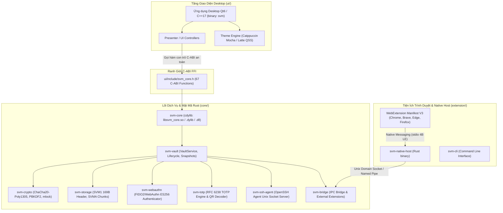

# Hướng Dẫn Dành Cho Lập Trình Viên (Developer Guide)

Chào mừng bạn đến với tài liệu kỹ thuật phát triển dự án **Secure Vault Manager (SVM)**. Tài liệu này cung cấp toàn bộ hướng dẫn cần thiết để bạn thiết lập môi trường, hiểu rõ kiến trúc phân lớp, biên dịch, chạy thử nghiệm, viết mã, kiểm thử và đóng góp vào dự án.

---

## Mục Lục

1. [Tổng Quan Kiến Trúc Hệ Thống](#1-tổng-quan-kiến-trúc-hệ-thống)
2. [Cấu Trúc Thư Mục Dự Án](#2-cấu-trúc-thư-mục-dự-án)
3. [Yêu Cầu Môi Trường & Công Cụ (Prerequisites)](#3-yêu-cầu-môi-trường--công-cụ-prerequisites)
4. [Quy Trình Biên Dịch & Khởi Chạy (Build & Run)](#4-quy-trình-biên-dịch--khởi-chạy-build--run)
5. [Quy Trình Kiểm Thử & Đảm Bảo Chất Lượng (Testing & QA)](#5-quy-trình-kiểm-thử--đảm-bảo-chất-lượng-testing--qa)
6. [Phát Triển & Gỡ Lỗi Browser Extension](#6-phát-triển--gỡ-lỗi-browser-extension)
7. [Quản Lý Giao Tiếp C-ABI FFI (`svm_core.h`)](#7-quản-lý-giao-tiếp-c-abi-ffi-svm_coreh)
8. [Quy Chuẩn Viết Mã & Git Commit](#8-quy-chuẩn-viết-mã--git-commit)
9. [Bản Đồ Tài Liệu Kỹ Thuật Chuyên Sâu (`docs/`)](#9-bản-đồ-tài-liệu-kỹ-thuật-chuyên-sâu-docs)

---

## 1. Tổng Quan Kiến Trúc Hệ Thống

Secure Vault Manager được thiết kế theo mô hình **3 tầng phân lập bản địa (Native Multi-Tier Architecture)** nhằm đảm bảo an toàn bộ nhớ, hiệu năng tối đa và tính cô lập rủi ro:



### Danh Mục 14 Crates Trong Rust Workspace (`core/crates/`)

| Crate | Vai Trò & Trách Nhiệm Kỹ Thuật |
| :--- | :--- |
| **`svm-crypto`** | Mật mã học nguyên thủy: ChaCha20-Poly1305 AEAD, PBKDF2-HMAC-SHA256, khóa trang bộ nhớ `mlock` / `VirtualLock`, zeroize vùng nhớ nhạy cảm, chống memory dump (`PR_SET_DUMPABLE`). |
| **`svm-domain`** | Data models & Schema JSON: Định nghĩa `VaultProfile`, `VaultItem` phẳng 32 trường, `ItemCategory` (9 loại), `CustomField`, `ItemRevision`. |
| **`svm-storage`** | Tầng lưu trữ tệp: Đọc/ghi cấu trúc nhị phân `vault.svm` (Header `SVM1` 169-byte dual-envelope), mã hóa streaming tệp đính kèm `SVMA` chunk 64 KiB, tệp đồng hành `SVMB` cho sinh trắc học. |
| **`svm-vault`** | Nghiệp vụ trung tâm: `VaultService`, vòng đời khóa/mở khóa kho, quản lý danh sách bản ghi, tìm kiếm, lưu trữ 20 bản snapshot lịch sử sửa đổi. |
| **`svm-totp`** | Bộ sinh mã xác thực 2 bước: Triển khai thuật toán TOTP chuẩn RFC 6238 (SHA-1/SHA-256/SHA-512) và giải mã hình ảnh mã QR qua `rqrr`. |
| **`svm-webauthn`** | Trình xác thực Passkey ảo: Triển khai Virtual Software Authenticator FIDO2/WebAuthn chuẩn thuật toán ES256 (COSE `-7`), sinh cặp khóa ECDSA P-256 và ký assertion object. |
| **`svm-ssh-agent`** | OpenSSH Agent Server: Lắng nghe qua Unix Domain Socket (`$XDG_RUNTIME_DIR/svm/ssh-agent.sock`), hỗ trợ sinh và ký khóa Ed25519 với hộp thoại phê duyệt. |
| **`svm-ipc`** | Khung truyền thông liên tiến trình (IPC): Đóng gói thông điệp theo chuẩn 4-byte Little-Endian Length Prefix + UTF-8 JSON payload. |
| **`svm-bridge`** | Bộ định tuyến cầu nối trình duyệt: Xử lý các action Native Messaging từ extension, ghép nối client và cài đặt External Extensions vào Chromium/Windows Registry. |
| **`svm-transfer`** | Chuyển đổi dữ liệu: Trình nhập dữ liệu từ Bitwarden JSON, 1Password `.1pux`, KeePass XML, trình duyệt CSV; trình xuất file `.svm` mã hóa. |
| **`svm-system`** | Tích hợp hệ điều hành: Tương tác với Keyring hệ thống (Secret Service / Keychain / Credential Manager), phát hiện sleep/wake để auto-lock. |
| **`svm-core`** | Tầng liên kết C-ABI FFI: Xuất 67 hàm C chuẩn (`svm_*`) cho Desktop Qt6, bọc an toàn ngoại lệ bằng `catch_unwind`, cấp phát và giải phóng an toàn bộ nhớ qua `svm_free_secret`. |
| **`svm-native-host`** | Binary trung gian (Relay Host): Đọc/ghi luồng `stdio` chuẩn Native Messaging của trình duyệt và chuyển tiếp đến IPC server của ứng dụng Desktop. |
| **`svm-cli`** | Công cụ dòng lệnh: Cung cấp giao diện CLI quản lý kho, nhập/xuất, sinh mật khẩu và kiểm tra hệ thống. |

---

## 2. Cấu Trúc Thư Mục Dự Án

```text
secure-vault-manager/
├── CMakeLists.txt           # Cấu hình gốc CMake (tích hợp build core/ và ui/)
├── CMakePresets.json        # CMake Presets (Debug, Release, CI)
├── README.md                # Tài liệu dành cho người dùng cuối (End-User)
├── DEVELOPMENT.md           # Tài liệu kỹ thuật dành cho nhà phát triển (file này)
├── STYLE_GUIDELINE.md       # Quy chuẩn thiết kế giao diện (Catppuccin Mocha/Latte & QSS)
├── core/                    # Rust Core Workspace (Cargo.toml + 14 crates)
│   ├── Cargo.toml
│   └── crates/              # svm-crypto, svm-domain, svm-storage, svm-vault...
├── ui/                      # Ứng dụng Desktop Qt6 Widgets C++17 (binary: svm)
│   ├── CMakeLists.txt
│   ├── include/             # Header files (chứa ui/include/svm_core.h)
│   ├── src/                 # Triển khai MainWindow, Presenter, Views, Dialogs
│   └── resources/           # SVG icons, Catppuccin QSS stylesheets, i18n
├── extension/               # Browser Extension Manifest V3 (TypeScript)
│   ├── package.json
│   ├── pnpm-lock.yaml
│   ├── public/              # manifest.chrome.json, manifest.firefox.json, icons
│   ├── src/                 # background/, content/, popup/, passkey/
│   ├── scripts/             # build.mjs, post-build.js
│   └── dist/                # Thư mục đích sau khi build (chrome/, firefox/, .zip)
├── packaging/               # Cấu hình đóng gói hệ thống (.deb, .rpm, AppImage, .iss, .wxs)
├── scripts/                 # Bộ script chuẩn hóa quy trình phát triển
│   ├── build.sh             # Biên dịch Core + UI (Debug/Release)
│   ├── run.sh               # Chạy ứng dụng Desktop, CLI hoặc Native Host
│   ├── build-extension.sh   # Biên dịch & đóng gói Browser Extension
│   ├── install-native-host.sh # Cài đặt manifest Native Host cục bộ cho dev
│   ├── test.sh              # Chạy toàn bộ bộ kiểm thử (Cargo, Doc, FFI, CTest)
│   ├── lint.sh              # Kiểm tra chất lượng mã (Clippy, Rustdoc, oxlint)
│   ├── format.sh            # Định dạng mã nguồn (rustfmt, clang-format, prettier)
│   ├── gen-header.sh        # Sinh lại header C-ABI svm_core.h
│   └── clean.sh             # Dọn dẹp build artifacts
└── docs/                    # 12 tài liệu đặc tả kiến trúc & kỹ thuật chi tiết
```

---

## 3. Yêu Cầu Môi Trường & Công Cụ (Prerequisites)

Dự án yêu cầu các công cụ phát triển sau:

| Công Cụ | Phiên Bản Khuyến Nghị | Mục Đích Sử Dụng |
| :--- | :--- | :--- |
| **Rust Toolchain** | `>= 1.75` (Edition 2021) | Biên dịch 14 crates trong `core/` (`cargo`, `rustc`, `clippy`, `rustfmt`) |
| **C++ Compiler** | GCC `>= 11` hoặc Clang `>= 14` | Biên dịch mã nguồn C++17 trong `ui/` |
| **CMake & Ninja** | CMake `>= 3.20`, Ninja `>= 1.10` | Hệ thống sinh file và biên dịch song song |
| **Qt6** | `>= 6.4` | Thư viện UI (`Core`, `Gui`, `Widgets`, `Network`) |
| **Node.js & pnpm** | Node `>= 20.0`, pnpm `>= 9.0` | Đóng gói Browser Extension trong `extension/` |
| **cbindgen** | Tùy chọn (để sinh lại FFI header) | Cài đặt: `cargo install cbindgen` |

### Hướng Dẫn Cài Đặt Môi Trường Trên Các Hệ Điều Hành

<details>
<summary><b>Ubuntu / Debian (Linux)</b></summary>

```bash
# 1. Cài đặt các gói công cụ C++, CMake, Ninja và Qt6
sudo apt update
sudo apt install -y build-essential cmake ninja-build clang-format \
    qt6-base-dev qt6-base-dev-tools libgl1-mesa-dev libxkbcommon-dev

# 2. Cài đặt Rust qua rustup
curl --proto '=https' --tlsv1.2 -sSf https://sh.rustup.rs | sh
source $HOME/.cargo/env
rustup component add rustfmt clippy

# 3. Cài đặt Node.js và pnpm
curl -fsSL https://deb.nodesource.com/setup_20.x | sudo -E bash -
sudo apt install -y nodejs
corepack enable && corepack prepare pnpm@latest --activate
```

</details>

<details>
<summary><b>Fedora / RHEL (Linux)</b></summary>

```bash
sudo dnf groupinstall -y "Development Tools"
sudo dnf install -y cmake ninja-build clang-tools-extra \
    qt6-qtbase-devel nodejs
sudo npm install -g pnpm
curl --proto '=https' --tlsv1.2 -sSf https://sh.rustup.rs | sh
```

</details>

<details>
<summary><b>macOS (Homebrew)</b></summary>

```bash
brew install cmake ninja qt@6 node pnpm clang-format
brew link qt@6 --force
curl --proto '=https' --tlsv1.2 -sSf https://sh.rustup.rs | sh
```

</details>

---

## 4. Quy Trình Biên Dịch & Khởi Chạy (Build & Run)

Tất cả các thao tác chính đều được tự động hóa thông qua các script trong thư mục `scripts/`:

### 4.1. Biên Dịch Dự Án (`scripts/build.sh`)

```bash
# Biên dịch toàn bộ Rust Core + Desktop Qt6 UI ở chế độ Debug (mặc định)
./scripts/build.sh

# Biên dịch toàn bộ ở chế độ tối ưu Release (lưu tại build/release và core/target/release)
./scripts/build.sh --release

# Chỉ biên dịch Rust Core Workspace (sinh libsvm_core.so)
./scripts/build.sh --core-only

# Chỉ biên dịch công cụ dòng lệnh svm-cli
./scripts/build.sh --cli-only
```

### 4.2. Khởi Chạy Ứng Dụng (`scripts/run.sh`)

```bash
# Khởi chạy ứng dụng Desktop Qt6
./scripts/run.sh --app

# Khởi chạy bản dựng Release của ứng dụng Desktop
./scripts/run.sh --app -r

# Khởi chạy công cụ dòng lệnh CLI
./scripts/run.sh --cli -- --help
./scripts/run.sh --cli -- vault list

# Chạy thử nghiệm tiến trình Native Messaging Host
./scripts/run.sh --host
```

### 4.3. Đóng Gói Browser Extension (`scripts/build-extension.sh`)

Script này sẽ build TypeScript, đồng bộ assets, tạo bản phân phối cho cả Chrome và Firefox, đồng thời nén thành các tệp `.zip`:

```bash
./scripts/build-extension.sh
```

Kết quả xuất ra tại `extension/dist/`:

- `extension/dist/chrome/`: Bản dựng unpacked cho Chrome, Brave, Edge.
- `extension/dist/firefox/`: Bản dựng unpacked cho Mozilla Firefox.
- `extension/dist/secure-vault-manager-chrome.zip`: Gói nén nộp Chrome Web Store.
- `extension/dist/secure-vault-manager-firefox.zip`: Gói nén nộp Mozilla AMO.
- `extension/dist/extension-source-code.zip`: Gói mã nguồn phục vụ Mozilla Code Review.

### 4.4. Cài Đặt Native Host Manifest Cục Bộ (`scripts/install-native-host.sh`)

Để Extension trên trình duyệt có thể kết nối với binary `svm-native-host` trong quá trình phát triển trên máy của bạn:

```bash
# Cấu hình Native Messaging Host cho tất cả trình duyệt đã cài đặt trên máy
./scripts/install-native-host.sh
```

---

## 5. Quy Trình Kiểm Thử & Đảm Bảo Chất Lượng (Testing & QA)

Dự án áp dụng bộ quy chuẩn kiểm thử nghiêm ngặt đa tầng.

### 5.1. Chạy Toàn Bộ Kiểm Thử (`scripts/test.sh`)

Script này chạy liên hoàn 4 bài kiểm tra:

1. **Cargo Unit Tests:** Chạy 36+ unit tests trên toàn bộ 14 crates trong workspace.
2. **Rustdoc Tests:** Kiểm tra tính hợp lệ của các đoạn code mẫu trong tài liệu doc-comments.
3. **C-ABI FFI Smoke Test:** Nạp động thư viện `libsvm_core.so` thông qua Python `ctypes`, gọi khởi tạo và kiểm tra bộ nhớ.
4. **CTest:** Chạy bộ kiểm thử C++ của Desktop UI.

```bash
./scripts/test.sh
```

### 5.2. Kiểm Tra Chất Lượng Mã Nguồn (`scripts/lint.sh`)

```bash
./scripts/lint.sh
```

Script sẽ kiểm tra:

- `cargo clippy`: Phát hiện code smells, tối ưu hiệu năng và an toàn bộ nhớ Rust.
- `cargo doc`: Đảm bảo không có broken links hoặc cảnh báo tài liệu.
- `cargo deny`: Kiểm tra giấy phép mã nguồn và lỗ hổng bảo mật của dependencies bên thứ ba.
- `oxlint`: Kiểm tra lỗi tĩnh cho toàn bộ mã nguồn TypeScript của Browser Extension.

### 5.3. Định Dạng Mã Nguồn Chuẩn Hóa (`scripts/format.sh`)

```bash
# Tự động format toàn bộ mã nguồn trong repo (Rust, C++, TypeScript, JSON, Markdown)
./scripts/format.sh

# Kiểm tra định dạng trong CI/CD mà không chỉnh sửa file
./scripts/format.sh --check
```

Công cụ format tương ứng từng loại tệp:

- Rust: `rustfmt`
- C++ (`.cpp`, `.h`): `clang-format` (theo chuẩn Google / LLVM cấu hình trong dự án)
- TypeScript, HTML, CSS, JSON, Markdown: `prettier`

---

## 6. Phát Triển & Gỡ Lỗi Browser Extension

Mã nguồn Extension nằm tại thư mục `extension/`:

### Cài Đặt Dependencies & Watch Mode

```bash
cd extension
pnpm install

# Build extension
pnpm build

# Chạy linter cho extension
pnpm lint
```

### Nạp Extension Dạng Unpacked Vào Trình Duyệt

1. **Google Chrome / Brave / Edge:**
   - Truy cập: `chrome://extensions` (hoặc `edge://extensions`, `brave://extensions`).
   - Bật nút gạt **Developer mode** ở góc trên cùng bên phải.
   - Bấm **Load unpacked** và chọn thư mục: `extension/dist/chrome`.
2. **Mozilla Firefox:**
   - Truy cập: `about:debugging#/runtime/this-firefox`.
   - Bấm nút **Load Temporary Add-on...**.
   - Chọn tệp: `extension/dist/firefox/manifest.json`.

### Gỡ Lỗi Giao Tiếp Native Messaging

- Mở Inspect tab background của Extension (`service_worker` trên Chrome hoặc Inspect background page trên Firefox).
- Xem luồng gửi/nhận JSON giữa Extension và `svm-native-host`.
- Đảm bảo bạn đã chạy `./scripts/install-native-host.sh` trước khi thử kết nối.

---

## 7. Quản Lý Giao Tiếp C-ABI FFI (`svm_core.h`)

Giao tiếp giữa Desktop UI (C++) và Lõi Rust hoàn toàn thông qua C-ABI:

- **Tệp Header:** [`ui/include/svm_core.h`](ui/include/svm_core.h).
- **Crate C-ABI:** [`core/crates/svm-core/src/lib.rs`](core/crates/svm-core/src/lib.rs).

### Quy Tắc Bất Biến Khi Viết FFI

1. **Memory Safety & Ownership:** Mọi chuỗi nhạy cảm (mật khẩu, secret key, data blob) do Rust cấp phát (`CString`) **phải** được giải phóng bằng hàm `svm_free_secret()` hoặc `svm_free_string()`. C++ không được tự ý gọi `free()` hoặc `delete[]`.
2. **Chống Panic văng qua FFI:** Mọi hàm `pub extern "C"` trong `svm-core` **bắt buộc** phải được bọc trong block `std::panic::catch_unwind(|| { ... })`. Không bao giờ để Rust panic unwinding xuyên qua ranh giới C-ABI.
3. **Sinh lại tệp Header:** Nếu bạn thêm mới hoặc sửa đổi signature của một hàm C-ABI trong `svm-core`, hãy chạy script:

   ```bash
   ./scripts/gen-header.sh
   ```

---

## 8. Quy Chuẩn Viết Mã & Git Commit

### Quy Chuẩn Conventional Commits

Thông điệp commit phải tuân thủ chuẩn Conventional Commits với cấu trúc:

```text
<type>(<scope>): <mô tả ngắn gọn bằng thể mệnh lệnh>

[Thân commit chi tiết (tùy chọn)]
```

Các `<type>` được chấp nhận:

- `feat`: Tính năng mới cho người dùng hoặc API mới.
- `fix`: Sửa lỗi (bug fix).
- `refactor`: Tái cấu trúc mã nguồn mà không thay đổi chức năng.
- `perf`: Tối ưu hóa hiệu năng, giảm dung lượng bộ nhớ.
- `test`: Thêm mới hoặc cải thiện unit tests / integration tests.
- `docs`: Cập nhật tài liệu kỹ thuật hoặc tài liệu người dùng.
- `style`: Chỉnh sửa định dạng, khoảng trắng, format (không đổi logic code).
- `chore`: Cập nhật build script, cấu hình phụ trợ, dependencies.

Các `<scope>` thường dùng:

- `core`, `crypto`, `vault`, `storage`, `webauthn`, `totp`, `ssh-agent`, `bridge`
- `ui`, `desktop`, `theme`, `dialogs`
- `extension`, `autofill`, `popup`, `content`
- `scripts`, `packaging`, `ci`

*Ví dụ:*

```text
feat(bridge): implement external extensions installer and standardize store IDs
fix(webauthn): resolve sign counter validation on subsequent assertion requests
docs(dev): add comprehensive developer guide and architecture diagrams
```

### Checklist Bắt Buộc Trước Khi Commit / Tạo Pull Request

- [ ] Chạy `./scripts/format.sh` để format chuẩn toàn bộ file.
- [ ] Chạy `./scripts/lint.sh` đạt 0 lỗi cảnh báo (Clippy, Oxlint).
- [ ] Chạy `./scripts/test.sh` 100% bài test vượt qua thành công.

---

## 9. Bản Đồ Tài Liệu Kỹ Thuật Chuyên Sâu (`docs/`)

Để tìm hiểu sâu hơn về từng thành phần kiến trúc, hãy tham khảo bộ 12 tài liệu kỹ thuật trong thư mục `docs/`:

| Tài Liệu | Nội Dung Trọng Tâm |
| :--- | :--- |
| [STYLE_GUIDELINE.md](STYLE_GUIDELINE.md) | Quy chuẩn giao diện Catppuccin Mocha/Latte, bảng màu QSS và phân cấp CTA. |
| [01. BRD](docs/01.%20BRD%20-%20Business%20Requirements%20Document.md) | Yêu cầu nghiệp vụ, mục tiêu chiến lược và phạm vi của hệ thống. |
| [02. SRS](docs/02.%20SRS%20-%20System%20Requirements%20Specification.md) | Đặc tả chi tiết các yêu cầu chức năng (FR) và phi chức năng (NFR). |
| [03. SAD](docs/03.%20SAD%20-%20Software%20Architecture%20Document.md) | Kiến trúc phân tầng, phân rã 14 crates, mô hình luồng và xử lý đồng thời. |
| [04. FFI Contract](docs/04.%20FFI%20Contract.md) | Đặc tả toàn bộ 67 hàm C-ABI, hợp đồng sở hữu con trỏ bộ nhớ và xử lý lỗi. |
| [05. Vault File Format](docs/05.%20Vault%20File%20Format.md) | Cấu trúc nhị phân tệp `vault.svm` (Header `SVM1`), tệp `biometric.env` (`SVMB`), và chunk `SVMA`. |
| [06. Extension Bridge Protocol](docs/06.%20Extension%20Bridge%20Protocol.md) | Giao thức Native Messaging và danh mục 15+ action JSON giữa Extension và Desktop. |
| [07. Passkey Implementation](docs/07.%20Passkey%20Implementation.md) | Kiến trúc Virtual Authenticator FIDO2/WebAuthn, can thiệp MAIN world và Shadow DOM modal. |
| [08. SSH Agent Protocol](docs/08.%20SSH%20Agent%20Protocol.md) | Giao thức OpenSSH Agent qua Unix Socket, thuật toán Ed25519 và phê duyệt ký số. |
| [09. Threat Model](docs/09.%20Threat%20Model.md) | Mô hình phân tích đe dọa STRIDE, ranh giới tin cậy và các biện pháp giảm thiểu. |
| [10. Domain Data Schemas](docs/10.%20Domain%20Data%20Schemas.md) | Định nghĩa Schema JSON cho 9 danh mục bản ghi, custom fields và cấu hình. |
| [11. External Extensions Installation](docs/11.%20External%20Extensions%20Installation%20Specification.md) | Đặc tả cơ chế phân phối cài đặt tự động External Extensions cho Chromium và Registry Windows. |
| [12. Extension Testing Guide](docs/12.%20Browser%20Extension%20Setup%20%26%20Testing%20Guide.md) | Hướng dẫn chi tiết từng bước kiểm thử Extension trên 4 trình duyệt và kịch bản test Autofill/Passkey. |
| [PUBLISH_CHROME_WEB_STORE.md](docs/PUBLISH_CHROME_WEB_STORE.md) | Hướng dẫn phát hành tiện ích lên Google Chrome Web Store. |
| [SUBMIT_FIREFOX_ADDON.md](docs/SUBMIT_FIREFOX_ADDON.md) | Hướng dẫn phát hành tiện ích lên Mozilla Add-ons (AMO). |
