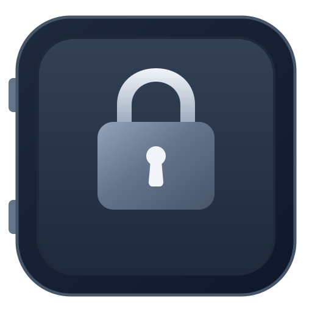

# Secure Vault Manager (SVM)

**Ứng dụng Quản Lý Mật Khẩu, Khóa Passkey & Mã Xác Thực 2FA Cục Bộ — An Toàn Tuyệt Đối**  
*Local-First, Zero-Cloud, Offline-First Password & Identity Manager*

  
  
  
  
  

[Tính Năng Nổi Bật](#-tính-năng-nổi-bật) •
[Cài Đặt & Tải Về](#-cài-đặt--tải-về) •
[Tích Hợp Trình Duyệt](#-tích-hợp-trình-duyệt-extension) •
[Hướng Dẫn Sử Dụng](#-hướng-dẫn-bắt-đầu-nhanh) •
[Bảo Mật & Quyền Riêng Tư](#-triết-lý-bảo-mật--quyền-riêng-tư) •
[Dành Cho Lập Trình Viên](#-dành-cho-lập-trình-viên-developer)

---

## Giới Thiệu

**Secure Vault Manager (SVM)** là giải pháp quản lý thông tin đăng nhập, dữ liệu nhạy cảm, mã xác thực 2 bước (TOTP), khóa xác thực **Passkey (FIDO2 / WebAuthn)** và **OpenSSH Agent** hoạt động hoàn toàn cục bộ (**Local-First & Offline-First**).

Khác biệt với các dịch vụ đám mây tiềm ẩn nguy cơ rò rỉ dữ liệu máy chủ, Secure Vault Manager đặt quyền kiểm soát tuyệt đối vào tay bạn:

- **100% Cục bộ:** Dữ liệu chỉ nằm trên máy tính của bạn, không bao giờ gửi đến bất kỳ máy chủ bên thứ ba nào.
- **Không Telemetry & Không Theo Dõi:** Hoàn toàn không thu thập dữ liệu hành vi người dùng, không quảng cáo, không yêu cầu tạo tài khoản trực tuyến.
- **Mã Hóa Chuẩn Quân Sự:** Kho dữ liệu được bảo vệ bằng thuật toán mã hóa tối tân **ChaCha20-Poly1305** kết hợp dẫn xuất khóa **PBKDF2-HMAC-SHA256 (100.000 vòng lặp)**.
- **Trải Nghiệm Mượt Mà:** Ứng dụng Desktop Native siêu nhanh, khởi động tức thì, tối ưu tài nguyên hệ thống, hỗ trợ song ngữ (Tiếng Việt / English) và giao diện Dark/Light hiện đại.

---

## Tính Năng Nổi Bật

### 1. Quản Lý Đa Kho & 9 Nhóm Dữ Liệu Chuyên Biệt

- **Đa kho (Multi-Vault):** Dễ dàng tạo và chuyển đổi giữa nhiều kho riêng biệt như *Cá nhân*, *Công việc*, *Tài chính* hoặc *Dự án*.
- **9 danh mục toàn diện:**
  - **Đăng nhập (Login):** Tài khoản, mật khẩu kèm bộ đếm thời gian mã OTP 2FA trực quan.
  - **Khóa Passkey (FIDO2):** Lưu trữ và quản lý chứng chỉ xác thực WebAuthn không cần mật khẩu.
  - **Thẻ thanh toán (Card):** Thông tin thẻ tín dụng/ghi nợ an toàn kèm mã CVV được ẩn.
  - **Định danh số (Identity):** Hộ chiếu, CCCD, thông tin cá nhân.
  - **Ghi chú an toàn (Secure Note):** Lưu trữ các tài liệu, ghi chú nhạy cảm có mã hóa.
  - **Khóa SSH (SSH Key):** Quản lý khóa riêng tư (Private Key) và tích hợp trực tiếp với SSH Agent.
  - **Cơ sở dữ liệu (Database):** Lưu thông tin kết nối DB (Postgres, MySQL, Mongo, Redis...).
  - **Máy chủ (Server):** Quản trị thông tin máy chủ VPS, RDP, Cloud.
  - **Mật khẩu WiFi (WiFi):** Lưu trữ tên mạng (SSID) và khóa truy cập bảo mật.
- **Trường tùy biến linh hoạt:** Thêm không giới hạn các trường phụ với 4 kiểu dữ liệu (`Text`, `Concealed`, `Boolean`, `Date`).

### 2. Xác Thực Không Mật Khẩu (Passkey / WebAuthn)

- Hoạt động như một **Virtual Software Authenticator** độc lập trên máy trạm.
- Hỗ trợ đầy đủ chuẩn **ES256 (ECDSA P-256 / SHA-256)** tương thích với Google, GitHub, Apple, Microsoft, Cloudflare...
- Modal xác nhận ủy quyền hiển thị ngay trên trang web thông qua Extension được cô lập an toàn, chống lừa đảo (Anti-phishing) và tự động fallback về hệ điều hành khi cần.

### 3. Mã Xác Thực 2FA (TOTP) & Quét Mã QR Từ Màn Hình

- Sinh mã 2 bước 6 chữ số chuẩn RFC 6238 theo chu kỳ 30 giây với thanh đếm ngược trực quan.
- **Quét mã QR thông minh:** Khi thiết lập 2FA trên trang web, chỉ cần dùng công cụ cắt ảnh màn hình tích hợp sẵn trên Extension để khoanh vùng mã QR — hệ thống sẽ tự động nhận diện và kích hoạt mã OTP mà không cần dùng điện thoại.

### 4. Tự Động Điền & Tích Hợp Trình Duyệt (Browser Extension)

- Tiện ích mở rộng Manifest V3 cho **Google Chrome, Mozilla Firefox, Brave, Microsoft Edge**.
- Tự động phát hiện trường đăng nhập và điền tài khoản, mật khẩu hoặc mã TOTP chỉ với một phím tắt (`Ctrl+Shift+L` / `Cmd+Shift+L`).
- Hộp thoại lưu mật khẩu xuất hiện gọn gàng, tự động bắt cặp tài khoản mới và hỗ trợ mở khóa kho trực tiếp từ trang web.

### 5. Mở Khóa Sinh Trắc Học & Khóa Phục Hồi Khẩn Cấp

- Hỗ trợ mở khóa nhanh bằng **Vân tay**, **Windows Hello**, **Touch ID** hoặc Keyring hệ thống mà không cần nhập lại Master Password dài.
- Cung cấp **Mã khóa phục hồi (Emergency Recovery Key)** độc lập dạng 32 ký tự định dạng chuẩn, giúp bạn luôn khôi phục được toàn bộ dữ liệu nếu chẳng may quên Master Password.

### 6. OpenSSH Agent Tích Hợp

- Khởi chạy OpenSSH Agent Server cục bộ qua Unix Domain Socket cho nhà phát triển và kỹ sư hệ thống.
- Ký xác thực Git commit, kết nối SSH server an toàn mà không cần lưu khóa không mã hóa trên ổ đĩa.
- Hộp thoại hiển thị thông báo phê duyệt xác thực trước mỗi thao tác ký số.

### 7. Tệp Đính Kèm Mã Hóa & Lịch Sử Phiên Bản

- Đính kèm tệp tin tài liệu, ảnh chứng chỉ được mã hóa theo từng khối (chunk streaming 64 KiB).
- Tự động lưu trữ tới **20 bản ghi lịch sử sửa đổi (Revision History)** cho mỗi mục, cho phép so sánh và khôi phục lại mật khẩu cũ bất cứ lúc nào.

### 8. Nhập & Xuất Dữ Liệu Dễ Dàng

- Di chuyển dữ liệu dễ dàng từ các trình quản lý khác: hỗ trợ nhập dữ liệu từ **Bitwarden JSON**, **1Password (.1pux)**, **KeePass XML**, và file **CSV** từ các trình duyệt phổ biến.
- Hỗ trợ xuất sao lưu mã hóa định dạng `.svm` độc quyền hoặc định dạng chuẩn mở.

---

## Cài Đặt & Tải Về

Tải bản phát hành mới nhất phù hợp với hệ điều hành của bạn từ trang **[Releases](https://github.com/hephaestus-studio/secure-vault-manager/releases)**:

| Hệ Điều Hành | Gói Cài Đặt Khuyến Nghị | Ghi Chú |
| :--- | :--- | :--- |
| **Linux (Ubuntu / Debian)** | `secure-vault-manager_amd64.deb` | Cài đặt: `sudo dpkg -i secure-vault-manager_*.deb` |
| **Linux (Fedora / RHEL)** | `secure-vault-manager.x86_64.rpm` | Cài đặt: `sudo rpm -i secure-vault-manager-*.rpm` |
| **Linux (Mọi phân phối)** | `secure-vault-manager-x86_64.AppImage` | Chạy trực tiếp (cấp quyền `chmod +x`) |
| **Windows 10 / 11** | `SecureVaultManager-Setup.exe` hoặc `.msi` | Trình cài đặt tự động tích hợp Windows Hello |
| **macOS (Intel & Apple Silicon)** | `SecureVaultManager.dmg` | Kéo thả vào thư mục `Applications` |

---

## Tích Hợp Trình Duyệt (Extension)

Để sử dụng tính năng Tự động điền và Passkey trên trình duyệt:

1. **Cài đặt tiện ích mở rộng:**
   - **Google Chrome / Brave / Edge:** Cài đặt từ [Chrome Web Store](https://chromewebstore.google.com/detail/secure-vault-manager/jfgmpgpijiloaglplchmjomeboglioec).
   - **Mozilla Firefox:** Cài đặt từ [Firefox Add-ons (AMO)](https://addons.mozilla.org/).
2. **Kích hoạt kết nối với Desktop App:**
   - Mở ứng dụng Desktop **Secure Vault Manager**.
   - Vào menu **Settings** *(Cài đặt)* → Bật tùy chọn **Browser Integration** *(Tích hợp trình duyệt)*.
   - Ứng dụng sẽ tự động cấu hình kênh giao tiếp bảo mật Native Messaging.
   - Mở trình duyệt lên, tiện ích sẽ tự động nhận diện và sẵn sàng hoạt động!

---

## Hướng Dẫn Bắt Đầu Nhanh

1. **Khởi tạo Kho đầu tiên:**
   - Khi mở ứng dụng lần đầu, bạn sẽ được hướng dẫn thiết lập **Master Password**. Hãy chọn một mật khẩu mạnh và dễ nhớ đối với riêng bạn.
   - Hệ thống sẽ cấp một **Khóa Phục Hồi (Recovery Key)**. **Hãy ghi lại và cất giữ ở nơi an toàn!** Đây là chìa khóa duy nhất giúp bạn lấy lại dữ liệu nếu quên Master Password.
2. **Tạo mục dữ liệu mới:**
   - Bấm nút **New Item** (hoặc phím tắt `Ctrl+N` / `Cmd+N`).
   - Chọn loại mục bạn muốn lưu (Đăng nhập, Thẻ ngân hàng, Ghi chú...).
   - Nhập thông tin và bấm **Save**.
3. **Sử dụng khi duyệt web:**
   - Khi truy cập trang web đã lưu tài khoản, biểu tượng Secure Vault Manager sẽ xuất hiện trong ô nhập liệu.
   - Nhấn phím tắt `Ctrl+Shift+L` (hoặc click vào biểu tượng) để tự động điền toàn bộ thông tin đăng nhập.

---

## Triết Lý Bảo Mật & Quyền Riêng Tư

- **Zero-Knowledge Architecture:** Dữ liệu được mã hóa và giải mã hoàn toàn tại thiết bị cục bộ của bạn. Ngay cả khi ai đó tiếp cận được tệp dữ liệu `vault.svm`, họ không thể đọc được nội dung nếu không có Master Password hoặc Recovery Key.
- **Bảo vệ an toàn bộ nhớ (Memory Hardening):**
  - Khóa giải mã dữ liệu (DEK) được bảo vệ trong RAM thông qua cơ chế khóa trang bộ nhớ (`mlock` trên Linux/macOS, `VirtualLock` trên Windows) để ngăn việc hoán đổi ra ổ cứng (Swap/Paging file).
  - Vùng nhớ nhạy cảm được tự động xóa sạch (Zeroize) ngay sau khi sử dụng.
  - Ngăn chặn kết xuất bộ nhớ (Disable core dump) và chống tiến trình khác can thiệp bộ nhớ (`ptrace`).
- **Khóa tự động thông minh:** Tự động khóa ứng dụng sau khoảng thời gian không thao tác hoặc khi màn hình máy tính tắt/ngủ.

---

## Dành Cho Lập Trình Viên (Developer)

Nếu bạn là nhà phát triển muốn tìm hiểu kiến trúc kỹ thuật, biên dịch từ mã nguồn, chạy bộ kiểm thử toàn diện hoặc đóng góp tính năng mới cho dự án:

Vui lòng đọc tài liệu hướng dẫn phát triển chuyên sâu tại: **[DEVELOPMENT.md](DEVELOPMENT.md)**.

Tài liệu này bao gồm:

- Sơ đồ kiến trúc 3 tầng: **Rust Core (14 crates)**, **Desktop UI (C++17 & Qt6)** và **Browser Extension (TypeScript MV3)**.
- Chi tiết các lệnh biên dịch, chạy thử nghiệm và đóng gói (`./scripts/build.sh`, `./scripts/run.sh`, `./scripts/build-extension.sh`).
- Hướng dẫn chạy toàn bộ test suite (`./scripts/test.sh`), kiểm tra định dạng và chất lượng mã nguồn (`./scripts/lint.sh`, `./scripts/format.sh`).
- Danh mục 12 tài liệu đặc tả kỹ thuật kiến trúc, giao thức FFI C-ABI, Native Messaging, Passkey và mô hình đe dọa (Threat Model) trong thư mục `docs/`.

---

## Giấy Phép (License)

Dự án được phân phối theo giấy phép mã nguồn mở **MIT License** — xem chi tiết tại tệp [LICENSE](LICENSE).

Copyright (c) 2026 **Hephaestus Developers**.
