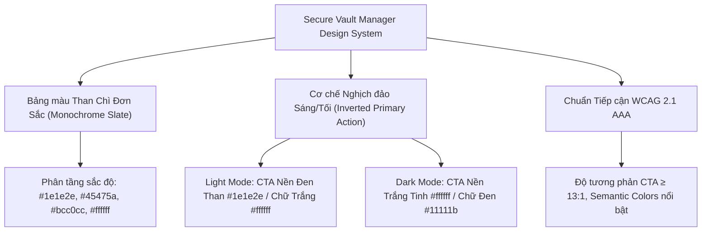

# SECURE VAULT MANAGER — DESIGN & UI/UX STYLE GUIDELINE
**Phiên bản:** 1.0 (Tài Liệu Quy Chuẩn Thiết Kế Hệ Thống)  
**Tác giả:** Đội ngũ Thiết kế & Phát triển Secure Vault Manager  
**Nền tảng:** Qt 6 Desktop (C++ / QSS) — Tương thích Linux (Wayland/X11), Windows, macOS  

---

## 1. Triết lý Thiết kế (Design Philosophy)

Secure Vault Manager là ứng dụng bảo mật tài khoản và quản lý thông tin nhạy cảm hoạt động ngoại tuyến (Offline-First). Hệ thống giao diện được xây dựng dựa trên ngôn ngữ **Tối Giản Than Chì Nghịch Đảo (Monochrome Inverted High-Contrast)** theo phong cách Swiss Tech-Luxury:

1. **Tin cậy & Tinh nhuệ (Cryptographic Solidity):** Toàn bộ giao diện sử dụng dải màu trung tính than chì cao cấp (Slate / Charcoal / Obsidian). Cấu trúc mang tính kỹ thuật, chính xác, đầm mắt và truyền tải cảm giác an toàn tuyệt đối.
2. **Nguyên lý Nghịch đảo Tương phản Tuyệt đối (Inverted Dual Scheme):**
   - **Light Theme:** Nền sáng thanh lịch (`#eff1f5` / `#ffffff`) kết hợp cùng nút bấm chính và điểm nhấn màu **Đen than (`#1e1e2e`)** với chữ **Trắng (`#ffffff`)**.
   - **Dark Theme:** Nền tối êm dịu (`#181825` / `#1e1e2e`) kết hợp cùng nút bấm chính và điểm nhấn màu **Trắng tinh (`#ffffff`)** với chữ **Đen than (`#11111b`)**.
   - Tỷ lệ tương phản của hành động chính (Primary CTA) đạt mức tối ưu **13.5:1 – 16:1 (Vượt xa chuẩn WCAG AAA 7:1)**, giúp định vị hành động cốt lõi tức thì.
3. **Kiến trúc Viền Khối Siêu Mảnh (1px Hairline Bento Grid):** Sử dụng các đường viền phân định `1px solid` sắc nét cùng sự chênh lệch sắc độ bề mặt (Surfaces) để tạo chiều sâu quang học tự nhiên, đảm bảo tính ổn định và sắc nét trên mọi hệ thống hiển thị.
4. **Tôn vinh Màu Ngữ nghĩa (Semantic Color Primacy):** Các màu trạng thái gồm **Xanh lá (An toàn), Đỏ (Nguy hiểm/Xóa), Vàng cam (Cảnh báo)** đóng vai trò là các tín hiệu thị giác nổi bật nhất trên nền khung đơn sắc, giúp người dùng nhận diện ngay lập tức tình trạng an toàn của mật khẩu và dữ liệu.



---

## 2. Hệ Phân Cấp Bề Mặt & Độ Sâu (Elevation Hierarchy)

Giao diện được phân bổ theo mô hình các tầng bề mặt phẳng (Flat Layering) kết hợp đường viền hairline 1px:

| Tầng (Layer) | Vai trò giao diện | Dark Theme Background | Dark Theme Border | Light Theme Background | Light Theme Border |
| :--- | :--- | :--- | :--- | :--- | :--- |
| **L0: Canvas** | Nền cửa sổ lớn nhất, nền Onboarding, nền màn hình khóa | `#11111b` (Crust) | Không có | `#e2e6ed` (Deep Base) | Không có |
| **L1: Workspace** | Vùng làm việc chính, bố cục 3 cột (3-column), Sidebar | `#181825` (Mantle) | `1px solid #313244` | `#eff1f5` / `#edf0f6` | `1px solid #bcc0cc` |
| **L2: Card / Panel** | Khối nội dung, Card giới thiệu, Bảng dữ liệu, Dialog Card | `#1e1e2e` (Base) | `1px solid #45475a` | `#ffffff` (Pure White) | `1px solid #bcc0cc` / `#acb0be` |
| **L3: Nested Card / Input** | Ô nhập liệu (QLineEdit), Card tính năng con, Code Box | `#181825` (Mantle) | `1px solid #313244` | `#f4f6fb` / `#f8f9fa` | `1px solid #ccd0da` |
| **L4: Floating / Modal** | Header Bar, Context Menu, Command Palette, Tooltips | `#181825` (Mantle) | `1px solid #45475a` | `#e6e9ef` / `#ffffff` | `1px solid #bcc0cc` |

---

## 3. Bảng Màu Chuẩn (Color Token Palette)

### 3.1. Dark Theme (Nền Tối — Điểm nhấn Nghịch đảo Trắng Sáng)

| Token | Tên màu | Mã HEX | Vai trò & Ứng dụng | Contrast vs Nền chính |
| :--- | :--- | :--- | :--- | :--- |
| `bg-canvas` | Crust | `#11111b` | Nền ngoài cùng của ứng dụng, viền ngoài Onboarding | N/A |
| `bg-surface` | Mantle | `#181825` | Nền Sidebar, Header Bar, Dialog background | N/A |
| `bg-card` | Base | `#1e1e2e` | Nền thẻ nội dung, danh sách mật khẩu, Tab widget | N/A |
| `bg-hover` | Surface 0 | `#313244` | Trạng thái hover của List item, button phụ | N/A |
| `bg-active` | Surface 1 | `#45475a` | Trạng thái active/pressed, selection | N/A |
| `border-subtle` | Surface 0 | `#313244` | Đường viền các card con, đường kẻ ngăn cách menu separator | 2.1:1 |
| `border-strong` | Surface 1 | `#45475a` | Đường viền Dialog, viền ngoài Header Bar, viền cửa sổ | 3.2:1 (Đạt chuẩn) |
| `border-focus` | White / Slate Light | `#ffffff` / `#cdd6f4` | Đường viền khi focus vào ô nhập liệu (ring highlight) | **16:1 (AAA)** |
| `text-primary` | Pure White / Text | `#ffffff` / `#cdd6f4` | Tiêu đề chính, nội dung mật khẩu, chữ quan trọng | **16:1 (AAA)** |
| `text-secondary`| Subtext 0 | `#a6adc8` | Nhãn phụ, mô tả ngắn, danh mục, thời gian tạo | **8.2:1 (AAA)** |
| `text-muted` | Overlay 0 | `#6c7086` | Chữ bị vô hiệu hóa (disabled), placeholder, phím tắt | **3.8:1 (Đạt chuẩn)** |
| **`brand-primary`**| **Pure White** | **`#ffffff`** | **Nút bấm chính (CTA Button) với chữ Đen `#11111b`** | **16:1 (AAA Tuyệt đối)** |
| *CTA Hover* | Latte Base | `#eff1f5` | Trạng thái rê chuột lên nút chính | **14:1 (AAA)** |
| `status-success`| Green | `#a6e3a1` | Trạng thái an toàn, Khóa khôi phục đã sao lưu | **11.2:1 (AAA)** |
| `status-warning`| Yellow | `#f9e2af` | Mật khẩu yếu, cảnh báo hết hạn, cảnh báo rò rỉ | **13.5:1 (AAA)** |
| `status-danger` | Red | `#f38ba8` | Nút xóa, lỗi nhập sai mật khẩu master, viền lỗi | **8.6:1 (AAA)** |

---

### 3.2. Light Theme (Nền Sáng — Điểm nhấn Nghịch đảo Đen Than)

| Token | Tên màu | Mã HEX | Vai trò & Ứng dụng | Contrast vs Nền chính |
| :--- | :--- | :--- | :--- | :--- |
| `bg-canvas` | Deep Latte Base | `#e2e6ed` | Nền canvas toàn màn hình Onboarding/Lock Screen | N/A |
| `bg-surface` | Latte Mantle | `#edf0f6` | Nền Sidebar phụ trợ, thanh điều hướng | N/A |
| `bg-card` | Pure White | `#ffffff` | Khối thẻ trung tâm, chi tiết mật khẩu, nền dialog | N/A |
| `bg-hover` | Latte Surface 0 | `#e6e9ef` | Trạng thái hover của List item, nút bấm phụ | N/A |
| `bg-active` | Latte Surface 1 | `#dce0e8` | Trạng thái pressed, menu item được chọn | N/A |
| `border-subtle` | Surface 0 | `#ccd0da` | Đường viền các card con, đường kẻ ngăn cách menu separator | 3.1:1 |
| `border-strong` | Surface 1 | `#bcc0cc` | Đường viền Header Bar, viền Dialog, viền Card chính | **4.1:1 (Đạt chuẩn)** |
| `border-focus` | Deep Slate | `#1e1e2e` | Viền focus ô nhập liệu, viền nút chính | **13.5:1 (AAA)** |
| `text-primary` | Latte Text | `#4c4f69` | Nội dung chính, dữ liệu mật khẩu, mô tả | **7.5:1 (AAA)** |
| `text-heading` | Deep Charcoal | `#1e1e2e` | Tiêu đề lớn, tên kho, tiêu đề thẻ Onboarding | **13.5:1 (AAA)** |
| `text-secondary`| Subtext 0 | `#6c6f85` | Nhãn phụ, mô tả tính năng, danh mục | **5.1:1 (AA)** |
| `text-muted` | Subtext 1 Refined | `#7c7f93` | Trạng thái disabled của nút bấm & menu, placeholder | **3.8:1 (Đạt chuẩn)** |
| **`brand-primary`**| **Deep Slate** | **`#1e1e2e`** | **Nút bấm chính (CTA Button) với chữ Trắng `#ffffff`** | **13.5:1 (AAA Tuyệt đối)** |
| *CTA Hover* | Surface 0 | `#313244` | Trạng thái rê chuột lên nút chính | **10:1 (AAA)** |
| `status-success`| Latte Green | `#40a02b` | Mã khóa khôi phục, mật khẩu mạnh, trạng thái an toàn | **4.8:1 (AA)** |
| `status-warning`| Latte Yellow | `#df8e1d` | Cảnh báo bảo mật, cảnh báo mật khẩu trùng | **3.2:1 (Large AA)** |
| `status-danger` | Latte Red | `#d20f39` | Nút nguy hiểm, thông báo lỗi xác thực | **4.6:1 (AA)** |

---

## 4. Quy tắc Typography & Phông chữ Chuẩn

| Phân cấp (Level) | Font Family | Kích thước (Size) | Độ đậm (Weight) | Màu Dark Theme | Màu Light Theme | Khoảng cách dòng |
| :--- | :--- | :--- | :--- | :--- | :--- | :--- |
| **Display / H1** | Inter / Segoe UI / San Francisco | 20px - 22px | 700 (Bold) | `#ffffff` | `#1e1e2e` | 28px |
| **Section Title** | Inter / Segoe UI / San Francisco | 15px - 16px | 600 (Semi-bold) | `#ffffff` | `#1e1e2e` | 22px |
| **Dialog / Card Title** | Inter / Segoe UI / San Francisco | 13px - 14px | 600 (Semi-bold) | `#ffffff` | `#1e1e2e` | 18px |
| **Body Text** | Inter / Segoe UI / San Francisco | 12px - 13px | 400 (Regular) | `#cdd6f4` | `#4c4f69` | 18px |
| **Caption / Subtitle** | Inter / Segoe UI / San Francisco | 11px - 11.5px | 400 (Regular) | `#a6adc8` | `#6c6f85` | 16px |
| **Overline / Badge** | Inter / Segoe UI / San Francisco | 9.5px - 10px | 700 (Bold, Uppercase) | `#ffffff` / `#11111b` | `#1e1e2e` / `#ffffff` | 12px |
| **Secret / Monospace** | JetBrains Mono / Cascadia / Fira | 13px - 15px | 600 - 700 (Mono) | `#a6e3a1` | `#40a02b` | 20px (Letter-spacing: 1.2px) |

---

## 5. Quy Chuẩn Thành Phần Giao Diện (Component Specifications)

### 5.1. Window & Dialog (Cửa sổ & Hộp thoại)
- **Đường viền (Border):** Khép kín 4 cạnh với độ dày cố định `1px solid`:
  - Dark Theme: `1px solid #45475a`
  - Light Theme: `1px solid #bcc0cc`
- **Góc bo (Border Radius):**
  - Cửa sổ chính & Dialog: `8px` hoặc `10px`.
  - Header của Dialog: `border-top-left-radius: 8px; border-top-right-radius: 8px;`.
- **Thanh tiêu đề (Header Bar):**
  - Chiều cao cố định: `40px` (Dialog) hoặc `44px` (Main Window).
  - Tích hợp nút đóng cửa sổ với màu hover:
    - Dark Theme hover: `rgba(243, 139, 168, 0.18)`
    - Light Theme hover: `#ffdce0` (Đỏ phấn nhẹ, êm dịu).

---

### 5.2. Các Nút Bấm (Button States & Inversion)

1. **Primary Button (Nút hành động chính - CTA):**
   - **Dark Theme (Inverted Light CTA):**
     - Mặc định: Nền `#ffffff`, chữ `#11111b`, viền `1px solid #ffffff`, font-weight 600.
     - Hover: Nền `#eff1f5`, viền `#eff1f5`, chữ `#11111b`.
     - Pressed: Nền `#e6e9ef`, viền `#e6e9ef`, chữ `#11111b`.
     - Disabled: Nền `#313244`, viền `#45475a`, chữ `#6c7086`.
   - **Light Theme (Inverted Dark CTA):**
     - Mặc định: Nền `#1e1e2e`, chữ `#ffffff`, viền `1px solid #1e1e2e`, font-weight 600.
     - Hover: Nền `#313244`, viền `#313244`, chữ `#ffffff`.
     - Pressed: Nền `#11111b`, viền `#11111b`, chữ `#ffffff`.
     - Disabled: Nền `#e6e9ef`, viền `#ccd0da`, chữ `#7c7f93`.

2. **Secondary / Standard Button:**
   - **Dark Theme:** Nền `#313244`, viền `1px solid #45475a`, chữ `#cdd6f4`. Hover: Nền `#45475a`, viền `#585b70`.
   - **Light Theme:** Nền `#eff1f5`, viền `1px solid #ccd0da`, chữ `#4c4f69`. Hover: Nền `#e6e9ef`, viền `#45475a`.

3. **Danger Button (Hành động xóa / phá hủy):**
   - **Dark Theme:** Nền `rgba(243, 139, 168, 0.15)`, viền `#f38ba8`, chữ `#f38ba8`.
   - **Light Theme:** Nền `#fff0f2`, viền `#ccd0da`, chữ `#d20f39`. Hover: `#ffdce0`, viền `#d20f39`.

---

### 5.3. Ô Nhập Liệu & Trường Mật Khẩu (Input Controls)
- Chiều cao chuẩn: `34px` - `36px`.
- Padding trong: `6px 12px`.
- **Default State:**
  - Dark: Nền `#181825`, viền `1px solid #313244`, chữ `#cdd6f4`.
  - Light: Nền `#ffffff`, viền `1px solid #ccd0da`, chữ `#4c4f69`.
- **Focus State:**
  - Dark: Viền `1.5px solid #cdd6f4` (hoặc `#ffffff`), nền `#1e1e2e`.
  - Light: Viền `1.5px solid #1e1e2e`, nền `#ffffff`.

---

## 6. Hướng Dẫn Triển Khai Kỹ Thuật (Implementation Guidelines for Qt/C++)

### 6.1. Thuộc tính `WA_StyledBackground`
Khi tạo các custom container widget kế thừa từ `QWidget` (như Header Widget, Card Widget, Bottom Bar) mà muốn áp dụng CSS `background-color` và `border` từ file QSS:
```cpp
setAttribute(Qt::WA_StyledBackground, true);
```

### 6.2. Đồng bộ Màu Sắc trong C++ Custom Item Delegates
Khi vẽ các item trong `QListView` hoặc `QTableView` qua `QStyledItemDelegate::paint()`:
```cpp
const bool isDark = app::ThemeManager::instance().isDarkTheme();
// Tiêu đề: Trắng trong Dark, Đen than trong Light
const QColor titleColor = isDark ? QColor(0xff, 0xff, 0xff) : QColor(0x1e, 0x1e, 0x2e);
// Mô tả: Xám nhạt trong Dark, Xám đậm trong Light
const QColor descColor  = isDark ? QColor(0xa6, 0xad, 0xc8) : QColor(0x6c, 0x6f, 0x85);
// Đường viền
const QColor borderColor = isDark ? QColor(0x31, 0x32, 0x44) : QColor(0xcc, 0xd0, 0xda);
// Màu điểm nhấn lựa chọn (Active/Selection)
const QColor accentColor = isDark ? QColor(0xff, 0xff, 0xff) : QColor(0x1e, 0x1e, 0x2e);
```

---

## 7. Tiêu Chuẩn Nghiệm Thu Thiết Kế (Design Acceptance Criteria)

- [x] **Hệ màu Than Chì Đơn Sắc Thống Nhất:** Sử dụng chuẩn xác bảng mã màu trung tính của hệ thống (`#1e1e2e`, `#181825`, `#11111b`, `#eff1f5`, `#bcc0cc`, `#ffffff`).
- [x] **Quy chuẩn Nghịch Đảo Tương Phản (Inversion):**
  - Light Mode: Nút CTA nền đen than `#1e1e2e`, chữ trắng `#ffffff`.
  - Dark Mode: Nút CTA nền trắng tinh `#ffffff`, chữ đen than `#11111b`.
- [x] **Độ Tương Phản Đạt Chuẩn WCAG AAA (≥ 13:1):** Mọi nút bấm chính và tiêu đề đều đạt độ tương phản quang học vượt trội.
- [x] **Đường Viền Hairline 1px Định Hình Khối:** Mọi Dialog, Window, Card đều có viền `1px solid` sắc nét bao quanh, phân định ranh giới rõ ràng.
- [x] **Trọng Tâm Màu Ngữ Nghĩa:** Các màu trạng thái an toàn (Xanh lá) và nguy hiểm (Đỏ) là điểm nhấn màu duy nhất trên toàn hệ thống.
