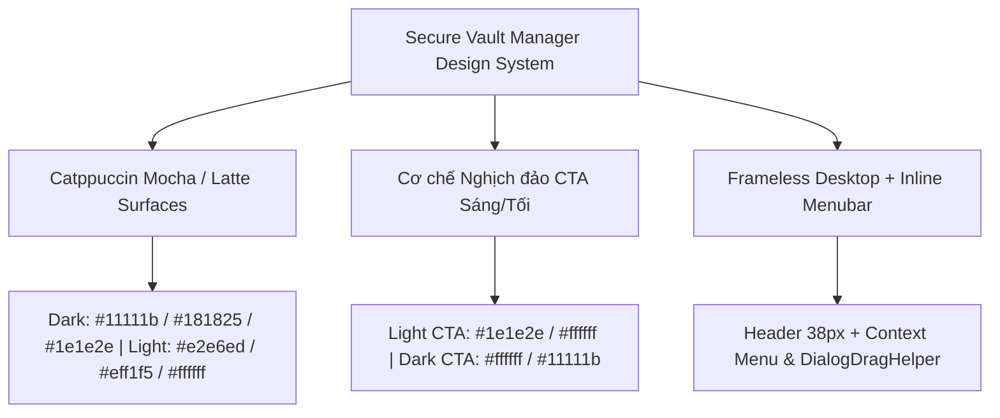

# SECURE VAULT MANAGER — DESIGN & UI/UX STYLE GUIDELINE

**Phiên bản:** 1.1 (Cập nhật đồng bộ với mã nguồn thực tế Qt6 C++17 & QSS)  
**Tác giả:** Đội ngũ Thiết kế & Phát triển Secure Vault Manager  
**Nền tảng:** Qt 6 Desktop (C++17 / QSS) — Tương thích Linux (Wayland/X11), Windows, macOS  

---

## 1. Triết lý Thiết kế (Design Philosophy)

Secure Vault Manager là ứng dụng bảo mật tài khoản và quản lý thông tin nhạy cảm hoạt động ngoại tuyến (Local-First, Zero-Knowledge). Hệ thống giao diện sử dụng nền **Catppuccin Mocha (Dark)** và **Catppuccin Latte (Light)** kết hợp ngôn ngữ **Tối Giản Tương Phản Cao (High-Contrast Inverted Primary CTA)**:

1. **Tin cậy & Tinh nhuệ (Cryptographic Solidity):** Toàn bộ giao diện dùng bề mặt tối/sáng trung tính dịu mắt, phân cấp ranh giới rõ ràng bằng đường viền `1px solid` sắc nét.
2. **Nguyên lý Nghịch đảo Tương phản cho Nút Chính (Inverted Primary CTA):**
   - **Light Theme:** Nền sáng (`#eff1f5` / `#ffffff`) kết hợp cùng nút bấm hành động chính màu **Đen than (`#1e1e2e`)** với chữ **Trắng (`#ffffff`)**.
   - **Dark Theme:** Nền tối (`#181825` / `#1e1e2e`) kết hợp cùng nút bấm hành động chính màu **Trắng tinh (`#ffffff`)** với chữ **Đen than (`#11111b`)**.
3. **Kiến trúc Viền Khối Sắc Nét (1px Hairline Border):** Toàn bộ cửa sổ chính, hộp thoại không viền (`Qt::FramelessWindowHint`) và các thẻ nội dung sử dụng đường viền `1px solid` kết hợp độ chênh sắc độ giữa các tầng bề mặt.
4. **Màu Ngữ nghĩa (Semantic & Accent Colors):** Màu xanh dương accent (`#89b4fa` Dark / `#1e66f5` Light), cùng màu trạng thái **Xanh lá (An toàn)**, **Đỏ (Nguy hiểm/Xóa)**, **Vàng cam (Cảnh báo/Yêu thích)** làm điểm nhấn thị giác nổi bật trên nền trung tính.
5. **Không sử dụng Emoji & Không lộ Thuật ngữ Mật mã Khó hiểu:** Dùng 100% SVG icons chuẩn hoá qua `ThemeManager`; cắt gọn tiêu đề dài bằng `ElidedLabel` (`...`); hiển thị thân thiện các thông tin kỹ thuật (ví dụ: mã COSE thuật toán Passkey hiển thị dạng `ES256 (ECDSA P-256 / SHA-256) • COSE -7`).



---

## 2. Hệ Phân Cấp Bề Mặt & Độ Sâu (Elevation Hierarchy)

Giao diện phân bổ theo các tầng bề mặt phẳng (Flat Layering) kết hợp viền `1px solid` (tham chiếu thực tế trong `ui/resources/styles/dark.qss` và `light.qss`):

| Tầng (Layer) | Vai trò giao diện | Dark Theme Background | Dark Theme Border | Light Theme Background | Light Theme Border |
| :--- | :--- | :--- | :--- | :--- | :--- |
| **L0: Canvas** | Nền ngoài cùng, Onboarding, Lock Screen | `#11111b` (Crust) | `1px solid #45475a` (Window) | `#e2e6ed` | `1px solid #bcc0cc` (Window) |
| **L1: Workspace** | Bố cục 3 cột, Sidebar, ItemListView | `#181825` (Mantle) / `#1e1e2e` | `1px solid #313244` | `#e6e9ef` / `#eff1f5` | `1px solid #ccd0da` |
| **L2: Card / Panel** | `DetailSectionCard`, `SettingSectionCard`, Dialog Card, Tab Pane | `#1e1e2e` / `#181825` | `1px solid #313244` / `#45475a` | `#ffffff` / `#f4f5f8` | `1px solid #ccd0da` / `#bcc0cc` |
| **L3: Controls / Input** | Ô nhập liệu (`QLineEdit`), `ShortcutKeyBadge`, Inline action buttons | `#181825` | `1px solid #313244` / `#45475a` | `#ffffff` / `#f4f4f6` | `1px solid #ccd0da` |
| **L4: Floating / Popup** | `UnifiedHeaderBar`, `QMenu`, Context Menu (`#ItemListContextMenu`), `InWindowPopupOverlay` | `#181825` / `#1e1e2e` | `1px solid #313244` / `#45475a` | `#e6e9ef` / `#eff1f5` | `1px solid #ccd0da` / `#bcc0cc` |

---

## 3. Bảng Màu Chuẩn (Color Token Palette)

### 3.1. Dark Theme (`ui/resources/styles/dark.qss`)

| Token | Tên màu | Mã HEX | Vai trò & Ứng dụng |
| :--- | :--- | :--- | :--- |
| `bg-canvas` | Crust | `#11111b` | Nền ngoài cùng, Header Bar của Dialog (`#AboutDialogHeader`, `#KeyboardShortcutsDialogHeader`, `#NotificationDialogHeader`, `#SettingsDialogHeader`) |
| `bg-surface` | Mantle | `#181825` | Nền Sidebar, nền `UnifiedHeaderBar`, nền Card Dialog, ô nhập liệu |
| `bg-card` | Base | `#1e1e2e` | Nền `DetailSectionCard`, `ShortcutSectionCard`, `QMenu`, nút mặc định |
| `bg-hover` | Surface 0 | `#313244` | Trạng thái hover của `QMenu::item`, `#HeaderMenuBtn`, `#HeaderThemeToggleBtn`, `#HeaderSettingsBtn`, viền subtle |
| `bg-active` | Surface 1 | `#45475a` | Trạng thái pressed, viền khung ngoài Window/Dialog, viền nút phụ |
| `border-focus` | Text / White | `#cdd6f4` / `#ffffff` | Viền `1px solid` khi focus ô nhập liệu, viền chọn thẻ |
| `text-primary` | Text / White | `#cdd6f4` / `#ffffff` | Tiêu đề chính, nội dung trường dữ liệu, chữ trên menu |
| `text-secondary` | Subtext 0 | `#a6adc8` / `#bac2de` | Nhãn phụ, mô tả ngắn, chữ `#HeaderMenuBtn` bình thường (`#bac2de`) |
| `text-muted` | Overlay 0 | `#6c7086` | Chữ vô hiệu hóa (disabled), placeholder |
| `accent-blue` | Blue | `#89b4fa` | Nhãn nhóm tiêu đề section (`#ShortcutSectionTitle`), badge thông tin |
| **`brand-primary`** | **Pure White** | **`#ffffff`** | **Nút hành động chính (CTA) với chữ `#11111b`** |
| *CTA Hover* | Latte Base | `#eff1f5` | Hover trên CTA |
| `status-success` | Green | `#a6e3a1` | Trạng thái an toàn, mã secret/2FA, Recovery Key |
| `status-warning` | Yellow | `#f9e2af` | Biểu tượng ngôi sao yêu thích (`star_filled.svg`), cảnh báo bảo mật |
| `status-danger` | Red / Win Close | `#f38ba8` / `#e81123` | Nút xóa, lỗi xác thực; `#e81123` khi hover `#WinCloseBtn` |

---

### 3.2. Light Theme (`ui/resources/styles/light.qss`)

| Token | Tên màu | Mã HEX | Vai trò & Ứng dụng |
| :--- | :--- | :--- | :--- |
| `bg-canvas` | Deep Latte Base | `#e2e6ed` | Nền canvas Onboarding / Lock Screen |
| `bg-surface` | Mantle / Crust | `#e6e9ef` / `#eff1f5` | Nền Sidebar (`#e6e9ef`), `QMenu` (`#eff1f5`), `Header` của Dialog (`#e6e9ef`) |
| `bg-card` | Pure White | `#ffffff` | Khối `DetailSectionCard`, nền Dialog Card, ô nhập liệu |
| `bg-hover` | Surface 0 | `#ccd0da` / `#dce0e8` | Hover trên `#HeaderMenuBtn` (`#ccd0da`), hover trên `QMenu::item` (`#dce0e8`) |
| `bg-active` | Surface 1 | `#bcc0cc` | Pressed state, viền khung ngoài Window/Dialog |
| `border-focus` | Deep Slate | `#2f3540` / `#1e1e2e` | Viền `1px solid` khi focus vào ô nhập liệu |
| `text-primary` | Latte Text | `#4c4f69` | Nội dung chính, mô tả, `#HeaderMenuBtn` |
| `text-heading` | Deep Charcoal | `#1e1e2e` | Tiêu đề lớn, tiêu đề Dialog, `QMenu::item:selected` |
| `text-secondary` | Subtext 0 | `#6c6f85` | Nhãn phụ, mô tả tính năng |
| `text-muted` | Subtext 1 Refined | `#7c7f93` | Chữ bị vô hiệu hóa (`disabled`), placeholder |
| `accent-blue` | Latte Blue | `#1e66f5` | Nhãn tiêu đề section (`#ShortcutSectionTitle`) |
| **`brand-primary`** | **Deep Slate** | **`#1e1e2e`** | **Nút hành động chính (CTA) với chữ Trắng `#ffffff`** |
| *CTA Hover* | Surface 0 | `#313244` | Hover trên CTA |
| `status-success` | Latte Green | `#40a02b` | Mã khóa khôi phục, mật khẩu mạnh |
| `status-warning` | Latte Yellow | `#df8e1d` | Cảnh báo bảo mật |
| `status-danger` | Latte Red / Win Close | `#d20f39` / `#e81123` | Nút nguy hiểm, thông báo lỗi; `#e81123` khi hover `#WinCloseBtn` |

---

## 4. Quy tắc Typography & Phông chữ Chuẩn

| Phân cấp (Level) | Font Family | Kích thước | Độ đậm | Màu Dark | Màu Light |
| :--- | :--- | :--- | :--- | :--- | :--- |
| **Display / H1** | Sans-serif hệ thống (`Inter / Segoe UI`) | `20px - 22px` | `700` (Bold) | `#ffffff` | `#1e1e2e` |
| **Section Title** | Sans-serif hệ thống | `15px - 16px` | `600` (Semi-bold) | `#ffffff` / `#cdd6f4` | `#1e1e2e` |
| **Dialog / Header Title** | Sans-serif hệ thống | `13px - 14px` | `600` (Semi-bold) | `#cdd6f4` | `#1e1e2e` |
| **Body Text / Menu Item** | Sans-serif hệ thống | `12px - 13px` | `400 - 500` | `#cdd6f4` / `#bac2de` | `#4c4f69` |
| **Overline / Section Label** | Sans-serif hệ thống | `10px - 11px` | `700` (Bold, Uppercase) | `#a6adc8` / `#89b4fa` | `#6c6f85` / `#1e66f5` |
| **Secret / Monospace / Kbd** | Monospace | `11px - 15px` | `600 - 700` | `#a6e3a1` / `#f5e0dc` (`#ShortcutKeyBadge`) | `#40a02b` / `#1e1e2e` (`#ShortcutKeyBadge`) |

---

## 5. Quy Chuẩn Thành Phần Giao Diện (Component Specifications)

### 5.1. Frameless Window & Dialog Shell

- **Thuộc tính cửa sổ:** Mọi hộp thoại đều là `Qt::FramelessWindowHint | Qt::Dialog` với `setAttribute(Qt::WA_TranslucentBackground, false)` và tương tác di chuyển qua `DialogDragHelper` (`MainWindow::eventFilter` tạo hiệu ứng rung khi bấm ra ngoài modal đang hoạt động).
- **Đường viền & Bo góc ngoài:**
  - Khung ngoài Window & Dialog Card (`QMainWindow, QDialog`, `#UnifiedHeaderBar`, `#AboutDialogCard`, `#KeyboardShortcutsDialogCard`, `#NotificationDialogCard`, `#SettingsDialogCard`, `#NewVaultCard`, `#RecoveryDialogCard`): **`border-radius: 0px`**, viền khép kín **`1px solid`** (`#45475a` Dark / `#bcc0cc` Light).
  - Các thẻ nội dung bên trong (`#DetailSectionCard`, `#SettingSectionCard`, `#ShortcutSectionCard`, `#RevisionPreviewCard`, `#RevisionHistoryList`): **`border-radius: 8px` đến `10px`**, hoặc `12px` (`#EmptyStateCard`, `#LockScreenCard`), `16px` (`#OnboardingCard`).
- **Thanh tiêu đề (`Header Bar`):**
  - Chiều cao cố định **`38px`** (`UnifiedHeaderBar`, `AboutDialogHeader`, `KeyboardShortcutsDialogHeader`, `SettingsDialogHeader`, `RevisionHistoryDialog`, `RecoveryDialogHeader`, `NewVaultHeader`, `ConfirmDeleteDialog`) hoặc **`36px`** (`NotificationDialogHeader`).
  - Các nút cửa sổ (`#WinMinBtn`, `#WinMaxBtn`, `#WinCloseBtn`) kích thước `46×38`.
  - `#WinCloseBtn:hover` sử dụng nền `#e81123` kèm biểu tượng trắng `:/icons/controls/win_close_white.svg` (nhấn `:pressed` dùng `#c40e1d`).

### 5.2. Compact Inline Menubar trên `UnifiedHeaderBar`

- Đặt ngay bên phải `HeaderLogo` trong `#HeaderMenuBar`, gồm 4 nút phẳng (`#HeaderMenuBtn`, cao `28px`, `padding: 4px 10px`, `border-radius: 5px`): **Vault**, **Item**, **View**, **Help**.
- Tắt mũi tên dropdown thừa bằng `#HeaderMenuBtn::menu-indicator { image: none; width: 0px; }`.
- Hỗ trợ rê chuột chuyển mượt giữa các menu đang mở qua `UnifiedHeaderBar::eventFilter`.
- Khi ở trạng thái Locked hoặc Onboarding (`setUnlockedMenuVisible(false)`), ẩn `Vault`, `Item` và nút Settings ở góc phải; chỉ giữ `View` (Language/Theme) và `Help`.
- Tiêu đề căn giữa (`#HeaderTitleLabel`) tự động tính khoảng trống theo cạnh phải của menubar trong `repositionTitleOverlay()` để co/ẩn khi cửa sổ hẹp.

### 5.3. Context Menu & Dropdown (`QMenu`)

- Dùng cho menubar (`#HeaderDropDownMenu`, `min-width: 215px`), khay hệ thống (`TrayManager`) và chuột phải trên danh sách thẻ (`#ItemListContextMenu`, `min-width: 196px`, kèm submenu `#ItemListMoveToVaultMenu`).
- **Styling:** `border-radius: 6px; padding: 4px 2px;`; `QMenu::item` dùng `padding: 6px 24px 6px 30px; border-radius: 4px;`; `QMenu::icon { left: 8px; }`; `QMenu::indicator:checked` dùng `menu_check_{dark,light}.svg`; `QMenu::right-arrow` dùng `chevron_right_{dark,light}.svg` (`12×12`).
- **Hành vi chuột phải trên `ItemListView`:** `ItemListView::eventFilter` chặn `MouseButtonPress` chuột phải trước khi `QListView` đổi `currentIndex`, bảo đảm bấm chuột phải vào item không đang focus chỉ mở context menu cho item đó mà **không** đổi selection cột 2 hay cột 3 (ngoại trừ khi chọn `Edit`).

### 5.4. Các Nút Bấm (Buttons & Inline Form Actions)

1. **Primary Button (CTA):**
   - Dark Theme: Nền `#ffffff`, chữ `#11111b`, viền `1px solid #ffffff`. Hover `#eff1f5`, Pressed `#e6e9ef`.
   - Light Theme: Nền `#1e1e2e`, chữ `#ffffff`, viền `1px solid #1e1e2e`. Hover `#313244`, Pressed `#11111b`.
2. **Secondary / Standard Button:**
   - Dark Theme: Nền `#313244`, viền `1px solid #45475a`, chữ `#cdd6f4`. Hover `#45475a`.
   - Light Theme: Nền `#e6e9ef`, viền `1px solid #ccd0da`, chữ `#4c4f69`. Hover `#dce0e8`.
3. **Inline Full-Width Form Action Buttons (`#CustomFieldAddBtn`, `#AddTotpBtn`):**
   - Dùng cho `+ Add Custom Field`, `+ Setup 2FA (One-Time Code)`, `+ Generate SSH Key`, `+ Attach File...` trong `DetailInspectorView` và `CustomFieldsWidget`.
   - Căn thẳng chiều rộng với các ô nhập liệu/row phía trên, `height: 36px`, `border-radius: 8px`, viền liền **`1px solid`** (`#45475a` Dark / `#ccd0da` Light) trên nền đồng nhất thay cho viền đứt nét.
4. **Danger Button:**
   - Dark Theme: Nền mặc định `#24273a` (hover `rgba(243, 139, 168, 0.18)`), viền/chữ `#f38ba8`.
   - Light Theme: Nền `#fff0f2`, viền `#ccd0da` (hover `#ffdce0`, viền `#d20f39`), chữ `#d20f39`.

### 5.5. Ô Nhập Liệu (Input Controls)

- Chiều cao chuẩn: `34px - 36px`, `padding: 6px 12px`.
- **Default State:** Dark nền `#181825`, viền `1px solid #313244`, chữ `#cdd6f4`; Light nền `#ffffff`, viền `1px solid #ccd0da`, chữ `#4c4f69`.
- **Focus State:** Viền **`1px solid`** (`#cdd6f4` Dark / `#2f3540` Light).

---

## 6. Hướng Dẫn Triển Khai Kỹ Thuật (Implementation Guidelines for Qt6/C++17)

### 6.1. Thuộc tính `WA_StyledBackground`

Mọi custom widget kế thừa từ `QWidget` cần nhận `background-color` và `border` từ QSS bắt buộc phải gọi:

```cpp
setAttribute(Qt::WA_StyledBackground, true);
```

### 6.2. Đồng bộ Màu Sắc trong C++ Custom Item Delegates

Khi vẽ item trong `QStyledItemDelegate::paint()` (`ItemCardDelegate`, `SidebarItemDelegate`, `RevisionItemDelegate`), kiểm tra theme bằng `ThemeManager::instance().currentMode()`:

```cpp
const bool isDark =
    (app::ThemeManager::instance().currentMode() == app::ThemeMode::Dark);
const QColor titleColor = isDark ? QColor(0xff, 0xff, 0xff) : QColor(0x1e, 0x1e, 0x2e);
const QColor descColor  = isDark ? QColor(0xa6, 0xad, 0xc8) : QColor(0x6c, 0x6f, 0x85);
const QColor borderColor = isDark ? QColor(0x31, 0x32, 0x44) : QColor(0xcc, 0xd0, 0xda);
```

### 6.3. Bảo vệ Dữ liệu Bí mật khi Chỉnh sửa Từng Phần

`svm_items_list` trả về bản ghi tóm tắt (`to_summary_json()`, không kèm `password`, `totpSecret`, `notes`, `cardNumber`, `cardCvv`, `customFields`). Vì vậy, khi thực hiện thao tác nhanh từ Context Menu hoặc Menubar (như Toggle Favorite, Move to Vault), luôn phải nạp đầy đủ bản ghi qua `CoreBridge::instance().getItem(itemId)` trước khi gọi `upsertItem()`.

---

## 7. Tiêu Chuẩn Nghiệm Thu Thiết Kế (Design Acceptance Criteria)

- [x] **Hệ màu Catppuccin Mocha / Latte & CTA Nghịch Đảo Nhất quán:** Nút CTA giữ tương phản cao ở cả hai theme; đồng bộ SVG icon qua `ThemeManager`.
- [x] **Đường Viền Hairline 1px & Bo góc Chuẩn hoá:** Cửa sổ/Dialog không viền dùng góc vuông `0px` sắc nét (`WA_TranslucentBackground = false`) với Header `38px`; thẻ nội dung bên trong bo `8px - 12px`.
- [x] **Menubar & Context Menu Tích hợp:** 4 menu phẳng (`Vault`, `Item`, `View`, `Help`) trên `UnifiedHeaderBar`, Context Menu hỗ trợ `Move to Vault` không làm nhảy focus ngoài ý muốn.
- [x] **An toàn hiển thị & Bản địa hóa:** 100% nhãn có mặt trong `en.json` và `vi.json`, cắt chuỗi dài bằng `ElidedLabel`, không hiển thị emoji hay mã số kỹ thuật thô (như COSE `-7`) chưa giải thích.
