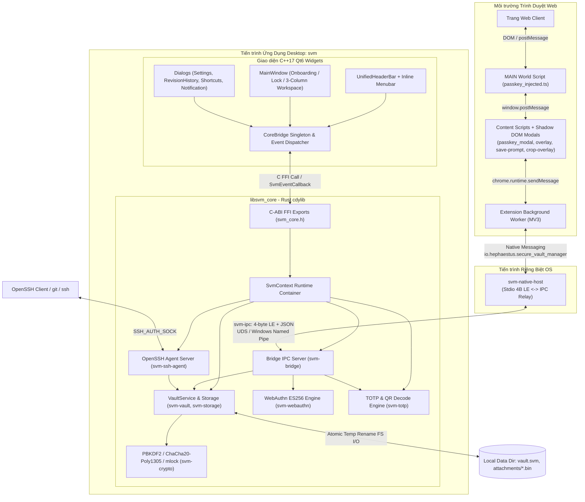

# TÀI LIỆU ĐẶC TẢ YÊU CẦU HỆ THỐNG (SRS) - SECURE VAULT MANAGER (SVM)

---

## 1. Giới Thiệu (Introduction)

### 1.1. Mục Đích (Purpose)

Tài liệu Đặc tả Yêu cầu Hệ thống (SRS) quy định chi tiết kiến trúc thành phần, yêu cầu chức năng, giao diện tương tác, giao thức kết nối và các ràng buộc phi chức năng của hệ thống **Secure Vault Manager (SVM)** đúng theo hiện trạng triển khai thực tế.

### 1.2. Phạm Vi Tài Liệu (Document Scope)

Áp dụng cho toàn bộ 3 phân hệ trong monorepo:

- **Lõi hệ thống Rust Core (`core/crates/*` — 14 crates):** Biên dịch thành thư viện động C-ABI `libsvm_core.so` (Linux), `libsvm_core.dylib` (macOS), `svm_core.dll` (Windows), cùng 2 binary thực thi `svm-native-host` và `svm-cli`.
- **Ứng dụng Native GUI Qt6 (`ui/` -> binary `svm`):** Ứng dụng Desktop C++17 sử dụng Qt6 (`Core`, `Gui`, `Network`, `Widgets`), liên kết với Rust Core qua C-ABI (`CoreBridge`).
- **Tiện ích mở rộng trình duyệt (`extension/`):** Chrome / Firefox WebExtension (Manifest V3) viết bằng TypeScript, đóng gói bằng script Node.js (`scripts/build.mjs` dùng `stripTypeScriptTypes`, không phụ thuộc React/Vite runtime hay WebAssembly), giao tiếp qua Native Messaging Host.

### 1.3. Định Nghĩa & Viết Tắt (Definitions & Acronyms)

| Thuật ngữ | Định nghĩa |
| :--- | :--- |
| **C-ABI** | C Application Binary Interface (Giao diện nhị phân C chuẩn trong `core/include/svm_core.h`) |
| **KEK** | Key Encryption Key (Khóa dẫn xuất bằng PBKDF2-HMAC-SHA256 để bọc DEK) |
| **DEK** | Data Encryption Key (Khóa 256-bit ngẫu nhiên mã hóa Payload và Attachments) |
| **AEAD** | Authenticated Encryption with Associated Data (ChaCha20-Poly1305) |
| **FIDO2 / WebAuthn** | Chuẩn xác thực không mật khẩu W3C dựa trên cặp khóa bất đối xứng ES256 |
| **RP / rpId** | Relying Party / Relying Party Identifier (Tên miền dịch vụ xác thực Passkey) |
| **COSE** | CBOR Object Signing and Encryption (ví dụ `-7` = ES256) |
| **UDS** | Unix Domain Socket |

---

## 2. Mô Tả Tổng Quan Hệ Thống

### 2.1. Kiến Trúc Khối Tổng Thể (System Block Architecture)

### 2.2. Các Tác Nhân Hệ Thống (System Actors)

1. **Người dùng cuối (End User):** Quản trị đa kho, CRUD 9 danh mục item, phê duyệt ký SSH trên Desktop, xác nhận Passkey & quét QR 2FA trên trình duyệt.
2. **Trình duyệt Web (Chrome, Chromium, Brave, Edge, Firefox):** Khởi chạy `svm-native-host` theo Native Messaging Host manifest.
3. **OpenSSH Client / Git CLI:** Kết nối Unix Domain Socket của `svm-ssh-agent` qua `SSH_AUTH_SOCK`.
4. **Hệ thống điều hành (OS):** Quản lý trạng thái suspend/sleep (`gdbus` monitor trên Linux), Keyring/Keychain hệ điều hành cho `biometric.env`.

---

## 3. Yêu Cầu Chức Năng Chi Tiết (Detailed Functional Requirements)

### 3.1. Phân Hệ Quản Lý Kho & Bản Ghi (FR-VAULT)

- **FR-VAULT-01 (Đa Kho Lưu Trữ - Vault Profiles):** Hỗ trợ tạo, chỉnh sửa thông tin (`id`, `name`, `iconName`, `description`), xóa, đặt mặc định nhiều `VaultProfile`, lọc theo `"all"` hoặc từng `vaultId`, và chuyển item sang vault khác (`Move to Vault`).
- **FR-VAULT-02 (Mô Hình Khóa Dual-KEK Envelope):**
  - Dẫn xuất `KEK` bằng **PBKDF2-HMAC-SHA256** (`100,000` vòng lặp) với salt 16 byte.
  - Bọc `DEK` 32 byte ngẫu nhiên bằng ChaCha20-Poly1305 thành hai khối độc lập: `Master Wrapped DEK` và `Recovery Wrapped DEK` trong header 169 byte của `vault.svm`.
- **FR-VAULT-03 (CRUD 9 Danh Mục Chuyên Biệt trên Cấu Trúc `VaultItem` Phẳng):**
  - `Login`: `username`, `password`, `websiteUrl`, `totpSecret` (`hasTotp`), `notes`.
  - `Passkey`: `username`, `websiteUrl`, `password` (private key PKCS#8 base64), `hasPasskey`, `passkeyCredentialId`, `passkeyRpId`, `passkeyAlgorithm` (`int` COSE ID), `passkeyUserHandle`, `passkeySignCount`.
  - `Card`: `username` (chủ thẻ), `cardNumber`, `cardExpiry`, `cardCvv`, `notes`.
  - `Identity`: `username`, `websiteUrl`, `notes` (kèm custom fields cho thông tin chi tiết).
  - `SecureNote`: `notes` (nội dung ghi chú bảo mật).
  - `SshKey`: `sshPublicKey`, `sshFingerprint`, `notes` (PEM OpenSSH private key), `isSshLoaded`.
  - `Database`: `dbHost`, `dbPort`, `dbName`, `username`, `password`, `notes`.
  - `Server`: `websiteUrl` (Host/IP), `username`, `password`, `notes`.
  - `Wifi`: `wifiSsid`, `wifiSecurity`, `password`, `notes`.
- **FR-VAULT-04 (Tệp Đính Kèm Mã Hóa - Attachments):** Mã hóa streaming theo chunk `64 KiB` bằng ChaCha20-Poly1305 (`magic = "SVMA"`) lưu tại `attachments/<attachment_id>.bin`.
- **FR-VAULT-05 (Lịch Sử Sửa Đổi - Revision History):** Tự động lưu tối đa `20` bản snapshot (`ItemRevision`) mỗi khi cập nhật item; hỗ trợ xem trước thông tin và khôi phục qua `RevisionHistoryDialog`.
- **FR-VAULT-06 (Khóa Tự Động - Auto-Lock & Lock-on-Sleep):** Đếm thời gian nhàn rỗi trên `MainWindow` (`m_inactivityTimer`), báo cáo qua `svm_vault_report_idle`, lắng nghe sleep qua `gdbus` trên Linux, xóa `DEK` khỏi RAM khi khóa.
- **FR-VAULT-07 (Trường Tùy Biến - Custom Fields):** Cho phép thêm không giới hạn trường tùy biến trên toàn bộ 9 danh mục với 4 kiểu: `text`, `concealed`, `boolean`, `date` (`YYYY-MM-DD`).
- **FR-VAULT-08 (Khôi Phục Bằng Recovery Key):** Hỗ trợ mở khóa khẩn cấp bằng chuỗi `__recovery__` qua `RecoveryDialog` (nhập Recovery Key và tùy chọn đặt lại Master Password mới) và xoay vòng Recovery Key (`svm_vault_rotate_recovery_key`).

### 3.2. Phân Hệ Passkey & WebAuthn (FR-PASSKEY)

- **FR-PASSKEY-01 (Tạo Khóa - `passkey_create`):**
  - Kiểm tra `rpId`, sinh cặp khóa **ECDSA P-256 (`ES256`, COSE `-7`)** và `credential_id` ngẫu nhiên 32 byte.
  - Tạo `authenticatorData` (`UP=1`, `UV=1`, `AT=1`, flags `0x45`) và `attestationObject` (`fmt: "none"`, CBOR).
  - Lưu item mới vào Vault ở danh mục `Passkey` kèm đầy đủ 5 trường `passkey*`.
- **FR-PASSKEY-02 (Xác Thực - `passkey_get` & `passkey_query`):**
  - Extension truy vấn trước (`passkey_query`) các Passkey khớp `rpId` qua `matches_passkey_rp_id`.
  - Hiển thị modal Shadow DOM (`passkey_modal.ts`) cho phép mở khóa inline nếu kho đang khóa hoặc chọn tài khoản Passkey cần dùng.
  - Ký ECDSA-SHA256 trên `authenticatorData || clientDataHash` (flags `0x05`: `UP|UV`), tăng `passkey_sign_count` thêm `1` và lưu lại vào Vault.

### 3.3. Phân Hệ SSH Agent (FR-SSH)

- **FR-SSH-01 (Unix Socket Server):** Khởi chạy OpenSSH Agent Server trên các nền tảng Unix (`#[cfg(unix)]`) tại `$XDG_RUNTIME_DIR/svm/ssh-agent.sock` (hoặc fallback `$HOME/.svm/ssh-agent.sock`).
- **FR-SSH-02 (Nạp Khóa Ed25519):** Hỗ trợ sinh cặp khóa `ssh-ed25519` (`svm_ssh_key_generate`) và ký thông điệp `SSH_AGENTC_SIGN_REQUEST` cho các khóa Ed25519 khi Vault đang mở khóa.
- **FR-SSH-03 (Phê Duyệt Ký Số):** Khi bật `ssh_prompt_approval`, phát sự kiện `SVM_EVENT_PROMPT` (`kind: "ssh_sign"`, timeout 30 giây) lên UI để người dùng xác nhận qua `NotificationDialog::question`.

### 3.4. Phân Hệ Cầu Nối Extension (FR-EXT)

- **FR-EXT-01 (Native Messaging Host):** `svm-native-host` đọc/ghi stdin/stdout (4-byte LE + JSON, giới hạn `4 MB` inbound / `10 MB` outbound) và định tuyến qua `svm-ipc` tới `svm-bridge` trong Desktop App.
- **FR-EXT-02 (Cài đặt Manifest Tự động):** `svm_native_host_install` tự động ghi file manifest `io.hephaestus.secure_vault_manager.json` cho Chrome, Chromium, Brave, Edge và Firefox (trên Linux/macOS/Windows Registry), tự động phát hiện Extension ID trong file `Preferences` của trình duyệt.
- **FR-EXT-03 (Autofill, Save Prompt & QR 2FA Capture):** Hỗ trợ `get_credentials`, `fill_credential`, `save_credential`, `get_totp`, `decode_qr`, `update_totp` (cho phép chọn vùng ảnh trên tab trình duyệt qua `crop-overlay.ts` và giải mã bằng Rust `rqrr` nếu `BarcodeDetector` không khả dụng).

### 3.5. Phân Hệ Nhập / Xuất Dữ Liệu (FR-TRANS)

- **FR-TRANS-01:** Hỗ trợ import 5 định dạng: Native `.svm`, Bitwarden `.json`, 1Password `.1pux`, KeePass `.xml`, CSV trình duyệt (`.csv`), kèm cơ chế `svm_import_preview` + `svm_import_execute`.
- **FR-TRANS-02:** Hỗ trợ export ra các định dạng chuẩn qua `svm_export`.

---

## 4. Giao Diện Bên Ngoài & Giao Thức (External Interfaces)

### 4.1. Giao Diện Desktop (`ui/svm`)

- Cửa sổ không viền `UnifiedHeaderBar` (cao `38px`) tích hợp **Compact Inline Menubar** gồm 4 menu: **Vault**, **Item**, **View**, **Help** (khi khóa/onboarding ẩn `Vault`, `Item` và nút Settings; giữ `View` và `Help`).
- Bố cục 3 cột (`QSplitter`):
  - **Cột 1 (`SidebarView`):** Bộ chọn Vault, nút tạo Vault mới, bộ lọc `All Items`, `Favorites`, `Trash` và 9 danh mục nghiệp vụ (`Category`), hỗ trợ thu gọn dạng Icon Rail (`Ctrl+B`).
  - **Cột 2 (`ItemListView`):** Tìm kiếm (`Ctrl+F`), nút tạo mới (`Ctrl+N`), danh sách thẻ (`ItemCardDelegate` hỗ trợ mật độ Compact/Comfortable), và **Right Context Menu** không làm thay đổi selection hiện tại (hỗ trợ Copy nhanh, Open Website, Edit, Favorite, **Move to Vault**, Move to Trash / Restore / Delete Permanently).
  - **Cột 3 (`DetailInspectorView`):** Hiển thị và chỉnh sửa inline theo từng danh mục (bao gồm metadata Passkey thân thiện với `formatPasskeyAlgorithm`), TOTP 2FA live (`TotpWidget`), Custom Fields (`CustomFieldsWidget`), Ghi chú và Tệp đính kèm (`Attachments`).
- Hộp thoại tra cứu phím tắt `KeyboardShortcutsDialog` (`F1`) và Lịch sử sửa đổi `RevisionHistoryDialog`.

### 4.2. Giao Thức Native Messaging & IPC

- Stdio giữa Trình duyệt và `svm-native-host`: `[4-byte LE uint32 length][UTF-8 JSON]`, tối đa `4 MB` inbound / `10 MB` outbound.
- IPC giữa `svm-native-host` và `svm-bridge`: cùng framing `[4-byte LE uint32 length][UTF-8 JSON]` qua Unix Domain Socket hoặc Windows Named Pipe.

---

## 5. Yêu Cầu Phi Chức Năng (Non-Functional Requirements)

- **NFR-01 (An Toàn FFI):** Các hàm thao tác item và một số hàm quản trị vault bọc `catch_unwind`; mọi chuỗi bí mật giải phóng bằng `svm_free_secret()` để zeroize.
- **NFR-02 (Bảo vệ RAM & Clipboard):** `mlock`/`VirtualLock` cho `DEK`; `prctl(PR_SET_DUMPABLE, 0)` tắt core dump trên Linux; `ClipboardManager` tự xóa clipboard sau `clipboard_clear_seconds` (mặc định 30s) và gắn hint tránh lịch sử clipboard OS.
- **NFR-03 (Kiểm định & Chất lượng mã):** Tuân thủ `cargo fmt`, `cargo clippy -- -D warnings`, `cargo test --workspace`, `cargo deny check`, `clang-format`, `oxlint --deny-warnings`, và `prettier --check`.
