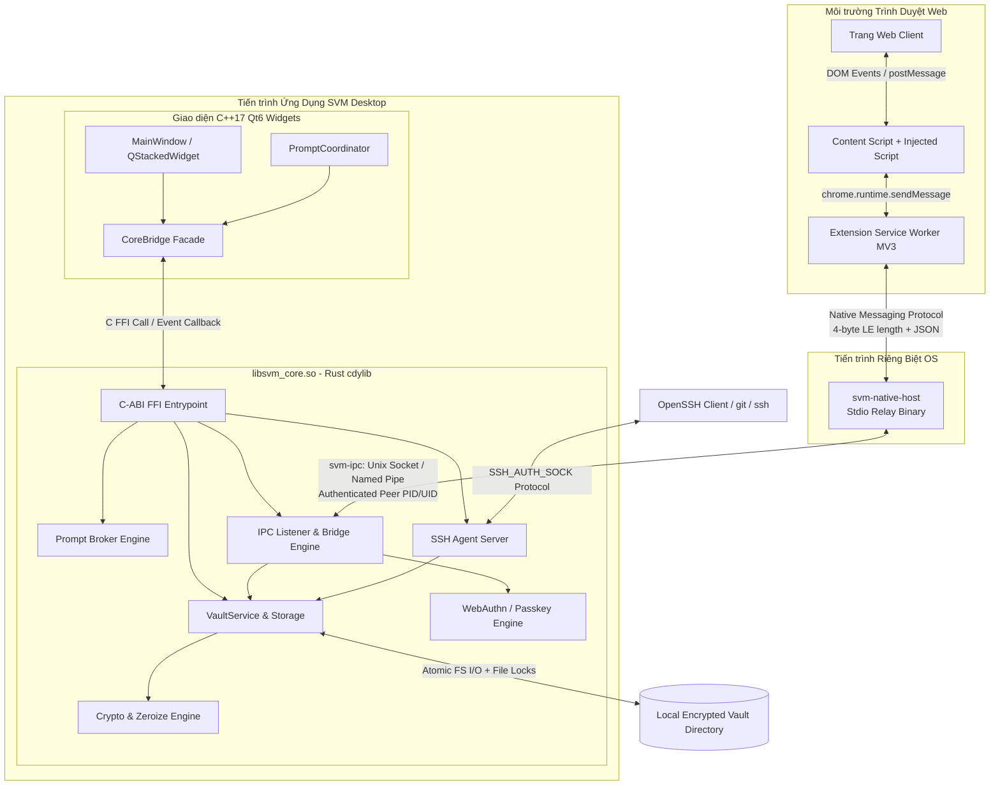

# TÀI LIỆU ĐẶC TẢ YÊU CẦU HỆ THỐNG (SRS) - SECURE VAULT MANAGER (SVM)

---

## 1. Giới Thiệu (Introduction)

### 1.1. Mục Đích (Purpose)

Tài liệu Đặc tả Yêu cầu Hệ thống (SRS) này quy định chi tiết các đặc tả kỹ thuật, luồng chức năng, giao diện bên ngoài, các ràng buộc hệ thống và yêu cầu phi chức năng cho toàn bộ dự án **Secure Vault Manager (SVM)**. Tài liệu là căn cứ pháp lý kỹ thuật duy nhất phục vụ lập trình, kiểm thử (Unit / Integration / E2E) và nghiệm thu kiến trúc.

### 1.2. Phạm Vi Tài Liệu (Document Scope)

Áp dụng cho toàn bộ các module trong giải pháp:

- **Lõi hệ thống Rust Core (`core/crates/*`):** Biên dịch thành thư viện động `libsvm_core.so` (Linux), `libsvm_core.dylib` (macOS), `svm_core.dll` (Windows), kèm binary độc lập `svm-native-host` và `svm-cli`.
- **Ứng dụng Native GUI Qt6 (`ui/`):** Ứng dụng Desktop C++17 sử dụng Qt6 Widgets, tích hợp động với Rust Core qua C-ABI.
- **Tiện ích mở rộng trình duyệt (`extension/`):** Chrome / Firefox WebExtension (Manifest V3) giao tiếp qua Native Messaging Host hoặc HTTP loopback fallback.
- **Thư viện WebAssembly (`core/crates/svm-wasm`):** Biên dịch từ Rust dùng cho offline cryptographic tasks trong Extension.

### 1.3. Định Nghĩa & Viết Tắt (Definitions & Acronyms)

| Thuật ngữ | Định nghĩa |
| :--- | :--- |
| **C-ABI** | C Application Binary Interface (Giao diện nhị phân C chuẩn) |
| **KEK** | Key Encryption Key (Khóa dẫn xuất từ Master Password để bọc DEK) |
| **DEK** | Data Encryption Key (Khóa 256-bit ngẫu nhiên mã hóa nội dung Vault) |
| **AEAD** | Authenticated Encryption with Associated Data (Mã hóa kèm xác thực) |
| **FIDO2** | Fast Identity Online 2 (Chuẩn xác thực không cần mật khẩu) |
| **WebAuthn** | Web Authentication API (Chuẩn W3C cho việc xác thực web) |
| **RP / rpId** | Relying Party / Relying Party Identifier (Tên miền dịch vụ web yêu cầu xác thực) |
| **PSL** | Public Suffix List (Danh sách đuôi tên miền công cộng) |
| **UDS** | Unix Domain Socket |
| **CSPRNG** | Cryptographically Secure Pseudorandom Number Generator |

---

## 2. Mô Tả Tổng Quan Hệ Thống

### 2.1. Kiến Trúc Khối Tổng Thể (System Block Architecture)

### 2.2. Các Tác Nhân Hệ Thống (System Actors)

1. **Người dùng cá nhân (End User):** Quản trị kho mật khẩu, phê duyệt quyền truy cập Passkey/SSH, điều chỉnh cấu hình bảo mật.
2. **Trình duyệt Web (Chromium / Firefox):** Khởi chạy `svm-native-host` và tiếp nhận thông tin autofill.
3. **OpenSSH Client / Git CLI:** Kết nối socket của `svm-ssh-agent` để yêu cầu danh sách khóa và ký các challenge SSH.
4. **Hệ thống điều hành (Operating System):** Cung cấp các tín hiệu quản lý nguồn (Suspend/Sleep), dịch vụ bảo vệ màn hình (ScreenSaver idle) và phân hệ Native Messaging.

---

## 3. Yêu Cầu Chức Năng Chi Tiết (Detailed Functional Requirements)

### 3.1. Phân Hệ Quản Lý Vault (Vault Management - FR-VAULT)

- **FR-VAULT-01 (Cấu Trúc Đa Kho):** Hỗ trợ tạo, đổi tên, xóa và đánh dấu kho mặc định trong danh mục `VaultRegistry`.
- **FR-VAULT-02 (Phân Cấp Khóa Envelope):**
  - Sử dụng Argon2id với tham số mặc định: `m=64MB, t=3, p=4` tạo `KEK`.
  - Sinh ngẫu nhiên `DEK` 32 bytes (256-bit). `DEK` được mã hóa bởi `KEK` bằng ChaCha20-Poly1305 và lưu trong phần header của tệp vault.
- **FR-VAULT-03 (CRUD Mục Dữ Liệu):** Hỗ trợ tạo, đọc, cập nhật, xóa các danh mục:
  - `Login`: username, password, urls, totp, custom_fields, notes.
  - `Card`: cardholder, number, expiry, cvv, pin, notes.
  - `SecureNote`: text dạng Markdown.
  - `Identity`: họ tên, cccd, hộ chiếu, ngày sinh, địa chỉ.
  - `SshKey`: private key, public key, passphrase, fingerprint, policy.
  - `Passkey`: rp_id, credential_id, private key, user_name, user_handle.
  - `Wifi`: ssid, password, security (WPA2/WPA3), hidden.
  - `Database`: host, port, dbname, user, password, cert.
  - `Server`: host, ip, port, admin_user, password, ssh_ref.
- **FR-VAULT-04 (Tệp Đính Kèm An Toàn - Attachments):**
  - Hỗ trợ thêm tệp đính kèm mã hóa riêng biệt bằng streaming chunking AEAD (kích thước chunk 64KiB).
  - Tách rời dữ liệu blob ra thư mục `attachments/` bên cạnh tệp `vault.svm`.
- **FR-VAULT-05 (Lịch Sử Phiên Bản - History):** Tự động ghi lại snapshot phiên bản cũ của một Item mỗi khi người dùng cập nhật, cho phép xem lại và phục hồi (tối đa 20 bản ghi/item).
- **FR-VAULT-06 (Khóa Tự Động - Auto Lock):**
  - Lắng nghe sự kiện không hoạt động toàn hệ thống (`idle_ms`) thông qua API hệ điều hành chuẩn.
  - Tự động xóa sạch `DEK` và `KEK` khỏi bộ nhớ RAM, chuyển trạng thái sang `Locked`.

### 3.2. Phân Hệ Passkey & WebAuthn (FR-PASSKEY)

- **FR-PASSKEY-01 (Tạo Khóa - MakeCredential):**
  - Tiếp nhận yêu cầu từ Extension kèm `clientDataHash`, `rpId`, `userName`, `userHandle`.
  - Kiểm tra tính hợp lệ của `rpId` thông qua thư viện Public Suffix List (PSL).
  - Sinh cặp khóa ECDSA P-256 (curve secp256r1) hoặc Ed25519.
  - Lưu `credential_id` ngẫu nhiên (32 bytes) và private key vào Vault.
  - Đóng gói dữ liệu `attestationObject` với cờ `none` attestation, cờ UP (User Present) = 1, UV (User Verified) = 1.
- **FR-PASSKEY-02 (Xác Thực - GetAssertion):**
  - Nhận challenge từ trang web, lọc các Passkey khớp với `rpId`.
  - Thực hiện ký số ECDSA-SHA256 trên chuỗi `authenticatorData || clientDataHash`.
  - Trả về chữ ký chuẩn DER và `authenticatorData` cho trình duyệt.
- **FR-PASSKEY-03 (Phê Duyệt Người Dùng - Consent):** Mọi hành động MakeCredential hoặc GetAssertion bắt buộc phải qua Prompt Broker để xin ý kiến người dùng tại `PasskeyConsentDialog`.

### 3.3. Phân Hệ SSH Agent (FR-SSH)

- **FR-SSH-01 (Socket Server):** Khởi chạy OpenSSH Agent Server lắng nghe trên Unix Domain Socket (`$XDG_RUNTIME_DIR/svm/ssh-agent.sock`) hoặc Windows Named Pipe (`\\.\pipe\svm-ssh-agent`).
- **FR-SSH-02 (Quản Lý Khóa Trong Bộ Nhớ):** Tự động nạp public/private keys vào keyring khi Vault mở và giải phóng hoàn toàn khi Vault khóa.
- **FR-SSH-03 (Phê Duyệt Ký Số - Approval):**
  - Khi nhận `SSH2_AGENTC_SIGN_REQUEST`, tiến trình xác thực danh tính client (PID, Executable path).
  - Gửi yêu cầu qua Prompt Broker hiển thị `SshApprovalDialog` yêu cầu người dùng bấm Cho Phép.
  - Hỗ trợ chính sách ghi nhớ phê duyệt trong thời gian N phút cho từng tiến trình.

### 3.4. Phân Hệ Kênh Trình Duyệt (Extension Bridge - FR-EXT)

- **FR-EXT-01 (Native Messaging Host):**
  - Chạy tiến trình độc lập `svm-native-host`.
  - Đọc/ghi stdin/stdout theo chuẩn Chromium/Firefox (4-byte Little Endian integer xác định độ dài gói tin JSON).
  - Định tuyến gói tin qua Unix Socket / Named Pipe tới `svm-bridge` trong ứng dụng chính.
- **FR-EXT-02 (Ghép Nối An Toàn - Pairing Handshake):**
  - Sử dụng giao thức trao đổi khóa X25519 + HKDF-SHA256.
  - Hiển thị mã ghép nối 6 chữ số ngẫu nhiên trên màn hình Desktop; người dùng phải xác nhận mã trên Extension.
- **FR-EXT-03 (Truy Vấn Danh Mục Đăng Nhập):** Trả về danh sách tài khoản chỉ khi tên miền trang web khớp chính xác với URL đã lưu trong Vault.
- **FR-EXT-04 (Fallback HTTP Server):** Cung cấp server HTTP Axum tại `127.0.0.1:12519` (mặc định tắt, chỉ bật khi cấu hình) có bảo vệ mã hóa E2E AES-256-GCM.

### 3.5. Phân Hệ Nhập / Xuất Dữ Liệu (Transfer - FR-TRANS)

- **FR-TRANS-01 (Import Đa Định Dạng):** Hỗ trợ phân tích cú pháp tệp 1Password (.1pux), Bitwarden (.json), KeePass (.xml), Chrome/Firefox (.csv), và SVM (.svm).
- **FR-TRANS-02 (Xem Trước & Xử Lý Xung Đột):** Trả về bản xem trước (Preview) số lượng bản ghi hợp lệ, bản ghi trùng lặp và cung cấp tùy chọn ghi đè hoặc bỏ qua.
- **FR-TRANS-03 (Sao Lưu Khẩn Cấp):** Tự động tạo snapshot bản sao lưu trước khi thực thi quá trình import.

---

## 4. Giao Diện Bên Ngoài & Giao Thức (External Interfaces & Protocols)

### 4.1. Giao Diện Người Dùng Máy Trạm (Native Qt6 UI)

- Thiết kế Frameless Window tùy biến, tích hợp các nút điều khiển thu nhỏ, phóng to, đóng cửa sổ.
- Bảng màu Dark/Light Mode chuyên nghiệp:
  - Deep Dark Background: `#080c14`
  - Container / Card Dark: `#0f1524`
  - Border Dark: `#1e263d`
  - Primary Accent: `#3b82f6` (Blue Shield)
- Tích hợp khay hệ thống (System Tray): Quick Lock, Mở/Ẩn cửa sổ, Thoát ứng dụng.

### 4.2. Giao Thức Native Messaging Framing

- Gói tin nhị phân chuẩn gồm 4 byte header (độ dài payload, kiểu `uint32_t` little-endian), theo sau là chuỗi JSON mã hóa UTF-8.
- Kích thước gói tin tối đa: 1MB cho chiều gửi đi (host -> extension), 64MB cho chiều gửi đến.

---

## 5. Yêu Cầu Phi Chức Năng (Non-Functional Requirements)

### 5.1. Hiệu Năng & Độ Trễ

- **NFR-01:** Thời gian phản hồi API FFI (trừ hàm băm KDF) phải nhỏ hơn `2ms`.
- **NFR-02:** Trọng lượng binary của `libsvm_core.so` khi biên dịch chế độ Release tối ưu LTO không vượt quá `15MB`.
- **NFR-03:** Bộ nhớ RAM tiêu thụ của toàn bộ ứng dụng khi đang mở khóa không vượt quá `75MB`.

### 5.2. An Toàn Bộ Nhớ & Tiến Trình

- **NFR-04:** Tất cả các biến chứa khóa (`SecretBytes`, `SecretString`) phải triển khai trait `Zeroize` và `ZeroizeOnDrop`.
- **NFR-05:** Gọi `mlock` trên Linux/macOS và `VirtualLock` trên Windows cho vùng nhớ giữ DEK và private keys.
- **NFR-06:** Vô hiệu hóa core dump qua `prctl(PR_SET_DUMPABLE, 0)` và `setrlimit(RLIMIT_CORE, 0)`.
