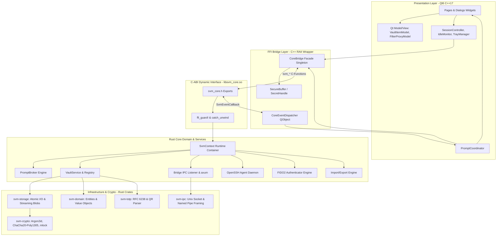
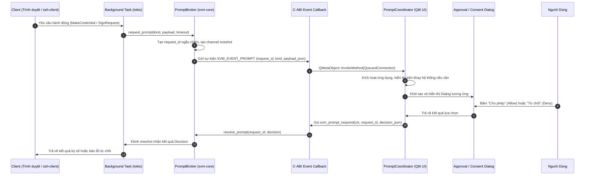
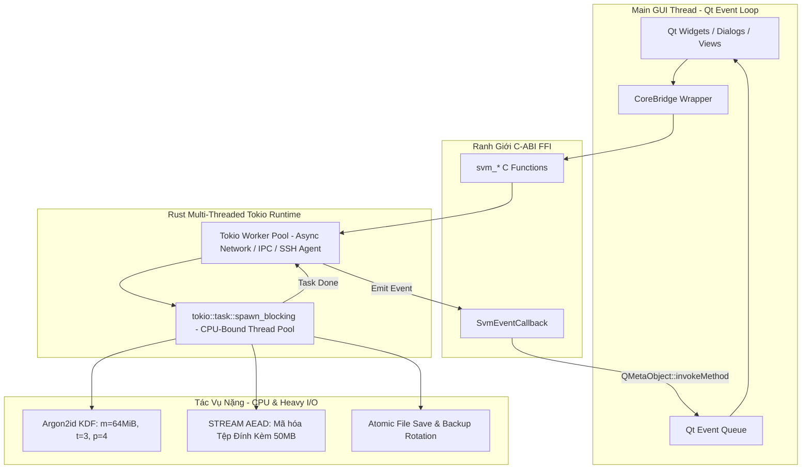

# TÀI LIỆU KIẾN TRÚC PHẦN MỀM (SAD) - SECURE VAULT MANAGER (SVM)

---

## 1. Giới Thiệu & Mục Tiêu Thiết Kế

Tài liệu Kiến trúc Phần mềm (SAD) này trình bày toàn bộ kiến trúc kỹ thuật của hệ thống **Secure Vault Manager (SVM)**. Kiến trúc này được thiết kế theo mô hình:

1. **Lõi hệ thống (Core Engine):** Viết hoàn toàn bằng Rust, đóng gói thành thư viện chia sẻ động C-ABI (`libsvm_core.so` / `.dylib` / `.dll`).
2. **Giao diện người dùng (UI):** Viết bằng C++17 với Qt6 Widgets, liên kết động trực tiếp với thư viện lõi Rust tại thời điểm biên dịch và thực thi.
3. **Phân hệ cầu nối trình duyệt (Extension Bridge):** Sử dụng cơ chế Native Messaging Host tiêu chuẩn qua tiến trình độc lập `svm-native-host` chuyển tiếp tới IPC Listener trong lõi.

### Các Nguyên Tắc Kiến Trúc Cốt Lõi

- **Zero-Trust Memory Management:** Tách biệt rõ ràng ranh giới bộ nhớ giữa C++ và Rust. Vùng nhớ chứa thông tin mật được quản lý bằng các kiểu dữ liệu an toàn tự zeroize (`secrecy`, `zeroize`) và khóa trang bộ nhớ vật lý (`mlock`).
- **Panic Boundary Isolation:** Không cho phép bất kỳ lỗi Panic nào từ Rust rò rỉ xuyên qua ranh giới FFI sang C++, mọi hàm extern "C" đều được bọc bởi cơ chế bắt ngoại lệ `catch_unwind`.
- **Asynchronous Prompt Brokering:** Xây dựng cơ chế điều phối yêu cầu tương tác hai chiều (Prompt Broker) giữa các luồng backend bất đồng bộ (tokio) và giao diện người dùng (Qt Event Loop).

---

## 2. Kiến Trúc Phân Lớp (Layered Architecture)



---

## 3. Cấu Trúc Thư Mục & Phân Hệ Toàn Dự Án (Repository Scaffold Architecture)

Hệ sinh thái Secure Vault Manager (SVM) được tổ chức theo mô hình monorepo đa ngôn ngữ (Rust, C++17/Qt6, TypeScript/React), chuẩn hóa quy trình biên dịch bằng CMake kết hợp Cargo và PNPM.

Dưới đây là cấu trúc thư mục hoàn chỉnh (scaffold layout) của toàn bộ dự án:

```text
secure-vault-manager/
├── CMakeLists.txt                         # project(svm); add_subdirectory(core) + add_subdirectory(ui)
├── CMakePresets.json                      # debug / release / ci (Ninja; GCC, Clang, MSVC)
├── README.md
├── DEVELOPMENT.md                         # Qt6, Rust, CMake, cbindgen, wasm-pack, pnpm, native host dev
├── CONTRIBUTING.md
├── PRIVACY.md                             # Favicon opt-in, zero telemetry
├── SECURITY.md                            # Chính sách báo cáo lỗ hổng bảo mật
├── LICENSE
├── logo.svg
├── .gitignore
├── .editorconfig
├── .clang-format
├── .clang-tidy
├── rustfmt.toml
├── clippy.toml
├── package.json
├── pnpm-workspace.yaml                    # extension, core/crates/svm-wasm/pkg
├── pnpm-lock.yaml
├── eslint.config.js
├── .prettierrc
├── .prettierignore
├── .npmrc
├── .vscode/
│   ├── extensions.json
│   ├── settings.json
│   └── launch.json
├── .agents/
│   └── skills/
│       ├── rust-core/SKILL.md
│       ├── rust-ffi/SKILL.md
│       ├── qt6-ui/SKILL.md
│       ├── cmake-build/SKILL.md
│       └── qt-testing/SKILL.md
├── .github/
│   └── workflows/
│       ├── ci.yml                        # fmt, clippy, test, deny, header drift, cmake+ctest, extension
│       └── release.yml                   # AppImage/deb/rpm, dmg, MSI/Inno, extension zip
│
├── docs/
│   ├── 01. BRD - Business Requirements Document.md
│   ├── 02. SRS - System Requirements Specification.md
│   ├── 03. SAD - Software Architecture Document.md
│   ├── 04. FFI Contract.md
│   ├── 05. Vault File Format.md
│   ├── 06. Extension Bridge Protocol.md
│   ├── 07. Passkey Implementation.md
│   ├── 08. SSH Agent Protocol.md
│   ├── 09. Threat Model.md
│   └── 10. Domain Data Schemas.md
│
├── core/                                  # ===== RUST CORE (Cargo workspace - 15 crates) =====
│   ├── CMakeLists.txt
│   ├── Cargo.toml
│   ├── Cargo.lock
│   ├── cbindgen.toml
│   ├── deny.toml
│   ├── include/
│   │   └── svm_core.h
│   └── crates/
│       ├── svm-domain/
│       │   ├── Cargo.toml
│       │   └── src/
│       │       ├── lib.rs
│       │       ├── category.rs
│       │       ├── custom_field.rs
│       │       ├── error.rs
│       │       ├── folder.rs
│       │       ├── item.rs
│       │       ├── json.rs
│       │       ├── prompt.rs
│       │       ├── status.rs
│       │       └── trash.rs
│       ├── svm-crypto/
│       │   ├── Cargo.toml
│       │   └── src/
│       │       ├── lib.rs
│       │       ├── aead.rs
│       │       ├── encoding.rs
│       │       ├── hash.rs
│       │       ├── kdf.rs
│       │       ├── mem.rs
│       │       └── password.rs
│       ├── svm-storage/
│       │   ├── Cargo.toml
│       │   └── src/
│       │       ├── lib.rs
│       │       ├── atomic.rs
│       │       ├── header.rs
│       │       └── vault_file.rs
│       ├── svm-vault/
│       │   ├── Cargo.toml
│       │   └── src/
│       │       ├── lib.rs
│       │       ├── attachment.rs
│       │       ├── defaults.rs
│       │       ├── items.rs
│       │       └── service.rs
│       ├── svm-totp/
│       │   ├── Cargo.toml
│       │   └── src/
│       │       ├── lib.rs
│       │       ├── otpauth.rs
│       │       └── totp.rs
│       ├── svm-webauthn/
│       │   ├── Cargo.toml
│       │   └── src/
│       │       ├── lib.rs
│       │       └── authenticator.rs
│       ├── svm-ssh-agent/
│       │   ├── Cargo.toml
│       │   └── src/
│       │       ├── lib.rs
│       │       ├── keygen.rs
│       │       └── server.rs
│       ├── svm-ipc/
│       │   ├── Cargo.toml
│       │   └── src/
│       │       ├── lib.rs
│       │       └── endpoint.rs
│       ├── svm-bridge/
│       │   ├── Cargo.toml
│       │   └── src/
│       │       ├── lib.rs
│       │       ├── client.rs
│       │       └── server.rs
│       ├── svm-system/
│       │   ├── Cargo.toml
│       │   └── src/
│       │       ├── lib.rs
│       │       └── hardening.rs
│       ├── svm-transfer/
│       │   ├── Cargo.toml
│       │   └── src/
│       │       ├── lib.rs
│       │       ├── exporters.rs
│       │       ├── format.rs
│       │       └── importers.rs
│       ├── svm-core/
│       │   ├── Cargo.toml
│       │   └── src/
│       │       ├── lib.rs
│       │       ├── context.rs
│       │       ├── item_ffi.rs
│       │       ├── lifecycle_ffi.rs
│       │       ├── service_ffi.rs
│       │       └── vault_ffi.rs
│       ├── svm-native-host/
│       │   ├── Cargo.toml
│       │   └── src/
│       │       ├── main.rs
│       │       ├── stdio.rs
│       │       └── launcher.rs
│       ├── svm-wasm/
│       │   ├── Cargo.toml
│       │   ├── package.json
│       │   └── src/
│       │       ├── lib.rs
│       │       ├── dispatcher.rs
│       │       ├── envelope.rs
│       │       └── ffi.rs
│       └── svm-cli/
│           ├── Cargo.toml
│           └── src/
│               ├── main.rs
│               ├── args.rs
│               └── commands.rs
│
├── ui/                                    # ===== QT6 WIDGETS (C++17) =====
│   ├── CMakeLists.txt
│   ├── main.cpp
│   ├── main_window.h / .cpp
│   ├── core/
│   │   └── core_bridge.h / .cpp
│   ├── app/
│   │   ├── clipboard_manager.h / .cpp
│   │   ├── language_manager.h / .cpp
│   │   ├── settings_manager.h / .cpp
│   │   ├── theme_manager.h / .cpp
│   │   ├── tray_manager.h / .cpp
│   │   └── vault_manager.h / .cpp
│   ├── components/
│   │   ├── combobox_popup_helper.h
│   │   ├── dialog_drag_helper.h
│   │   ├── elided_label.h
│   │   ├── menubar/app_menu_bar.h / .cpp
│   │   └── unified_header/unified_header_bar.h / .cpp
│   ├── views/
│   │   ├── about/about_dialog.h / .cpp
│   │   ├── command_palette/command_palette_dialog.h / .cpp
│   │   ├── detail/
│   │   │   ├── custom_field_row_widget.h / .cpp
│   │   │   ├── custom_fields_widget.h / .cpp
│   │   │   ├── detail_header_widget.h / .cpp
│   │   │   ├── detail_inspector_view.h / .cpp
│   │   │   ├── empty_state_widget.h / .cpp
│   │   │   ├── field_row_widget.h / .cpp
│   │   │   └── totp_widget.h / .cpp
│   │   ├── item_list/
│   │   │   ├── item_card_delegate.h / .cpp
│   │   │   ├── item_list_model.h / .cpp
│   │   │   ├── item_list_view.h / .cpp
│   │   │   └── item_sort_filter_proxy.h / .cpp
│   │   ├── lock/
│   │   │   ├── lock_screen_view.h / .cpp
│   │   │   └── recovery_dialog.h / .cpp
│   │   ├── onboarding/
│   │   │   ├── onboarding_wizard_view.h / .cpp
│   │   │   └── password_entropy_meter.h / .cpp
│   │   ├── settings/
│   │   │   ├── setting_row_widget.h / .cpp
│   │   │   ├── settings_dialog.h / .cpp
│   │   │   └── tabs/
│   │   │       ├── tab_browser.h / .cpp
│   │   │       ├── tab_data.h / .cpp
│   │   │       ├── tab_general.h / .cpp
│   │   │       ├── tab_security.h / .cpp
│   │   │       ├── tab_ssh.h / .cpp
│   │   │       └── tab_vaults.h / .cpp
│   │   ├── sidebar/
│   │   │   ├── sidebar_item_delegate.h / .cpp
│   │   │   ├── sidebar_types.h
│   │   │   └── sidebar_view.h / .cpp
│   │   └── vaults/
│   │       └── new_vault_dialog.h / .cpp
│   └── resources/
│       ├── resources.qrc
│       ├── i18n/ (en.json, vi.json)
│       ├── icons/
│       ├── fonts/
│       └── styles/ (dark.qss, light.qss)
│
├── extension/                             # ===== BROWSER EXTENSION (MV3) =====
│   ├── package.json
│   ├── tsconfig.json
│   ├── vite.config.ts
│   ├── popup.html
│   ├── scripts/
│   │   ├── build.mjs
│   │   └── post-build.js
│   ├── public/
│   │   ├── manifest.json
│   │   ├── manifest.firefox.json
│   │   └── icon-16/32/48/128.png
│   └── src/
│       ├── global.css
│       ├── background/
│       │   ├── index.ts
│       │   ├── transport.ts
│       │   ├── native_client.ts
│       │   ├── http_client.ts
│       │   ├── pairing.ts
│       │   └── passkey_router.ts
│       ├── content/
│       │   ├── index.ts
│       │   ├── classifier.ts
│       │   ├── form-capture.ts
│       │   ├── autofill.ts
│       │   ├── save-prompt.ts
│       │   ├── overlay.ts
│       │   └── passkey_bridge.ts
│       ├── injected/
│       │   └── passkey_injected.ts
│       ├── popup/
│       │   ├── popup.tsx
│       │   ├── popup.module.css
│       │   └── components/
│       │       ├── HeaderBar.ts
│       │       ├── CredentialList.ts
│       │       ├── GeneratorTab.ts
│       │       └── PairingView.ts
│       └── services/
│           ├── domain.ts
│           ├── protocol.ts
│           ├── qr-scanner.ts
│           ├── wasm-crypto.ts
│           └── webauthn.ts
│
├── packaging/
│   ├── native-messaging/
│   │   ├── chrome.json.in
│   │   └── firefox.json.in
│   ├── linux/
│   │   ├── README.md
│   │   ├── io.hephaestus.svm.desktop
│   │   ├── io.hephaestus.svm.metainfo.xml
│   │   ├── build-appimage.sh
│   │   ├── build-deb.sh
│   │   └── build-rpm.sh
│   ├── macos/
│   │   ├── README.md
│   │   ├── Info.plist.in
│   │   ├── entitlements.plist
│   │   ├── build-macos.sh
│   │   ├── build-dmg.sh
│   │   ├── build-pkg.sh
│   │   └── svm.icns
│   └── windows/
│       ├── README.md
│       ├── build-windows.ps1
│       ├── build-windows.bat
│       ├── svm.iss
│       ├── svm.wxs
│       ├── svm.rc
│       ├── resource.h
│       └── svm.ico
│
└── scripts/
    ├── build.sh
    ├── run.sh
    ├── test.sh
    ├── format.sh
    ├── lint.sh
    ├── clean.sh
    ├── gen-header.sh
    ├── build-wasm.sh
    ├── build-extension.sh
    └── install-native-host.sh
```

### 3.1. Bảng Trách Nhiệm 15 Crate trong Workspace `core/`

Hệ thống Rust Core được module hóa thành 15 crates độc lập với ranh giới trách nhiệm rõ ràng, tuân thủ nguyên tắc đơn trách nhiệm (Single Responsibility Principle) và triệt tiêu phụ thuộc vòng (circular dependencies):

| Crate | Tầng Kiến Trúc | Trách Nhiệm Kỹ Thuật Chính |
| :--- | :--- | :--- |
| `svm-domain` | Domain Entities | Định nghĩa các thực thể dữ liệu miền (`VaultItem`, 9 categories, `CustomField`, `Folder`, `ItemRevision`), Enums và Value Objects; không chứa I/O. |
| `svm-crypto` | Cryptography | Mật mã học thuần túy: Dẫn xuất Argon2id, mã hóa STREAM AEAD (ChaCha20-Poly1305, AES-256-GCM), trao đổi khóa X25519, chữ ký Ed25519, `mlock` và `zeroize`. |
| `svm-storage` | Persistence | Quản lý đọc/ghi file nhị phân `vault.svm`, tệp companion `biometric.env`, atomic write (`.tmp` -> `rename`), file lock OS, và streaming attachment blobs. |
| `svm-vault` | Core Services | Nghiệp vụ quản lý vòng đời kho (`VaultService`), quản trị phiên nạp khóa RAM, tự động khóa (`AutoLock`), tìm kiếm domain và quản lý thư mục/thùng rác. |
| `svm-totp` | Authenticator | Tính toán mã OTP thời gian thực RFC 6238 (SHA1/256/512), HOTP RFC 4226, phân tích cú pháp URI `otpauth://` và giải mã ảnh QR code. |
| `svm-webauthn` | Authenticator | Bộ xử lý Passkey / FIDO2 Authenticator hoàn chỉnh: `MakeCredential`, `GetAssertion`, kiểm tra `rpId` với PSL, mã hóa CBOR chuẩn hóa RFC 8949. |
| `svm-ssh-agent` | Agent Daemon | Trình phục vụ giao thức OpenSSH Agent qua Unix Domain Socket / Windows Named Pipe, nạp khóa trong RAM, kiểm tra client PID/UID qua `SO_PEERCRED`. |
| `svm-ipc` | Transport Framing | Định dạng gói tin IPC nhị phân (Length-prefixed framing), thiết lập kênh giao tiếp cục bộ an toàn giữa Native Host và Core. |
| `svm-bridge` | Extension Bridge | Lắng nghe kết nối IPC từ Extension, xác thực bắt cặp mã 6 số (Pairing), bắt tay mật mã X25519 E2EE, và máy chủ HTTP Axum dự phòng cục bộ. |
| `svm-system` | OS Integration | Tăng cường bảo mật tiến trình (`PR_SET_DUMPABLE=0`), chặn hệ thống ngủ khi đang mở khóa, tích hợp Biometrics OS (PAM/Windows Hello/Touch ID) và System Keystore. |
| `svm-transfer` | Data Migration | Phân tích cú pháp tệp nhập và xuất dữ liệu tương thích 1Password (`.1pux`), Bitwarden (JSON/CSV), KeePass XML, và SVM native format. |
| `svm-core` | C-ABI Interface | Thư viện chia sẻ động (`libsvm_core.so`/`.dll`/`.dylib`), bao bọc `SvmContext`, Prompt Broker, chuyển đổi chuỗi FFI và xuất header `svm_core.h`. |
| `svm-native-host` | Relay Binary | Binary độc lập siêu nhẹ (< 2MB) đóng vai trò chuyển tiếp Native Messaging giữa WebExtension (stdio) và Core IPC Socket. |
| `svm-wasm` | WebAssembly | Gói WebAssembly biên dịch từ Rust hỗ trợ Browser Extension thực thi giải mã / mã hóa cục bộ khi ứng dụng Desktop không khởi chạy. |
| `svm-cli` | Management CLI | Công cụ dòng lệnh phục vụ tự động hóa CI, kiểm thử chức năng không cần UI, và quản trị kho dữ liệu dạng headless. |

---

## 4. Cơ Chế Điều Phối Yêu Cầu Tương Tác Hai Chiều (Prompt Broker)

Khi các thành phần bất đồng bộ (như SSH Agent hoặc WebAuthn từ Extension) nhận được yêu cầu cần sự phê duyệt của người dùng (User Consent/Approval), tiến trình xử lý trong tokio background task không thể dừng lại hay tự động mở UI. Hệ thống triển khai mẫu thiết kế **Prompt Broker**:



### Xử Lý Hết Hạn & Đóng Băng (Timeouts & Vault Lock)

- Mỗi Prompt có thời gian chờ (timeout) mặc định là 60 giây. Nếu người dùng không phản hồi, Broker tự động hủy channel với mã lỗi `SVM_ERR_TIMEOUT`.
- Khi Vault bị khóa đột ngột (do người dùng bấm Quick Lock hoặc do Auto-Lock kích hoạt), toàn bộ các Prompt đang chờ phê duyệt lập tức bị hủy bỏ với quyết định `Deny`.

---

## 5. Kiến Trúc Cầu Nối Native Messaging

Để giải quyết triệt để vấn đề phân quyền trình duyệt và bảo mật hệ thống, cơ chế giao tiếp giữa Extension và Desktop App được phân tách thành hai tiến trình:

```mermaid
graph LR
    subgraph BrowserProcess [Trình Duyệt]
        ExtWorker[Extension Service Worker]
    end

    subgraph NativeHostProcess [Tiến trình svm-native-host]
        StdioHandler[Stdio 4-byte LE Framer]
        IpcClient[IPC Unix Domain Socket Client]
        StdioHandler <--> IpcClient
    end

    subgraph DesktopProcess [Tiến trình Chính: secure-vault-manager]
        IpcServer[svm-bridge: Unix Domain Socket Listener]
        PeerValidator[Peer Validator: Check PID / UID / ExePath]
        BridgeHandler[Action Dispatcher: credentials, passkey, totp]
        IpcServer --> PeerValidator
        PeerValidator --> BridgeHandler
    end

    ExtWorker <-->|Stdin / Stdout| StdioHandler
    IpcClient <-->|Unix Socket / Named Pipe| IpcServer
```



### Các Bước Bảo Mật Kết Nối

1. **Kiểm tra Peer Credentials:** Khi `svm-native-host` kết nối vào socket của App, `svm-bridge` kiểm tra quyền sở hữu tiến trình thông qua `SO_PEERCRED` trên Linux, `LOCAL_PEERPID` trên macOS, hoặc `GetNamedPipeClientProcessId` trên Windows. Socket chỉ chấp nhận kết nối từ tiến trình thuộc cùng User ID (UID) và thực thi đúng binary `svm-native-host`.
2. **Kênh Mã Hóa Phiên:** Mỗi phiên giao tiếp thiết lập khóa đối xứng bằng giao thức trao đổi khóa X25519. Mọi gói tin truyền qua IPC đều được mã hóa bằng AES-256-GCM.
3. **Phê Duyệt Ghép Nối Ban Đầu:** Lần đầu tiên Extension kết nối, ứng dụng yêu cầu nhập mã xác nhận 6 số ngẫu nhiên hiển thị trên màn hình Desktop.

---

## 6. Thiết Kế Giao Diện Người Dùng (Qt6 C++ UI Architecture)

Giao diện người dùng được tổ chức theo mô hình **Model/View/Controller (MVC)** chặt chẽ của Qt6:

- **Lớp View & Components (`ui/views/`, `ui/components/`):**
  - Cửa sổ không viền (`MainWindow`) kết hợp thanh tiêu đề hợp nhất (`UnifiedHeaderBar`) tích hợp menu ứng dụng (`AppMenuBar`), nút tìm kiếm lệnh nhanh (`CommandPaletteDialog`), nút chuyển đổi giao diện Dark/Light và cụm nút điều khiển cửa sổ.
  - Các màn hình chính chuyển đổi qua `QStackedWidget`: `OnboardingWizardView` (4 bước thiết lập kho mới & khóa khôi phục), `LockScreenView` (mở khóa mật khẩu chính / sinh trắc học / `RecoveryDialog`), và không gian làm việc 3 cột (`SidebarView`, `ItemListView`, `DetailInspectorView`).
  - Hỗ trợ kéo thả di chuyển mọi hộp thoại không viền (`DialogDragHelper`) kèm cơ chế khóa tương tác cửa sổ cha (Modal) và cảnh báo trực quan khi bấm ra ngoài hộp thoại.
  - Sử dụng `ElidedLabel` cắt gọn tự động bằng `...` cho tiêu đề dài trên `DetailHeaderWidget`, bộ chọn lịch đồng bộ theme cho trường `date` trong `CustomFieldsWidget`, và nút sao chép mã 2FA gọn gàng trên `TotpWidget`.
- **Lớp Model & Proxy (`ui/views/item_list/`):**
  - `ItemListModel` kế thừa `QAbstractListModel` kết hợp `ItemCardDelegate` hiển thị các mục thuộc 9 danh mục chuyên biệt.
  - `ItemSortFilterProxy` kế thừa `QSortFilterProxyModel` thực hiện lọc theo Vault, Danh mục, Từ khóa tìm kiếm, Thùng rác và 4 tiêu chí kiểm toán bảo mật **Watchtower** (`Weak Passwords`, `Reused Passwords`, `Missing 2FA`, `Expiring Soon`).
- **Lớp Dịch Vụ Ứng Dụng (`ui/app/`, `ui/core/`):**
  - `CoreBridge`: Lớp bọc RAII C++17 giao tiếp trực tiếp với các hàm C-ABI của `libsvm_core.so`.
  - `VaultManager` & `SettingsManager`: Đồng bộ trạng thái kho, danh mục mục lưu trữ, khôi phục kho và cấu hình hệ thống với Rust Core.
  - `ClipboardManager`: Quản lý sao chép thông tin mật vào Clipboard và tự động xóa sạch sau thời gian cấu hình.
  - `TrayManager`, `LanguageManager` & `ThemeManager`: Quản lý khay hệ thống, đa ngôn ngữ (EN/VI) và bảng màu Catppuccin Mocha/Latte tức thì.

---

## 7. Mô Hình Đa Luồng & Xử Lý Bất Đồng Bộ (Concurrency & Threading Model)

Để đảm bảo hiệu năng máy trạm vượt trội, đạt chuẩn NFR-01 (độ trễ dựng hình UI `< 16ms` - 60 FPS) và Cold Start `< 150ms`, hệ thống triển khai mô hình đa luồng tách biệt giữa luồng giao diện người dùng và luồng xử lý nền:



### Các Nguyên Tắc Điều Phối Luồng

1. **Bảo Vệ Luồng Giao Diện (Zero GUI Freezing):**
   - Tuyệt đối không thực thi các tác vụ dẫn xuất khóa KDF (`Argon2id`), mã hóa phân đoạn tệp đính kèm (`STREAM AEAD`), hoặc quét tệp nhập dữ liệu lớn trực tiếp trên Main GUI Thread.
   - Các tác vụ này bắt buộc phải được điều chuyển sang nhóm luồng `tokio::task::spawn_blocking` trong Rust Core. Giao diện hiển thị thanh tiến trình bất đồng bộ thông qua `SvmEventCallback`.

2. **Ranh Giới FFI & Chuyển Tiếp Luồng An Toàn (Thread Boundary Bridging):**
   - Các luồng nền trong Rust khi gửi sự kiện hoặc yêu cầu phê duyệt (`PromptBroker`) sẽ gọi con trỏ hàm C `SvmEventCallback`.
   - Phía C++ Qt6, `CoreEventDispatcher` tiếp nhận callback trên bất kỳ luồng nền nào và sử dụng `QMetaObject::invokeMethod(receiver, [=]() { ... }, Qt::QueuedConnection)` để đóng gói sự kiện vào hàng đợi sự kiện của Qt Main Thread, đảm bảo không vi phạm an toàn luồng của Qt GUI widgets.

3. **Đồng Bộ Hóa Trạng Thái Phiên (Thread-Safe Session Management):**
   - Trạng thái phiên của kho dữ liệu (`VaultSession`, bộ khóa DEK trong RAM) được bảo vệ bằng cấu trúc `tokio::sync::RwLock` phía Rust, hỗ trợ nhiều luồng đọc đồng thời (cho SSH Agent, Extension autofill) và độc quyền ghi khi sửa đổi mục hoặc khóa kho.
   - Khi cờ khóa kho (`LockState`) được kích hoạt, toàn bộ các tác vụ nền đang chờ truy cập khóa lập tức bị hủy bỏ và giải phóng vùng nhớ an toàn.
