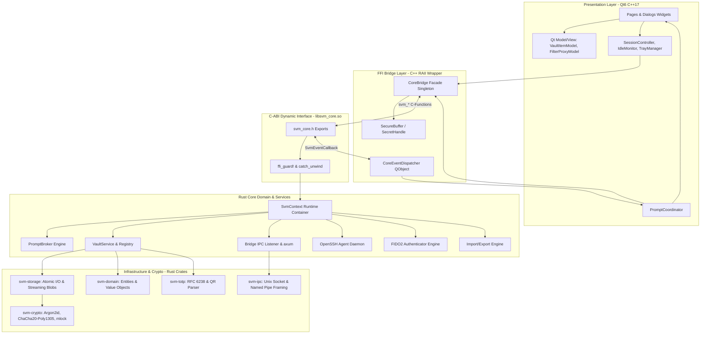
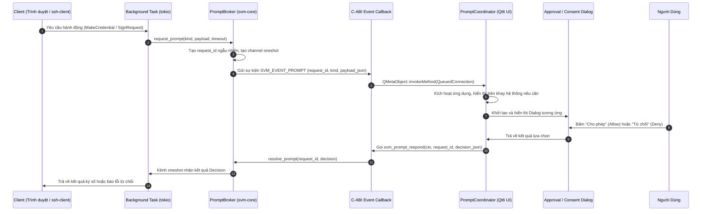

# TÀI LIỆU KIẾN TRÚC PHẦN MỀM (SAD) - SECURE VAULT MANAGER (SVM)

---

## 1. Giới Thiệu & Mục Tiêu Thiết Kế

Tài liệu Kiến trúc Phần mềm (SAD) này trình bày toàn bộ kiến trúc kỹ thuật của hệ thống **Secure Vault Manager (SVM)**. Kiến trúc này được thiết kế theo mô hình:

1. **Lõi hệ thống (Core Engine):** Viết hoàn toàn bằng Rust, đóng gói thành thư viện chia sẻ động C-ABI (`libsvm_core.so` / `.dylib` / `.dll`).
2. **Giao diện người dùng (UI):** Viết bằng C++17 với Qt6 Widgets, liên kết động trực tiếp với thư viện lõi Rust tại thời điểm biên dịch và thực thi.
3. **Phân hệ cầu nối trình duyệt (Extension Bridge):** Sử dụng cơ chế Native Messaging Host tiêu chuẩn qua tiến trình độc lập `svm-native-host` chuyển tiếp tới IPC Listener trong lõi.

### Các Nguyên Tắc Kiến Trúc Cốt Lõi

- **Zero-Trust Memory Management:** Tách biệt rõ ràng ranh giới bộ nhớ giữa C++ và Rust. Vùng nhớ chứa thông tin mật được quản lý bằng các kiểu dữ liệu an toàn tự zeroize (`secrecy`, `zeroize`) và khóa trang bộ nhớ vật lý (`mlock`).
- **Panic Boundary Isolation:** Không cho phép bất kỳ lỗi Panic nào từ Rust rò rỉ xuyên qua ranh giới FFI sang C++, mọi hàm extern "C" đều được bọc bởi cơ chế bắt ngoại lệ `catch_unwind`.
- **Asynchronous Prompt Brokering:** Xây dựng cơ chế điều phối yêu cầu tương tác hai chiều (Prompt Broker) giữa các luồng backend bất đồng bộ (tokio) và giao diện người dùng (Qt Event Loop).

---

## 2. Kiến Trúc Phân Lớp (Layered Architecture)



---

## 3. Thiết Kế Chi Tiết Các Crate trong Rust Core Workspace

Hệ thống Rust Core được chia thành 13 crate chuyên biệt nằm trong workspace `core/`:

```text
core/
├── Cargo.toml (Workspace)
└── crates/
    ├── svm-domain/          # Định nghĩa dữ liệu miền, Enums, Entities, không chứa I/O
    ├── svm-crypto/          # Mật mã học thuần túy: Argon2id, AEAD, KEX, mlock, zeroize
    ├── svm-storage/         # Quản lý đọc/ghi đĩa, file lock, migration, streaming attachments
    ├── svm-vault/           # Nghiệp vụ quản lý Vault, session, auto-lock, tìm kiếm domain
    ├── svm-totp/            # Tính toán mã OTP (SHA1/256/512) và giải mã QR code
    ├── svm-webauthn/        # Bộ xử lý Passkey / FIDO2 Authenticator (ECDSA P-256, CBOR)
    ├── svm-ssh-agent/       # OpenSSH Agent Server (Unix Socket / Windows Named Pipe)
    ├── svm-ipc/             # Giao thức liên tiến trình giữa Native Host và App
    ├── svm-bridge/          # IPC Listener & Fallback HTTP Axum server
    ├── svm-system/          # Hardening, sleep blocker, autostart, biometric integration
    ├── svm-transfer/        # Phân tích cú pháp & xuất dữ liệu (1Pux, Bitwarden, KeePass, CSV)
    ├── svm-core/            # Thư viện cdylib chính xuất C-ABI và header svm_core.h
    ├── svm-native-host/     # Binary độc lập đóng vai trò Native Messaging Relay
    ├── svm-wasm/            # WASM wrapper hỗ trợ Browser Extension thực thi offline
    └── svm-cli/             # Công cụ dòng lệnh hỗ trợ kiểm thử và quản trị headless
```

---

## 4. Cơ Chế Điều Phối Yêu Cầu Tương Tác Hai Chiều (Prompt Broker)

Khi các thành phần bất đồng bộ (như SSH Agent hoặc WebAuthn từ Extension) nhận được yêu cầu cần sự phê duyệt của người dùng (User Consent/Approval), tiến trình xử lý trong tokio background task không thể dừng lại hay tự động mở UI. Hệ thống triển khai mẫu thiết kế **Prompt Broker**:



### Xử Lý Hết Hạn & Đóng Băng (Timeouts & Vault Lock)

- Mỗi Prompt có thời gian chờ (timeout) mặc định là 60 giây. Nếu người dùng không phản hồi, Broker tự động hủy channel với mã lỗi `SVM_ERR_TIMEOUT`.
- Khi Vault bị khóa đột ngột (do người dùng bấm Quick Lock hoặc do Auto-Lock kích hoạt), toàn bộ các Prompt đang chờ phê duyệt lập tức bị hủy bỏ với quyết định `Deny`.

---

## 5. Kiến Trúc Cầu Nối Native Messaging

Để giải quyết triệt để vấn đề phân quyền trình duyệt và bảo mật hệ thống, cơ chế giao tiếp giữa Extension và Desktop App được phân tách thành hai tiến trình:

```mermaid
graph LR
    subgraph BrowserProcess [Trình Duyệt]
        ExtWorker[Extension Service Worker]
    end

    subgraph NativeHostProcess [Tiến trình svm-native-host]
        StdioHandler[Stdio 4-byte LE Framer]
        IpcClient[IPC Unix Domain Socket Client]
        StdioHandler <--> IpcClient
    end

    subgraph DesktopProcess [Tiến trình Chính: secure-vault-manager]
        IpcServer[svm-bridge: Unix Domain Socket Listener]
        PeerValidator[Peer Validator: Check PID / UID / ExePath]
        BridgeHandler[Action Dispatcher: credentials, passkey, totp]
        IpcServer --> PeerValidator
        PeerValidator --> BridgeHandler
    end

    ExtWorker <-->|Stdin / Stdout| StdioHandler
    IpcClient <-->|Unix Socket / Named Pipe| IpcServer
```



### Các Bước Bảo Mật Kết Nối

1. **Kiểm tra Peer Credentials:** Khi `svm-native-host` kết nối vào socket của App, `svm-bridge` kiểm tra quyền sở hữu tiến trình thông qua `SO_PEERCRED` trên Linux, `LOCAL_PEERPID` trên macOS, hoặc `GetNamedPipeClientProcessId` trên Windows. Socket chỉ chấp nhận kết nối từ tiến trình thuộc cùng User ID (UID) và thực thi đúng binary `svm-native-host`.
2. **Kênh Mã Hóa Phiên:** Mỗi phiên giao tiếp thiết lập khóa đối xứng bằng giao thức trao đổi khóa X25519. Mọi gói tin truyền qua IPC đều được mã hóa bằng AES-256-GCM.
3. **Phê Duyệt Ghép Nối Ban Đầu:** Lần đầu tiên Extension kết nối, ứng dụng yêu cầu nhập mã xác nhận 6 số ngẫu nhiên hiển thị trên màn hình Desktop.

---

## 6. Thiết Kế Giao Diện Người Dùng (Qt6 C++ UI Architecture)

Giao diện người dùng được tổ chức theo mô hình **Model/View/Controller (MVC)** chặt chẽ của Qt6:

- **Lớp View (`pages/`, `dialogs/`, `components/`):**
  - Cửa sổ không viền (`FramelessWindow`) với thanh tiêu đề tùy biến (`TitleBar`) và bộ xử lý co giãn kích thước (`WindowResizeHandler`).
  - Sử dụng giao diện tối ưu với `QStackedWidget` quản lý các trang nghiệp vụ chính: `OnboardingPage`, `VaultSelectionPage`, `UnlockPage`, `DashboardPage`, `SettingsPage`.
  - Hiệu ứng Animation mượt mà cho Drawer chi tiết (`DrawerPanel`) trượt từ bên phải.
- **Lớp Model (`models/`):**
  - `VaultItemModel` kế thừa `QAbstractListModel`, lưu trữ danh sách các mục trong bộ nhớ.
  - `ItemFilterProxyModel` kế thừa `QSortFilterProxyModel`, thực hiện tìm kiếm đa trường và phân loại danh mục theo thời gian thực mà không làm biến đổi dữ liệu gốc.
- **Lớp Dịch Vụ Ứng Dụng (`app/`):**
  - `IdleMonitor`: Giám sát thời gian rảnh rỗi toàn hệ điều hành để kích hoạt Auto-Lock.
  - `ClipboardGuard`: Quản lý việc sao chép mật khẩu vào Clipboard, tự động xóa sạch dữ liệu sau 30 giây và thiết lập cờ `x-kde-passwordManagerHint` để ngăn các công cụ quản lý Clipboard khác lưu lại.
  - `TrayManager`: Tích hợp biểu tượng khay hệ thống, hỗ trợ thu nhỏ vào khay và menu thao tác nhanh song ngữ.
  - `LanguageManager` & `ThemeManager`: Quản lý việc chuyển đổi ngôn ngữ (JSON) và giao diện Dark/Light (QSS) tức thì không cần khởi động lại.
