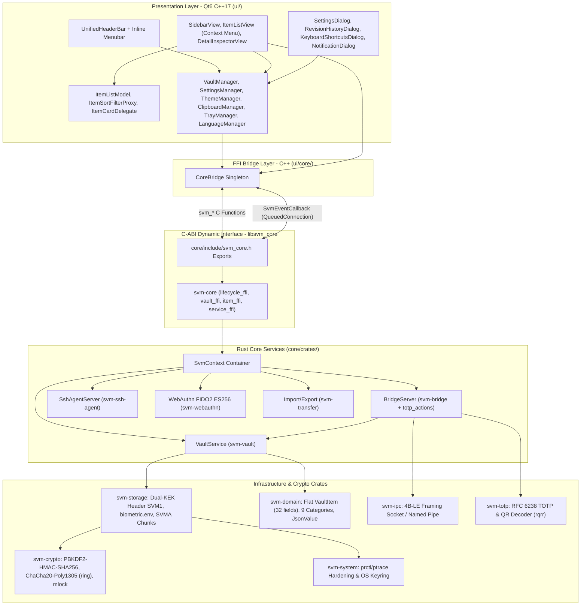
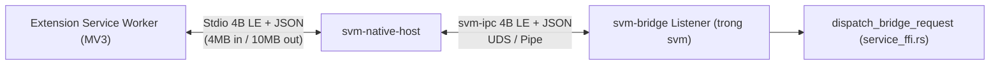

# TÀI LIỆU KIẾN TRÚC PHẦN MỀM (SAD) - SECURE VAULT MANAGER (SVM)

---

## 1. Giới Thiệu & Mục Tiêu Thiết Kế

Tài liệu Kiến trúc Phần mềm (SAD) mô tả kiến trúc kỹ thuật thực tế của **Secure Vault Manager (SVM)** theo mô hình:

1. **Lõi hệ thống (Rust Core):** Biên dịch từ Cargo Workspace gồm **14 crates**, xuất thư viện động C-ABI (`libsvm_core.so` / `.dylib` / `svm_core.dll`) cùng 2 binary độc lập `svm-native-host` và `svm-cli`.
2. **Giao diện máy trạm (Desktop UI):** C++17 với Qt6 Widgets (`Core`, `Gui`, `Network`, `Widgets`), build ra binary `svm`, giao tiếp với Rust Core qua lớp bọc `CoreBridge`.
3. **Browser Extension (MV3):** Viết bằng TypeScript (`extension/src/`), chuyển mã bằng `node scripts/build.mjs` (`stripTypeScriptTypes`) ra `dist/chrome/` và `dist/firefox/`, kết nối với Desktop App qua `svm-native-host` -> `svm-bridge`.

### Các Nguyên Tắc Kiến Trúc Cốt Lõi

- **Ranh Giới Bộ Nhớ Rõ Ràng (Ownership & Zeroize):** Các buffer nhạy cảm (`DEK`, `SecretBytes`, `svm_free_secret`, `svm_free_buffer`) được cấp phát/giải phóng qua API Rust C-ABI, ghim trang nhớ vật lý bằng `mlock`/`VirtualLock` (`svm-crypto/src/mem.rs`) và xóa bằng zeroize khi thu hồi.
- **Panic Boundary Isolation:** Các hàm FFI nhạy cảm sử dụng `ffi_guard` (`std::panic::catch_unwind`) trả mã lỗi `SVM_ERR_PANIC` (99) thay vì để panic lan qua biên giới C-ABI.
- **Event & Prompt Bridging:** Các luồng nền trong Rust (`BridgeServer`, `SshAgentServer`) phát sự kiện qua con trỏ hàm `SvmEventCallback`; `CoreBridge` đưa về luồng chính Qt qua `QMetaObject::invokeMethod(..., Qt::QueuedConnection)`.

---

## 2. Kiến Trúc Phân Lớp (Layered Architecture)



---

## 3. Cấu Trúc Thư Mục & Phân Hệ Toàn Dự Án

```text
secure-vault-manager/
├── CMakeLists.txt
├── CMakePresets.json
├── README.md
├── LICENSE
├── STYLE_GUIDELINE.md
├── .clangd
├── .gitignore
├── .prettierrc
├── .prettierignore
│
├── core/                                  # ===== RUST CORE WORKSPACE (14 crates) =====
│   ├── CMakeLists.txt
│   ├── Cargo.toml
│   ├── Cargo.lock
│   ├── deny.toml
│   ├── cbindgen.toml
│   ├── include/
│   │   └── svm_core.h
│   └── crates/
│       ├── svm-domain/
│       │   └── src/ (lib.rs, category.rs, custom_field.rs, error.rs, item.rs, json.rs, prompt.rs, status.rs, trash.rs)
│       ├── svm-crypto/
│       │   └── src/ (lib.rs, aead.rs, encoding.rs, hash.rs, kdf.rs, mem.rs, password.rs)
│       ├── svm-storage/
│       │   └── src/ (lib.rs, atomic.rs, header.rs, vault_file.rs)
│       ├── svm-vault/
│       │   └── src/ (lib.rs, attachment.rs, defaults.rs, items.rs, service.rs)
│       ├── svm-totp/
│       │   └── src/ (lib.rs, otpauth.rs, qr.rs, totp.rs)
│       ├── svm-webauthn/
│       │   └── src/ (lib.rs, authenticator.rs, cbor.rs, fido2.rs)
│       ├── svm-ssh-agent/
│       │   └── src/ (lib.rs, keygen.rs, server.rs)
│       ├── svm-ipc/
│       │   └── src/ (lib.rs, endpoint.rs)
│       ├── svm-bridge/
│       │   └── src/ (lib.rs, client.rs, server.rs, totp_actions.rs)
│       ├── svm-system/
│       │   └── src/ (lib.rs, hardening.rs, keystore.rs)
│       ├── svm-transfer/
│       │   └── src/ (lib.rs, exporters.rs, format.rs, importers.rs)
│       ├── svm-core/
│       │   └── src/ (lib.rs, context.rs, item_ffi.rs, lifecycle_ffi.rs, service_ffi.rs, vault_ffi.rs)
│       ├── svm-native-host/
│       │   └── src/ (main.rs, launcher.rs, stdio.rs)
│       └── svm-cli/
│           └── src/ (main.rs, args.rs, commands.rs)
│
├── ui/                                    # ===== QT6 WIDGETS (C++17 -> binary svm) =====
│   ├── CMakeLists.txt
│   ├── main.cpp
│   ├── main_window.h / .cpp
│   ├── core/core_bridge.h / .cpp
│   ├── models/ (vault_item.h, vault_types.h)
│   ├── app/
│   │   ├── clipboard_manager.h / .cpp
│   │   ├── dev_logger.h / .cpp
│   │   ├── language_manager.h / .cpp
│   │   ├── settings_manager.h / .cpp
│   │   ├── single_instance_guard.h / .cpp
│   │   ├── theme_manager.h / .cpp
│   │   ├── tray_manager.h / .cpp
│   │   └── vault_manager.h / .cpp
│   ├── components/
│   │   ├── combobox_popup_helper.h
│   │   ├── confirm_delete_dialog.h / .cpp
│   │   ├── dialog_drag_helper.h
│   │   ├── elided_label.h
│   │   ├── in_window_combobox.h
│   │   ├── notification_dialog.h / .cpp
│   │   ├── unified_header_bar.h / .cpp
│   │   └── window_resize_handler.h / .cpp
│   ├── views/
│   │   ├── about/ (about_dialog.h/.cpp, keyboard_shortcuts_dialog.h/.cpp)
│   │   ├── detail/ (custom_field_row_widget, custom_fields_widget, detail_header_widget,
│   │   │            detail_inspector_view, empty_state_widget, field_row_widget,
│   │   │            revision_history_dialog, totp_widget)
│   │   ├── item_list/ (item_card_delegate, item_list_empty_widget, item_list_model,
│   │   │               item_list_view, item_sort_filter_proxy)
│   │   ├── lock/ (lock_screen_view, recovery_dialog, reset_vault_dialog)
│   │   ├── onboarding/ (onboarding_wizard_view, password_entropy_meter)
│   │   ├── settings/ (setting_row_widget, settings_dialog, tabs/{tab_browser,tab_data,tab_general,tab_security,tab_ssh,tab_vaults})
│   │   ├── sidebar/ (sidebar_item_delegate, sidebar_types.h, sidebar_view)
│   │   └── vaults/ (new_vault_dialog)
│   └── resources/ (resources.qrc, i18n/{en,vi}.json, icons/, fonts/, styles/{dark,light}.qss)
│
├── extension/                             # ===== BROWSER EXTENSION (MV3, pnpm + oxlint + prettier) =====
│   ├── package.json
│   ├── pnpm-lock.yaml
│   ├── tsconfig.json
│   ├── vite.config.ts                     # (Build thực tế qua scripts/build.mjs)
│   ├── popup.html
│   ├── scripts/ (build.mjs, post-build.js)
│   ├── public/ (manifest.json, manifest.firefox.json, icon-16/32/48/128.png)
│   └── src/
│       ├── global.css
│       ├── background/ (index.ts, transport.ts, native_client.ts, passkey_router.ts, qr_crop_handler.ts)
│       ├── content/ (index.ts, classifier.ts, form-capture.ts, autofill.ts, save-prompt.ts,
│       │             overlay.ts, crop-overlay.ts, passkey_bridge.ts, passkey_modal.ts)
│       ├── injected/ (passkey_injected.ts)
│       ├── popup/ (popup.tsx, popup.module.css, components/{HeaderBar.ts, CredentialList.ts, LockView.ts, icons.ts})
│       └── services/ (crypto-local.ts, domain.ts, protocol.ts, qr-scanner.ts, webauthn.ts)
│
├── packaging/
│   ├── native-messaging/ (chrome.json.in, firefox.json.in)
│   ├── linux/ (build-appimage.sh, build-deb.sh, build-rpm.sh, io.hephaestus.svm.desktop, metainfo, icons/)
│   ├── macos/ (build-macos.sh, build-dmg.sh, build-pkg.sh, Info.plist.in, entitlements.plist, svm.icns)
│   └── windows/ (build-windows.ps1, build-windows.bat, svm.iss, svm.wxs, svm.rc, resource.h, svm.ico)
│
├── scripts/ (build.sh, run.sh, test.sh, format.sh, lint.sh, clean.sh, gen-header.sh, build-extension.sh, install-native-host.sh, generate-icons.py)
│
└── docs/ (01 .. 11)
```

### 3.1. Bảng Trách Nhiệm 14 Crate trong Workspace `core/`

| Crate | Phụ thuộc ngoài chính | Trách Nhiệm Kỹ Thuật Chính |
| :--- | :--- | :--- |
| `svm-domain` | *(Zero external deps)* | Thực thể miền (`VaultItem` 32 trường, `VaultProfile`, `Category` 9 biến thể, `CustomField`, `ItemRevision`, `TrashItem`), `JsonValue` parser/serializer tự viết. |
| `svm-crypto` | `ring`, `windows-sys` (Win) | `PBKDF2-HMAC-SHA256` (100k vòng), `ChaCha20-Poly1305` (RFC 8439), SHA-1/SHA-256, Base64/Base32, CSPRNG, sinh/đánh giá mật khẩu, `mlock`/`VirtualLock`, zeroize. |
| `svm-storage` | *(nội bộ + svm-system)* | Đọc/ghi `vault.svm` (Header `SVM1` 169B), `biometric.env` (`SVMB` 64B), streaming attachments (`SVMA` chunks 64 KiB tại `attachments/*.bin`), atomic temp-rename (`atomic.rs`). |
| `svm-vault` | *(nội bộ)* | Nghiệp vụ `VaultService`: khởi tạo, mở/khóa kho, Recovery Key, CRUD items, di chuyển vault (`vaultId`), 20 revision snapshots, Trash, Attachment metadata (`AttachmentMeta`). |
| `svm-totp` | `rqrr` | Sinh/kiểm tra TOTP RFC 6238, parse `otpauth://` URI, giải mã QR code từ buffer hình ảnh RGBA8888 (`qr.rs`). |
| `svm-webauthn` | `ring` | Virtual WebAuthn Authenticator (`ES256`, COSE `-7`): `MakeCredential`, `GetAssertion`, CBOR encoder (`cbor.rs`), khớp `rpId` và tăng `sign_count`. |
| `svm-ssh-agent` | `ring` | OpenSSH Agent Server trên Unix socket (`#[cfg(unix)]`), sinh và ký khóa `ssh-ed25519` OpenSSH PEM. |
| `svm-ipc` | *(nội bộ)* | Framing `[4-byte LE length][UTF-8 JSON]` trên Unix Domain Socket và Windows Named Pipe (`endpoint.rs`). |
| `svm-bridge` | `windows-sys` (Win) | `BridgeServer` IPC listener, danh sách client (`PairedClient`), cài đặt Native Messaging Host manifests (`install_manifests`), xử lý `decode_qr` & `update_totp` (`totp_actions.rs`). |
| `svm-system` | `keyring`, `windows-sys` (Win) | Process hardening (`prctl(PR_SET_DUMPABLE, 0)` / `PT_DENY_ATTACH`) và tích hợp OS Keyring (`keystore.rs`) lưu khóa wrapping sinh trắc học. |
| `svm-transfer` | `zip` | Import/Export định dạng `.svm`, Bitwarden JSON, 1Password `.1pux`, KeePass XML và CSV trình duyệt. |
| `svm-core` | `ureq` + toàn bộ crates | C-ABI dynamic library (`cdylib`, `rlib`), quản lý `SvmContext`, Prompt coordination cho `ssh_sign`, tải favicon opt-in (`ureq`), xuất `svm_core.h`. |
| `svm-native-host` | *(nội bộ)* | Binary relay stdin/stdout (`4B LE + JSON`) kết nối tới `svm-bridge` (`NativeHostRouter`, tự launch app desktop nếu yêu cầu mở khóa). |
| `svm-cli` | *(nội bộ)* | Công cụ dòng lệnh headless phục vụ kiểm thử và thao tác kho dữ liệu. |

---

## 4. Cơ Chế Điều Phối Yêu Cầu Tương Tác (`PromptBroker` & `NotificationDialog`)

Hiện tại, cơ chế Prompt từ Rust Core lên Qt UI đang phục vụ quy trình **phê duyệt ký SSH (`ssh_sign`)**:

1. Khi `SshAgentServer` nhận `SSH_AGENTC_SIGN_REQUEST` và cài đặt `ssh_prompt_approval` đang bật, [`ContextState::request_ssh_approval`](../core/crates/svm-core/src/context.rs#L71-L143) tạo `request_id` và chờ trên cặp `Arc<(Mutex<Option<bool>>, Condvar)>` với **timeout 30 giây**.
2. Core phát `SVM_EVENT_PROMPT` (`kind = 4`) kèm JSON `{"request_id", "kind": "ssh_sign", "title", "key", "fingerprint"}` qua `SvmEventCallback`.
3. `CoreBridge` đưa về luồng UI chính bằng `Qt::QueuedConnection` (`promptReceived` signal).
4. `MainWindow` mở [`NotificationDialog::question`](../ui/main_window.cpp#L135-L153) cho người dùng chọn Cho phép / Từ chối, rồi gọi `CoreBridge::respondPrompt(requestId, approved)` -> `svm_prompt_respond(ctx, request_id, {"approved": bool})`.
5. Nếu timeout (30s) hoặc Vault bị khóa, yêu cầu tự động từ chối (`SSH_AGENT_FAILURE`).

*Ghi chú về Passkey Consent:* Phê duyệt WebAuthn/Passkey được thực thi trực tiếp phía Extension trên modal Shadow DOM (`extension/src/content/passkey_modal.ts`), không đi qua `SVM_EVENT_PROMPT` của Desktop UI.

---

## 5. Kiến Trúc Cầu Nối Native Messaging



- **Unix (Linux/macOS):** Socket nằm tại `$XDG_RUNTIME_DIR/svm/bridge.sock` (hoặc thư mục fallback `SVM_DATA_DIR`).
- **Windows:** Named Pipe `\\.\pipe\hephaestus-svm-bridge-<sanitized_user>`.
- **Manifest Name:** `io.hephaestus.secure_vault_manager` (đăng ký bởi `BridgeServer::install_manifests` trong `svm-bridge/src/server.rs`).

---

## 6. Thiết Kế Giao Diện Người Dùng (Qt6 C++17 UI Architecture)

- **Thanh tiêu đề hợp nhất ([`UnifiedHeaderBar`](../ui/components/unified_header_bar.h)):** Chiều cao cố định `38px`, tích hợp **Compact Inline Menubar** gồm 4 menu động (**Vault**, **Item**, **View**, **Help**) cạnh logo; góc phải có nút Theme Toggle, nút Settings (ẩn khi khóa) và 3 nút điều khiển cửa sổ.
- **Màn hình điều hướng (`QStackedWidget`):** `OnboardingWizardView`, `LockScreenView` (hỗ trợ Master Password, Sinh trắc học, `RecoveryDialog`, `ResetVaultDialog`), và không gian làm việc 3 cột (`QSplitter`):
  - **Cột 1 ([`SidebarView`](../ui/views/sidebar/sidebar_view.h)):** Chọn Vault (`All Vaults` hoặc từng Vault), nút tạo Vault mới (`NewVaultDialog`), bộ lọc `All Items`, `Favorites`, `Trash` và 9 danh mục `Category`, hỗ trợ thu gọn Icon Rail (`Ctrl+B`).
  - **Cột 2 ([`ItemListView`](../ui/views/item_list/item_list_view.h)):** Thanh tìm kiếm (`Ctrl+F`), nút tạo mới (`Ctrl+N`), `ItemListModel` + `ItemSortFilterProxy` + `ItemCardDelegate`. Hỗ trợ **Right Context Menu** (chặn nhảy selection khi chuột phải lên item khác) với Copy nhanh, Open Website, Edit, Toggle Favorite, **Move to Vault**, Move to Trash / Restore / Delete Permanently.
  - **Cột 3 ([`DetailInspectorView`](../ui/views/detail/detail_inspector_view.h)):** Hiển thị/chỉnh sửa theo từng danh mục, `DetailHeaderWidget` (`ElidedLabel`, Favorite, `RevisionHistoryDialog`), `TotpWidget` (RFC 6238 live timer), trường Passkey chuyên biệt (`formatPasskeyAlgorithm`), `CustomFieldsWidget`, Ghi chú và Tệp đính kèm.
- **Lớp Dịch Vụ (`ui/app/`, `ui/core/`):** `CoreBridge` (RAII FFI), `VaultManager`, `SettingsManager`, `ClipboardManager`, `TrayManager`, `LanguageManager`, `ThemeManager`, `SingleInstanceGuard`, `DevLogger`.

---

## 7. Mô Hình Đa Luồng & Xử Lý Bất Đồng Bộ

- **Main GUI Thread (Qt Event Loop):** Toàn bộ Widget, Model/Proxy, Dialog và thao tác UI chạy trên luồng chính Qt.
- **Rust Background Worker Threads (`std::thread`):**
  - `SshAgentServer` lắng nghe kết nối `ssh`/`git` trên luồng nền riêng và đồng bộ truy cập `VaultService` / `PromptState` qua `std::sync::Mutex` và `Condvar`.
  - `BridgeServer` lắng nghe kết nối IPC từ `svm-native-host` trên luồng nền riêng, gọi `dispatch_bridge_request` truy cập `VaultService` được bảo vệ bởi `Arc<Mutex<...>>`.
- **Event Marshalling:** Mọi callback từ các luồng nền Rust qua `SvmEventCallback` đều được `CoreBridge` đẩy về Qt Main Thread qua `QMetaObject::invokeMethod(..., Qt::QueuedConnection)`.
