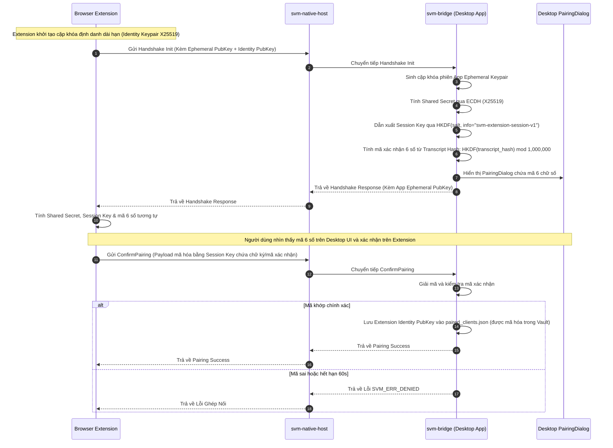

# ĐẶC TẢ GIAO THỨC CẦU NỐI EXTENSION - SECURE VAULT MANAGER (SVM)

---

## 1. Tổng Quan Kiến Trúc Kênh Giao Tiếp

Hệ thống cung cấp hai phương thức kết nối giữa Browser Extension và Desktop Application:

1. **Native Messaging Host (Kênh Tiêu Chuẩn & Mặc Định):**
   - Trình duyệt khởi chạy trực tiếp binary relay mỏng `svm-native-host` thông qua cơ chế chuẩn của Chromium/Firefox.
   - `svm-native-host` kết nối tới `svm-bridge` trong Desktop App thông qua Unix Domain Socket (`$XDG_RUNTIME_DIR/svm/bridge.sock`) hoặc Windows Named Pipe (`\\.\pipe\svm-bridge`).
2. **Loopback HTTP Server (Kênh Dự Phòng Fallback):**
   - Dành riêng cho môi trường Linux chạy trình duyệt trong Sandbox Snap hoặc Flatpak (nơi trình duyệt bị cấm gọi native binary bên ngoài sandbox).
   - Server Axum lắng nghe tại `127.0.0.1:12519` (hoặc các cổng dự phòng `12520`, `12521`).
   - Mặc định **tắt hoàn toàn**; chỉ kích hoạt khi người dùng bật trong cài đặt và cấu hình quy tắc CORS chặt chẽ.

---

## 2. Giao Thức Khung Gói Tin (Framing Protocol)

### 2.1. Chuẩn Native Messaging (Stdio Framing)

- Gói tin nhị phân gồm:
  - **Header:** 4 bytes số nguyên không dấu 32-bit (Little-Endian) thể hiện độ dài chính xác của chuỗi JSON theo sau.
  - **Payload:** Chuỗi JSON mã hóa định dạng UTF-8.
- Kích thước tối đa: 1MB cho chiều từ Host sang Extension; tối đa 64MB cho chiều ngược lại.

```text
+--------------------+---------------------------------------------+
| Length (4 bytes LE)| JSON Payload (UTF-8 Encoded String)         |
+--------------------+---------------------------------------------+
```

### 2.2. Giao Thức IPC Giữa `svm-native-host` và `svm-bridge`

- Dữ liệu được đóng gói thành các Frame gồm:
  - 4 bytes Magic Identifier: `"SVMI"` (0x53, 0x56, 0x4D, 0x49).
  - 4 bytes Length (uint32 LE).
  - 2 bytes Message Type (0x0001: Handshake, 0x0002: Relay, 0x0003: Heartbeat, 0x0004: Close).
  - N bytes Payload.

---

## 3. Quy Trình Ghép Nối & Thiết Lập Phiên Mã Hóa (Pairing & Session Handshake)

Để bảo đảm tính bảo mật tuyệt đối chống lại các ứng dụng độc hại cùng chạy trên máy trạm quét port hoặc giả mạo extension, cơ chế bắt cặp sử dụng trao đổi khóa công khai **X25519** kết hợp hàm dẫn xuất khóa **HKDF-SHA256**:



Sau khi hoàn tất ghép nối thành công, mọi gói tin trao đổi nghiệp vụ tiếp theo đều được mã hóa bằng **AES-256-GCM** với khóa `Session Key`:

- **Chống tấn công phát lại (Anti-Replay):** Nonce 12 bytes sử dụng bộ đếm tuần tự tăng dần (`Sequence Counter` 8 bytes kết hợp 4 bytes hướng gửi: `0x00000001` cho Host->Ext và `0x00000002` cho Ext->Host). Các gói tin có bộ đếm trùng hoặc nhỏ hơn sẽ bị từ chối ngay lập tức.
- **Xác thực toàn vẹn AAD:** Trường AAD bao gồm `v || client_id || request_id || action` để ngăn kẻ tấn công can thiệp vào siêu dữ liệu bên ngoài gói tin.

---

## 4. Định Dạng Bản Tin Nghiệp Vụ (Action Payloads)

Mọi yêu cầu (`BridgeRequest`) và phản hồi (`BridgeResponse`) giữa Browser Extension (`extension/src/services/protocol.ts`), `svm-native-host` và `svm-bridge` đều sử dụng cấu trúc phong bì JSON thống nhất:

### Khung Yêu Cầu (`BridgeRequest`)

```json
{
  "requestId": "req-1730938800-1",
  "action": "get_credentials",
  "sessionToken": "svm-sess-550e8400-e29b-41d4-a716-446655440000",
  "payload": {
    "domain": "github.com"
  }
}
```

### Khung Phản Hồi Thành Công (`BridgeResponse` - `ok: true`)

```json
{
  "requestId": "req-1730938800-1",
  "type": "credentials_list",
  "ok": true,
  "payload": {
    "credentials": []
  }
}
```

### Khung Phản Hồi Lỗi Chung (`BridgeResponse` - `ok: false`)

```json
{
  "requestId": "req-1730938800-1",
  "type": "error",
  "ok": false,
  "error": {
    "code": "NOT_FOUND",
    "message": "Credential not found"
  }
}
```

---

Chi tiết `payload` của từng `action`:

### 4.1. Action: `get_credentials` (Truy Vấn Danh Sách Tài Khoản Phù Hợp)

- **Mục đích:** Trả về danh sách thông tin tài khoản để hiển thị trên popup hoặc gợi ý autofill. **Không bao giờ trả về mật khẩu (`password`) ở bước này** để bảo vệ dữ liệu trước khi người dùng chủ động chọn.
- **Request `payload`:**

  ```json
  {
    "domain": "github.com",
    "origin": "https://github.com"
  }
  ```

- **Response `payload` (`type: "credentials_list"`):**

  ```json
  {
    "credentials": [
      {
        "id": "item-uuid-1",
        "title": "GitHub Production",
        "username": "user@example.com",
        "websiteUrl": "https://github.com/login",
        "hasTotp": true,
        "totpCode": "482910",
        "totpRemaining": 24
      }
    ]
  }
  ```

### 4.2. Action: `fill_credential` (Lấy Mật Khẩu Cho Tài Khoản Được Chọn)

- **Mục đích:** Chỉ được gọi khi người dùng chủ động nhấn chọn điền (`Fill`) hoặc sao chép mật khẩu của một mục cụ thể.
- **Request `payload`:**

  ```json
  {
    "itemId": "item-uuid-1"
  }
  ```

- **Response `payload` (`type: "credential_secret"`):**

  ```json
  {
    "id": "item-uuid-1",
    "title": "GitHub Production",
    "username": "user@example.com",
    "password": "DecryptedPassword123",
    "totpCode": "482910",
    "totpRemaining": 24
  }
  ```

### 4.3. Action: `save_credential`

- **Request `payload`:**

  ```json
  {
    "title": "GitHub",
    "username": "developer",
    "password": "StrongGeneratedPassword!@#",
    "websiteUrl": "https://github.com/login"
  }
  ```

- **Response `payload` (`type: "credential_saved"`):**

  ```json
  {
    "id": "item-uuid-2",
    "saved": true
  }
  ```

### 4.4. Action: `update_totp`

- **Request:**

  ```json
  {
    "url": "https://gitlab.com",
    "otpauth_uri": "otpauth://totp/GitLab:dev?secret=JBSWY3DPEHPK3PXP&issuer=GitLab"
  }
  ```

- **Response:**

  ```json
  {
    "status": "success",
    "updated_item_id": "item-uuid-3"
  }
  ```

### 4.5. Action: `get_totp`

- **Request:**

  ```json
  {
    "item_id": "item-uuid-1",
    "origin": "https://accounts.google.com"
  }
  ```

- **Response:**

  ```json
  {
    "status": "success",
    "code": "482910",
    "remaining_secs": 18
  }
  ```

### 4.6. Action: `passkey_create`

- **Mô tả:** Tiếp nhận yêu cầu WebAuthn MakeCredential từ Extension. Sau khi người dùng chấp thuận trên Desktop, cặp khóa Passkey được tạo và lưu trữ thành một mục độc lập mới thuộc danh mục `Category::Passkey` trong Vault (với `title: rp.name` và `user_name: user.name`).

- **Request:**

  ```json
  {
    "origin": "https://github.com",
    "client_data_json_b64": "eyJ0eXBlIjoid2ViYXV0aG4uY3JlYXRlIi...",
    "client_data_hash_hex": "e3b0c44298fc1c149afbf4c8996fb92427ae41e4649b934ca495991b7852b855",
    "rp": {
      "id": "github.com",
      "name": "GitHub"
    },
    "user": {
      "id_b64": "dXNlcl9pZF8xMjM0",
      "name": "developer",
      "display_name": "Developer User"
    },
    "pub_key_cred_params": [
      { "type": "public-key", "alg": -7 },
      { "type": "public-key", "alg": -8 }
    ],
    "exclude_credentials": []
  }
  ```

- **Response:**

  ```json
  {
    "status": "success",
    "credential_id_b64": "SnVzdEFuRXhhbXBsZUNyZWRlbnRpYWxJRA",
    "attestation_object_b64": "o2NmbXRkbm9uZWdhdHRTdG10oGhhdXRoRGF0YVi...",
    "client_data_json_b64": "eyJ0eXBlIjoid2ViYXV0aG4uY3JlYXRlIi..."
  }
  ```

### 4.7. Action: `passkey_get`

- **Request:**

  ```json
  {
    "origin": "https://github.com",
    "rp_id": "github.com",
    "client_data_json_b64": "eyJ0eXBlIjoid2ViYXV0aG4uZ2V0Ii...",
    "client_data_hash_hex": "8f434346648f6b96df89dda901c5176b10a6d83961dd3c1ac88b59b2dc327aa4",
    "allow_credentials": []
  }
  ```

- **Response:**

  ```json
  {
    "status": "success",
    "credential_id_b64": "SnVzdEFuRXhhbXBsZUNyZWRlbnRpYWxJRA",
    "authenticator_data_b64": "SZYN5YgOjGh0NBcPZHZgW4_krrmihjLHmVzzuoMdl2MFAAAAAQ",
    "signature_b64": "MEYCIQDx9...",
    "user_handle_b64": "dXNlcl9pZF8xMjM0"
  }
  ```

### 4.8. Action: `get_vault_status`

- **Request:** `{}`
- **Response:**

  ```json
  {
    "status": "success",
    "unlocked": true,
    "active_vault_name": "Personal Vault"
  }
  ```
