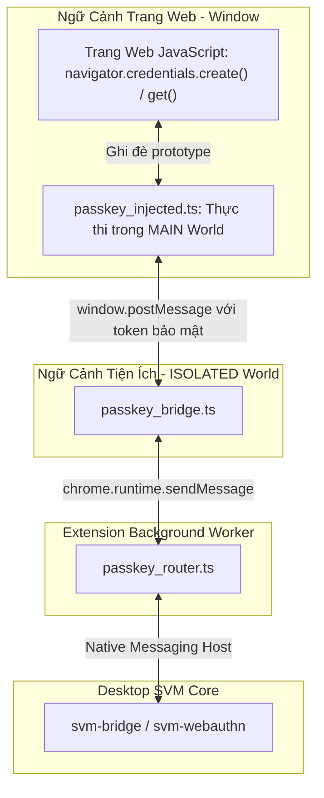
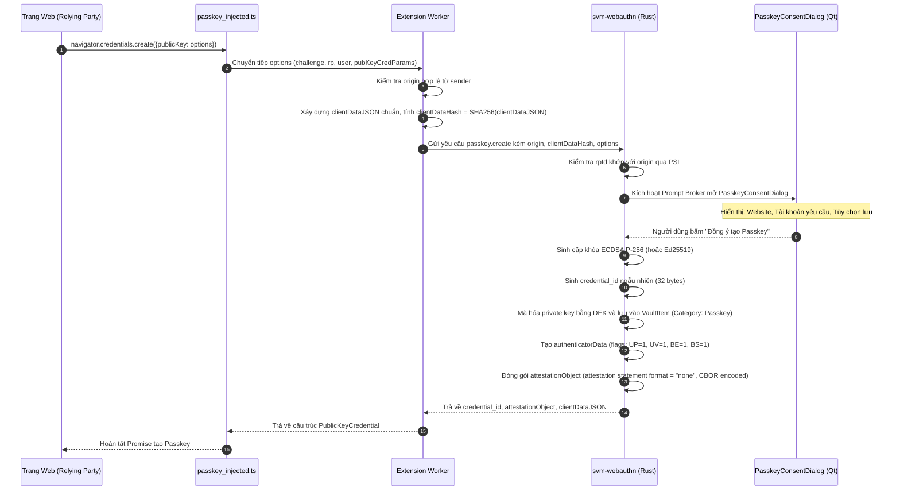
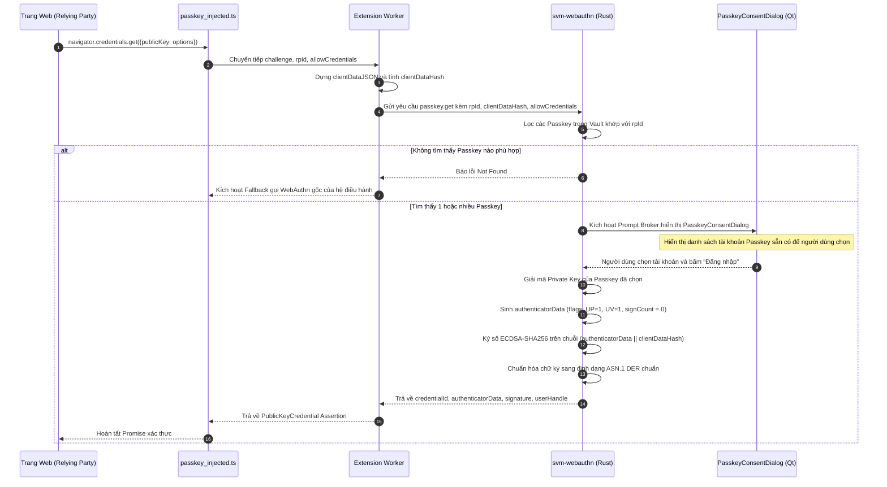

# ĐẶC TẢ TRIỂN KHAI PASSKEY (WEBAUTHN / FIDO2) - SECURE VAULT MANAGER (SVM)

---

## 1. Tổng Quan Kiến Trúc Passkey Trong SVM

Thay vì phụ thuộc vào các giải pháp quản lý Passkey độc quyền của nền tảng (như Apple Keychain, Windows Hello), **SVM** triển khai một **Virtual Software Authenticator** độc lập nằm trọn vẹn trong `core/crates/svm-webauthn`.

Cơ chế này mang lại các lợi thế chiến lược:

1. **Độc lập nền tảng:** Hoạt động đồng nhất trên cả Linux (X11 & Wayland), Windows và macOS.
2. **Khả năng sao lưu & di chuyển:** Passkey được lưu trữ dưới dạng một bản ghi trong Vault (được mã hóa bằng DEK), cho phép xuất/nhập an toàn và sao lưu toàn diện.
3. **Phê duyệt minh bạch:** Mỗi lần tạo khóa hoặc đăng nhập đều yêu cầu sự đồng ý tường minh của người dùng qua giao diện Native C++ Qt6 (`PasskeyConsentDialog`).

---

## 2. Kiến Trúc Can Thiệp Trình Duyệt (Browser Interception Pipeline)

Để đón bắt các lệnh gọi WebAuthn tiêu chuẩn từ trang web, Extension sử dụng mô hình hai tầng script:



### Ràng Buộc Bảo Mật Nghiêm Ngặt

- **Xác Thực Nguồn Gốc (Origin Validation):** Trang web **không bao giờ** được phép tự khai báo nguồn gốc của mình. Background Worker của Extension trích xuất `origin` trực tiếp từ thuộc tính bảo vệ `sender.url` hoặc `sender.origin` do trình duyệt cung cấp.
- **Kiểm Tra Relying Party ID (rpId):** Lõi `svm-webauthn` sử dụng thư viện Public Suffix List (PSL) để xác thực `rpId` phải là hậu tố hợp lệ của tên miền trang web (ví dụ: `accounts.google.com` có thể dùng `rpId: "google.com"`, nhưng không thể dùng `rpId: "com"` hoặc `rpId: "microsoft.com"`).
- **Cơ Chế Chuyển Tiếp Fallback (Graceful Degradation):** Nếu Vault đang ở trạng thái Khóa (Locked), hoặc nếu người dùng bấm "Từ chối" trên hộp thoại, `passkey_injected.ts` tự động chuyển tiếp lời gọi hàm về phương thức gốc của trình duyệt (`window.__original_credentials_create`), cho phép hệ điều hành hoặc khóa bảo mật phần cứng USB xử lý tiếp mà không gây lỗi giao diện trang web.

---

## 3. Luồng Tạo Khóa Mới (Registration Flow - `navigator.credentials.create`)



---

## 4. Luồng Xác Thực Đăng Nhập (Authentication Flow - `navigator.credentials.get`)



---

## 5. Cấu Trúc Lưu Trữ Dữ Liệu Passkey Trong Vault

Mỗi Passkey được lưu trữ dưới dạng một `VaultItem` với danh mục chuyên biệt `Category::Passkey`:

```json
{
  "id": "550e8400-e29b-41d4-a716-446655440000",
  "category": "Passkey",
  "title": "Google (user@gmail.com)",
  "created_at": 1793700000,
  "updated_at": 1793700000,
  "payload": {
    "rp_id": "google.com",
    "credential_id_hex": "4a7b9c1d...",
    "user_handle_b64": "dXNlcl9pZF8xMjM0",
    "user_name": "user@gmail.com",
    "user_display_name": "Nguyen Van A",
    "algorithm": -7,
    "public_key_spki_hex": "3059301306072a8648ce3d0201...",
    "private_key_envelope": "..."
  }
}
```

*Ghi chú:* Giá trị thuật toán `-7` đại diện cho chuẩn `ES256` (ECDSA P-256 với SHA-256) theo chuẩn COSE (RFC 8152).
