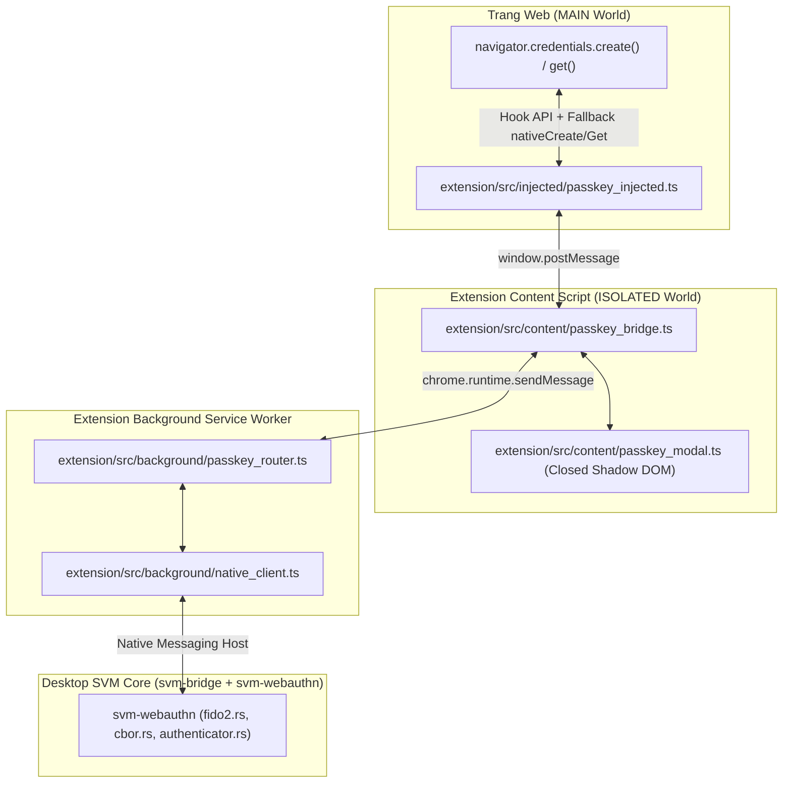

# ĐẶC TẢ TRIỂN KHAI PASSKEY (WEBAUTHN / FIDO2) - SECURE VAULT MANAGER (SVM)

---

## 1. Tổng Quan Kiến Trúc Passkey Trong SVM

**SVM** triển khai một **Virtual Software Authenticator** tại `core/crates/svm-webauthn` (`authenticator.rs`, `cbor.rs`, `fido2.rs`), lưu trữ Passkey trực tiếp dưới dạng bản ghi `Category::Passkey` trong Vault (`vault.svm`) kết hợp với Extension trên trình duyệt:

1. **Độc lập nền tảng:** Hoạt động đồng nhất trên Linux (X11 & Wayland), Windows và macOS.
2. **Quản trị & Hiển thị chuyên biệt:** Mỗi Passkey được lưu kèm 5 trường siêu dữ liệu chuẩn hoá (`passkeyCredentialId`, `passkeyRpId`, `passkeyAlgorithm`, `passkeyUserHandle`, `passkeySignCount`) và hiển thị trực tiếp trên giao diện Desktop `DetailInspectorView` với mô tả thuật toán dễ đọc (`formatPasskeyAlgorithm`).
3. **Phê duyệt & Mở khóa ngay tại trình duyệt (Shadow DOM Modal):** Thay vì bật hộp thoại riêng từ Desktop, hộp thoại xác nhận tạo/đăng nhập Passkey hiển thị trong closed Shadow DOM (`extension/src/content/passkey_modal.ts`), hỗ trợ mở khóa inline nếu Vault đang khóa và tự động fallback về WebAuthn gốc của trình duyệt nếu không khớp hoặc bị từ chối.

---

## 2. Kiến Trúc Can Thiệp Trình Duyệt (Browser Interception Pipeline)



### Quy Tắc Xác Thực & Fallback

- **Pre-flight `passkey_query`:** Trước khi hiển thị modal xác nhận đăng nhập (`navigator.credentials.get`), `passkey_bridge.ts` gửi `passkey_query` kiểm tra trạng thái kho và danh sách Passkey khớp `rpId`. Nếu Vault đang mở khóa nhưng có `0` Passkey khớp, Extension fallback thầm lặng ngay về WebAuthn gốc của OS/USB key mà không làm phiền người dùng.
- **Đối chiếu `rpId`:** `svm-webauthn/src/authenticator.rs` (`matches_passkey_rp_id`) kiểm tra khớp trực tiếp `passkey_rp_id` (không phân biệt hoa/thường) hoặc khớp ranh giới dấu chấm trên `website_url` của bản ghi.
- **Offline / Locked Handling:** Nếu Desktop App offline, modal báo trạng thái không khả dụng và cho phép fallback; nếu Vault đang khóa, modal cho phép nhập Master Password (`unlock_vault`) hoặc mở khóa sinh trắc học ngay tại chỗ.

---

## 3. Luồng Tạo Khóa (`navigator.credentials.create` -> `passkey_create`)

1. `passkey_injected.ts` chặn `navigator.credentials.create`, chuyển options qua `passkey_bridge.ts`.
2. `passkey_modal.ts` hiển thị thông tin Relying Party và tài khoản để người dùng bấm xác nhận.
3. Background `passkey_router.ts` gửi action `passkey_create` (payload camelCase: `origin`, `rpId`, `rpName`, `userHandle`, `userName`, `userDisplayName`, `challenge`, `excludeCredentials`) xuống Rust Core.
4. `svm-webauthn/src/fido2.rs` thực thi:
   - Sinh cặp khóa **ECDSA P-256 (`ES256`, COSE `-7`)**.
   - Sinh `credential_id` ngẫu nhiên 32 bytes.
   - Đóng gói `authenticatorData` (cờ `0x45` = `UP | UV | AT`, AAGUID `0073766d-7661-756c-742d-6d616e616765`, COSE key P-256) và `attestationObject` định dạng CBOR `fmt: "none"`.
5. `build_passkey_item` (`authenticator.rs`) lưu bản ghi `VaultItem` mới (`Category::Passkey`) vào Vault:
   - `title`: `"<rpId/rpName> Passkey"`
   - `username`: `userName` (hoặc `userDisplayName`)
   - `websiteUrl`: `origin` / `https://<rpId>`
   - `password`: PKCS#8 private key mã hóa Base64
   - `hasPasskey`: `true`
   - `passkeyCredentialId`, `passkeyRpId`, `passkeyAlgorithm`: `-7`, `passkeyUserHandle`, `passkeySignCount`: `0`.

---

## 4. Luồng Xác Thực (`navigator.credentials.get` -> `passkey_get`)

1. `passkey_bridge.ts` truy vấn `passkey_query`; nếu có Passkey khớp (hoặc kho đang khóa cần người dùng chọn mở khóa), hiển thị danh sách tài khoản trong `passkey_modal.ts` (hỗ trợ chọn bằng radio khi có nhiều Passkey cùng domain).
2. Khi người dùng xác nhận, `passkey_router.ts` gửi `passkey_get` kèm `itemId` đã chọn, `rpId`, `origin`, `challenge`, `allowCredentials`.
3. `svm-webauthn/src/fido2.rs` thực thi:
   - Giải mã PKCS#8 private key từ `item.password`.
   - Tăng bộ đếm ký số lên `item.passkey_sign_count + 1` (`bump_passkey_sign_count` và lưu lại vào Vault).
   - Tạo `authenticatorData` (cờ `0x05` = `UP | UV`, không kèm `BE`/`BS`) và ký **ECDSA P-256 SHA-256** (chữ ký DER ASN.1) trên `authenticatorData || SHA256(clientDataJSON)`.
   - Trả về `{ credentialId, authenticatorData, clientDataJSON, signature, userHandle }`.

---

## 5. Lưu Trữ & Hiển Thị Trên Desktop UI

Trong `VaultItem` (`svm-domain/src/item.rs` và `ui/models/vault_item.h`), danh mục `Passkey` sử dụng cấu trúc phẳng:

```json
{
  "id": "550e8400-e29b-41d4-a716-446655440000",
  "vaultId": "personal",
  "title": "www.passkeys.io Passkey",
  "category": "passkey",
  "categoryIndex": 1,
  "username": "haitest@gmail.com",
  "password": "<PKCS8_PRIVATE_KEY_BASE64>",
  "websiteUrl": "https://www.passkeys.io",
  "hasPasskey": true,
  "passkeyCredentialId": "iQxXejo4owedwOiQhrOayQcC_sZsuZlbqnINKbq1BPg",
  "passkeyRpId": "www.passkeys.io",
  "passkeyAlgorithm": -7,
  "passkeyUserHandle": "2eO7iE7BT7GOYnC3Qa9x4g",
  "passkeySignCount": 1
}
```

Trên giao diện [`DetailInspectorView`](../ui/views/detail/detail_inspector_view.cpp), khối **"Passkey Metadata"** hiển thị trực tiếp các trường read-only (`Account / User Handle`, `Website / Relying Party`, `Credential ID`, `Relying Party (RP ID)`, `Algorithm`, `User Handle`, `Sign Count`), trong đó hàm [`models::formatPasskeyAlgorithm`](../ui/models/vault_item.h#L191-L210) quy đổi các mã COSE chuẩn (`-7` -> `ES256 (ECDSA P-256 / SHA-256) • COSE -7`, `-8` -> `EdDSA`, `-35` -> `ES384`, `-36` -> `ES512`, `-37` -> `PS256`, `-257` -> `RS256`).
