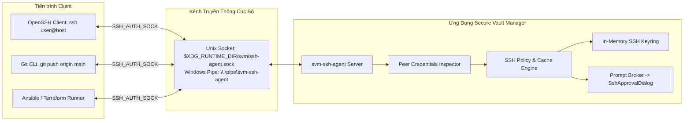
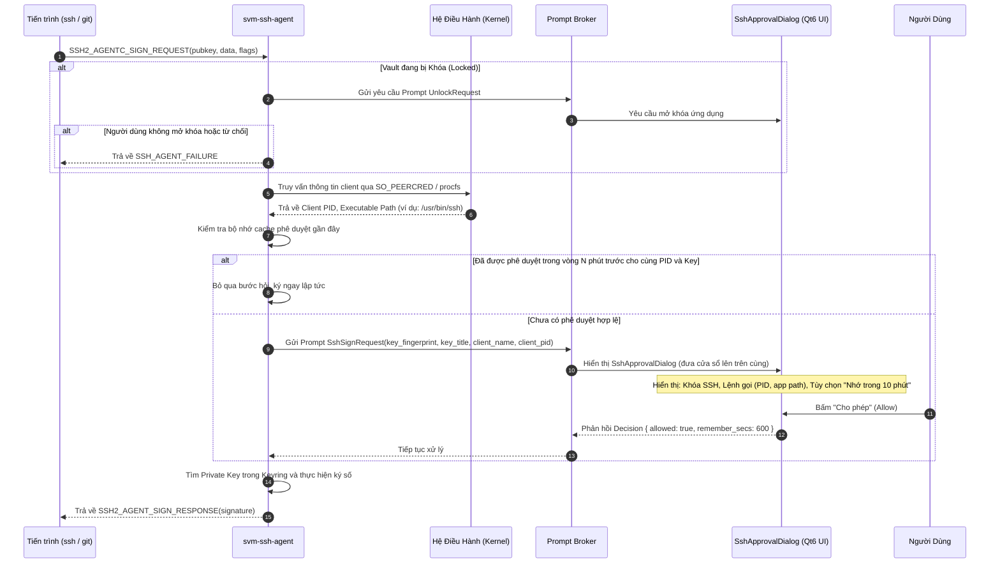

# ĐẶC TẢ GIAO THỨC SSH AGENT - SECURE VAULT MANAGER (SVM)

---

## 1. Giới Thiệu & Mục Đích

Trong quy trình làm việc hiện đại của lập trình viên và quản trị viên hệ thống (DevOps/Sysadmin), việc sử dụng các khóa SSH (SSH Keys) diễn ra liên tục khi tương tác với Git (GitHub, GitLab), kết nối máy chủ từ xa (SSH/SFTP), hoặc thực thi Ansible/Terraform.

Việc lưu trữ các private key không mã hóa trong thư mục `~/.ssh/id_*` tiềm ẩn rủi ro rất lớn: bất kỳ phần mềm độc hại nào chạy với quyền người dùng đều có thể sao chép toàn bộ private key.

**Crate `svm-ssh-agent`** trong Rust Core của SVM cung cấp một máy chủ daemon tương thích 100% với chuẩn OpenSSH Agent:

- Lắng nghe yêu cầu ký từ các tiến trình client qua **Unix Domain Socket** (Linux/macOS) hoặc **Windows Named Pipe**.
- Nạp và giữ các khóa SSH đã giải mã **chỉ trong bộ nhớ RAM được bảo vệ (`mlock`)**.
- Tuyệt đối không bao giờ để lộ private key ra ổ đĩa hoặc chuyển giao cho tiến trình client; chỉ tiếp nhận challenge và trả về chữ ký số.
- Tích hợp giao diện hỏi ý kiến người dùng (`SshApprovalDialog`) trước mỗi lần ký.

---

## 2. Giao Tiếp Socket & Định Tuyến Hệ Thống



### 2.1. Cấu Hình Biến Môi Trường Hệ Thống

Người dùng có thể cấu hình terminal bằng một trong hai cách:

1. **Thiết lập biến môi trường toàn cục:**

   ```bash
   export SSH_AUTH_SOCK="${XDG_RUNTIME_DIR:-/run/user/$(id -u)}/svm/ssh-agent.sock"
   ```

2. **Cấu hình trực tiếp trong `~/.ssh/config` (Khuyến nghị chuẩn của 1Password/OpenSSH):**

   ```ssh-config
   Host *
       IdentityAgent ~/.local/share/secure-vault-manager/ssh-agent.sock
   ```

---

## 3. Các Bản Tin Giao Thức Được Hỗ Trợ (OpenSSH Agent Protocol)

Mỗi thông điệp truyền qua socket tuân theo chuẩn nhị phân OpenSSH:

- 4 bytes số nguyên không dấu (uint32 big-endian) xác định độ dài gói tin.
- 1 byte định danh mã thông điệp (Message Type Number).
- N bytes payload tùy biến theo kiểu thông điệp.

| Mã Thông Điệp (Byte) | Hằng Số Giao Thức | Chiều | Mô Tả Chức Năng |
| :--- | :--- | :--- | :--- |
| `11` (`0x0B`) | `SSH2_AGENTC_REQUEST_IDENTITIES` | Client -> Agent | Yêu cầu danh sách các khóa công khai (Public Keys) hiện có |
| `12` (`0x0C`) | `SSH2_AGENT_IDENTITIES_ANSWER` | Agent -> Client | Trả về danh sách public keys kèm comment tương ứng |
| `13` (`0x0D`) | `SSH2_AGENTC_SIGN_REQUEST` | Client -> Agent | Yêu cầu ký số trên dữ liệu challenge kèm cờ thuật toán |
| `14` (`0x0E`) | `SSH2_AGENT_SIGN_RESPONSE` | Agent -> Client | Trả về chữ ký số đã hoàn tất |
| `5` (`0x05`) | `SSH_AGENT_FAILURE` | Agent -> Client | Báo lỗi hoặc từ chối hành động (do người dùng hủy hoặc lỗi) |
| `6` (`0x06`) | `SSH_AGENT_SUCCESS` | Agent -> Client | Báo thành công cho các tác vụ quản lý |

### Các Thuật Toán Khóa Được Hỗ Trợ

1. **`ssh-ed25519` (Ưu tiên cao nhất):** Chữ ký Ed25519 nhanh, nhỏ gọn và an toàn tuyệt đối.
2. **`ecdsa-sha2-nistp256`:** Chuẩn ECDSA trên đường cong NIST P-256.
3. **`rsa-sha2-256` & `rsa-sha2-512`:** Hỗ trợ các hệ thống di sản (legacy) vẫn sử dụng RSA (chỉ hỗ trợ kích thước khóa từ 2048-bit trở lên, vô hiệu hóa SHA-1 lỗi thời).

---

## 4. Quy Trình Phê Duyệt Ký Số (Approval Workflow)

Khi tiến trình SSH client yêu cầu ký một chuỗi byte challenge, hệ thống kích hoạt cơ chế bảo vệ nghiêm ngặt:



---

## 5. Chính Sách Bảo Mật Cho Từng Khóa (Per-Key Policy)

Trong mỗi bản ghi `VaultItem` thuộc danh mục `SshKey`, người dùng có thể thiết lập các chính sách riêng biệt:

- **`RequireApproval` (Bắt buộc phê duyệt):** Luôn hiển thị hộp thoại xin phép mỗi khi có yêu cầu ký số.
- **`AutoApproveKnownClient` (Tự động chấp thuận client quen thuộc):** Tự động ký nếu tiến trình gọi là `git` hoặc `ssh` được thực thi bởi cùng người dùng và nằm trong thư mục nhị phân hệ thống chuẩn (`/usr/bin/*`).
- **`ExpireAfter` (Tự động thu hồi khóa sau N phút):** Tự động gỡ bỏ khóa khỏi Keyring hoạt động sau một khoảng thời gian nhất định kể từ khi nạp.
