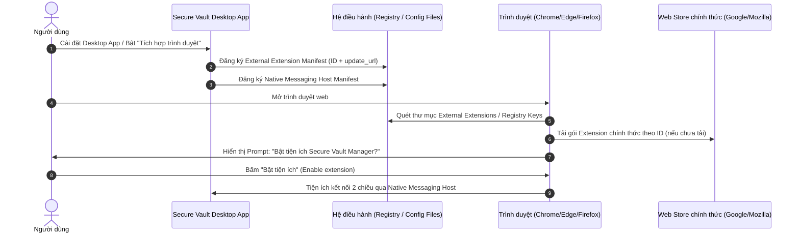

# 11. External Extensions Installation Specification

## Đặc tả Kỹ thuật Triển khai Cơ chế Tự động Kích hoạt Tiện ích Mở rộng (External Extensions)

---

## 1. Tổng quan & Mục tiêu

### 1.1. Bối cảnh

Thông thường, khi người dùng cài đặt ứng dụng Desktop (quản lý mật khẩu, download manager,...), họ phải tự mở trình duyệt, truy cập Chrome Web Store hoặc Firefox Add-ons, tìm kiếm tiện ích mở rộng và bấm cài đặt thủ công. Quy trình này tạo ra rào cản trải nghiệm (friction) và tiềm ẩn nguy cơ người dùng cài nhầm tiện ích giả mạo hoặc bỏ qua bước tích hợp trình duyệt.

Các phần mềm tiêu chuẩn công nghiệp như **Internet Download Manager (IDM)**, **1Password**, **Bitwarden** sử dụng cơ chế **External Extensions (Extension Sideloading/Pre-installation)**:
> Khi ứng dụng Desktop được cài đặt, nó tự động ghi cấu hình chỉ dẫn vào hệ điều hành. Lần khởi động tiếp theo của trình duyệt, trình duyệt sẽ tự động phát hiện, tải tiện ích chính chủ từ Store về và hiển thị hộp thoại xác nhận:
> *"Một chương trình trên máy tính đã thêm tiện ích Secure Vault Manager. Bạn có muốn bật tiện ích này không?"*.

### 1.2. Mục tiêu kỹ thuật

- **Zero-Friction Discovery**: Người dùng không cần tìm kiếm hay copy-paste URL Extension Store.
- **Bảo mật tuyệt đối**: Chỉ kích hoạt Extension chính thức đã được xuất bản và xác thực bởi Google Web Store / Mozilla Add-ons Store.
- **Hỗ trợ đa nền tảng**: Hoạt động đồng nhất trên **Linux**, **Windows**, **macOS**.
- **Đa trình duyệt**: Tương thích Google Chrome, Microsoft Edge, Brave, Chromium và Mozilla Firefox.
- **Dọn dẹp sạch sẽ (Uninstallation)**: Tự động gỡ bỏ các chỉ dẫn cấu hình khi người dùng tắt tích hợp hoặc gỡ ứng dụng Desktop.

---

## 2. Nguyên lý Hoạt động



### 2.1. Phân biệt hai phương thức External Extension

| Đặc tính | Phương thức 1: Qua Store (`update_url`) ⭐ *(Khuyến nghị chuẩn)* | Phương thức 2: File cục bộ (`.crx` / `.xpi`) |
| :--- | :--- | :--- |
| **Cơ chế** | Đăng ký Extension ID kèm URL cập nhật chính thức của Web Store. | Đăng ký đường dẫn file `.crx` hoặc `.xpi` nằm sẵn trên ổ cứng. |
| **Google Chrome / Edge** | ✅ Được hỗ trợ chính thức. Trình duyệt tự tải bản mới nhất từ Store. | ❌ **Bị chặn** trên bản Chrome tiêu chuẩn từ Chrome 33+ (chỉ cho phép trong Enterprise Policy). |
| **Mozilla Firefox** | ✅ Hỗ trợ qua file XPI đã được Mozilla ký điện tử (Signed). | ✅ Hỗ trợ nếu file XPI đã có chữ ký điện tử hợp lệ của AMO. |
| **Cập nhật tự động** | ✅ Tự động cập nhật phiên bản mới khi Store phát hành. | ❌ Desktop App phải tự tải và ghi đè file mới. |
| **Độ tin cậy AV/Chống mã độc** | ✅ Rất cao, không bị Windows Defender hay Antivirus cảnh báo. | ⚠️ Dễ bị nhận diện nhầm là phần mềm cài cắm độc hại (Sideloading malware). |

---

## 3. Đặc tả Cấu hình Chi tiết Theo Từng Nền tảng

### 3.1. Linux

Trên Linux, các trình duyệt họ Chromium quét thư mục `External Extensions` nằm trong thư mục cấu hình của người dùng (`$HOME`) hoặc toàn hệ thống (`/usr/share/` hoặc `/etc/`).

#### 3.1.1. Google Chrome & Chromium

- **Đường dẫn tệp tin:**
  - Chrome (User): `~/.config/google-chrome/External Extensions/<EXTENSION_ID>.json`
  - Chrome (System): `/opt/google/chrome/extensions/<EXTENSION_ID>.json` hoặc `/usr/share/google-chrome/extensions/<EXTENSION_ID>.json`
  - Chromium (User): `~/.config/chromium/External Extensions/<EXTENSION_ID>.json`
- **Nội dung tệp JSON (`<EXTENSION_ID>.json`):**

```json
{
  "external_update_url": "https://clients2.google.com/service/update2/crx"
}
```

#### 3.1.2. Brave Browser

- **Đường dẫn tệp tin:**
  - Brave (User): `~/.config/BraveSoftware/Brave-Browser/External Extensions/<EXTENSION_ID>.json`
- **Nội dung tệp JSON:** Tương tự Chrome, sử dụng Google Web Store update URL hoặc Brave component update URL.

#### 3.1.3. Microsoft Edge (Linux)

- **Đường dẫn tệp tin:**
  - Edge (User): `~/.config/microsoft-edge/External Extensions/<EDGE_EXTENSION_ID>.json`
- **Nội dung tệp JSON (Nếu phát hành trên Microsoft Edge Add-ons):**

```json
{
  "external_update_url": "https://edge.microsoft.com/extensionwebstorebase/v1/crx"
}
```

#### 3.1.4. Mozilla Firefox (Linux)

- Firefox hỗ trợ đặt file tiện ích đã ký (`<EXTENSION_ID>.xpi`) vào thư mục tiện ích hệ thống:
  - User: `~/.mozilla/extensions/{ec8030f7-c20a-464f-9b0e-13a3a9e97384}/<EXTENSION_ID>.xpi`
  - System: `/usr/share/mozilla/extensions/{ec8030f7-c20a-464f-9b0e-13a3a9e97384}/<EXTENSION_ID>.xpi`
  *(Lưu ý: `{ec8030f7-c20a-464f-9b0e-13a3a9e97384}` là Application ID cố định của Firefox trên toàn cầu).*

---

### 3.2. Windows

Trên Windows, cơ chế External Extensions hoạt động thông qua **Windows Registry**.

#### 3.2.1. Google Chrome

- **Vị trí Registry (User Scope - Không yêu cầu quyền Administrator):**
  `HKEY_CURRENT_USER\Software\Google\Chrome\Extensions\<EXTENSION_ID>`
- **Vị trí Registry (Machine Scope - Áp dụng mọi người dùng máy tính):**
  `HKEY_LOCAL_MACHINE\Software\Google\Chrome\Extensions\<EXTENSION_ID>`
  *(Trên Windows 64-bit cho ứng dụng 32-bit: `HKEY_LOCAL_MACHINE\Software\Wow6432Node\Google\Chrome\Extensions\<EXTENSION_ID>`)*
- **Giá trị Registry cần tạo:**

  | Tên Value | Kiểu dữ liệu | Giá trị (Value Data) |
  | :--- | :--- | :--- |
  | `update_url` | `REG_SZ` | `https://clients2.google.com/service/update2/crx` |

#### 3.2.2. Microsoft Edge

- **Vị trí Registry:**
  `HKEY_CURRENT_USER\Software\Microsoft\Edge\Extensions\<EDGE_EXTENSION_ID>`
- **Giá trị Registry cần tạo:**

  | Tên Value | Kiểu dữ liệu | Giá trị (Value Data) |
  | :--- | :--- | :--- |
  | `update_url` | `REG_SZ` | `https://edge.microsoft.com/extensionwebstorebase/v1/crx` |

#### 3.2.3. Brave Browser

- **Vị trí Registry:**
  `HKEY_CURRENT_USER\Software\BraveSoftware\Brave-Browser\Extensions\<EXTENSION_ID>`
- **Giá trị Registry cần tạo:**
  `update_url` = `https://clients2.google.com/service/update2/crx`

#### 3.2.4. Mozilla Firefox

- **Vị trí Registry:**
  `HKEY_CURRENT_USER\Software\Mozilla\Firefox\Extensions`
- **Giá trị Registry cần tạo:**

  | Tên Value (Name) | Kiểu dữ liệu | Giá trị (Value Data) |
  | :--- | :--- | :--- |
  | `<EXTENSION_ID>` (VD: `secure-vault@svm.local`) | `REG_SZ` | `C:\Program Files\Secure Vault Manager\extension\firefox.xpi` |

---

### 3.3. macOS

Trên macOS, các trình duyệt Chromium sử dụng tệp tin danh sách thuộc tính (`.plist`) hoặc thư mục `External Extensions`.

- **Đường dẫn:**
  `~/Library/Application Support/Google/Chrome/External Extensions/<EXTENSION_ID>.json`
- **Nội dung tệp JSON:**

```json
{
  "external_update_url": "https://clients2.google.com/service/update2/crx"
}
```

---

## 4. Bất biến về Extension ID và Public Key (Bảo đảm Tính Nhất quán)

Một sai lầm phổ biến khi triển khai là Extension ID bị thay đổi giữa các lần build hoặc giữa môi trường Dev và Store, dẫn tới việc:

1. Trình duyệt tải Extension mới nhưng Native Host chỉ chấp nhận Extension cũ trong `allowed_origins`.
2. External Extension Manifest chỉ định ID một đằng, nhưng extension tải về lại mang ID khác.

### 4.1. Quy tắc tính toán Extension ID

Trong Chromium:
$$\text{Extension ID} = \text{base32\_hex\_to\_a\_p}(\text{SHA256}(\text{RSA Public Key})[0..16])$$

- Để Extension ID luôn cố định vĩnh viễn (kể cả khi chạy Unpacked hay đóng gói Store), `manifest.json` của Extension **bắt buộc phải chứa trường `"key"` cố định**:

```json
{
  "manifest_version": 3,
  "name": "Secure Vault Manager",
  "version": "1.0.0",
  "key": "MIIBIjANBgkqhkiG9w0BAQEFAAOCAQ8AMIIBCgKCAQEA..."
}
```

### 4.2. Khớp nối 100% với Native Messaging Host

Tệp tin Native Messaging Host Manifest (`com.securevault.manager.json`) trên Desktop phải đồng bộ danh sách `allowed_origins`:

```json
{
  "name": "com.securevault.manager",
  "description": "Secure Vault Manager Native Messaging Host",
  "path": "/usr/bin/svm-native-host",
  "type": "stdio",
  "allowed_origins": [
    "chrome-extension://<CHROME_PERMANENT_EXTENSION_ID>/",
    "chrome-extension://<EDGE_PERMANENT_EXTENSION_ID>/"
  ]
}
```

---

## 5. Thiết kế Kiến trúc Triển khai trong Mã nguồn

Trong hệ thống Secure Vault Manager, logic này được đặt tại crate `svm-bridge` thuộc Core Rust và được điều khiển từ Desktop App UI.

### 5.1. Cấu trúc Module (`core/crates/svm-bridge/src/external_extensions.rs`)

```rust
pub struct ExternalExtensionInstaller;

impl ExternalExtensionInstaller {
    /// Cài đặt cấu hình External Extension cho tất cả trình duyệt được hỗ trợ
    pub fn install_all(chrome_id: &str, edge_id: &str) -> Result<(), BridgeError> {
        #[cfg(target_os = "linux")]
        {
            Self::install_linux_chromium_based("google-chrome", chrome_id)?;
            Self::install_linux_chromium_based("chromium", chrome_id)?;
            Self::install_linux_chromium_based("BraveSoftware/Brave-Browser", chrome_id)?;
            Self::install_linux_edge(edge_id)?;
        }

        #[cfg(target_os = "windows")]
        {
            Self::install_windows_registry_chrome(chrome_id)?;
            Self::install_windows_registry_edge(edge_id)?;
            Self::install_windows_registry_brave(chrome_id)?;
        }

        #[cfg(target_os = "macos")]
        {
            Self::install_macos_chrome(chrome_id)?;
        }

        Ok(())
    }

    /// Gỡ bỏ cấu hình External Extension (khi người dùng tắt tính năng hoặc uninstall)
    pub fn uninstall_all(chrome_id: &str, edge_id: &str) -> Result<(), BridgeError> {
        // Xóa các file .json trong "External Extensions" và xóa các Registry keys
        Ok(())
    }
}
```

### 5.2. Tích hợp FFI vào `svm-core` và UI Desktop

Desktop App cung cấp nút chuyển đổi trong mục **Cài đặt -> Tích hợp Trình duyệt**:

- **Bật "Tự động tích hợp khi mở trình duyệt"**:
  1. Ghi tệp Native Messaging Host manifest.
  2. Ghi tệp External Extension JSON/Registry.
- **Tắt "Tự động tích hợp khi mở trình duyệt"**:
  1. Xóa tệp External Extension JSON/Registry để trình duyệt không kích hoạt prompt nữa.

---

## 6. Kế hoạch Phát hành Thực tế (Rollout Roadmap)

### Giai đoạn 1: Phát triển & Kiểm thử Cục bộ (Hiện tại)

- Extension chạy dưới dạng **Load unpacked** từ thư mục `extension/dist/chrome`.
- Sử dụng Native Messaging Host manifest trỏ đến ID tạo bởi khóa Developer Key cố định.
- Giao diện Cài đặt Desktop cung cấp hướng dẫn rõ ràng kèm liên kết mở nhanh `chrome://extensions`.

### Giai đoạn 2: Xuất bản lên Cửa hàng (Store Publishing)

1. Đăng ký tài khoản Developer trên **Chrome Web Store** và **Microsoft Edge Add-ons**.
2. Upload gói extension và nhận **Extension ID chính thức** do Store cấp phát.
3. Ký số tiện ích Firefox trên **AMO (addons.mozilla.org)** để nhận file `.xpi` đã được chứng thực.

### Giai đoạn 3: Bật tính năng External Extensions

1. Cập nhật `CHROME_PERMANENT_EXTENSION_ID` chính thức vào mã nguồn Rust `svm-bridge`.
2. Đóng gói bộ cài Desktop (Debian `.deb`, Arch PKGBUILD, Windows InnoSetup / MSI, macOS PKG).
3. Trình cài đặt Desktop hoặc ứng dụng khi chạy lần đầu sẽ tự động cấu hình External Extensions.
4. Trải nghiệm người dùng đạt chuẩn hoàn hảo: Cài đặt app Desktop -> Mở Chrome -> Bấm "Bật tiện ích" -> Hoàn tất.

---

## 7. Tài liệu Tham khảo Chính thức

- [Chrome Developers: External Extension Distribution](https://developer.chrome.com/docs/extensions/how-to/distribute/install-alternative-providers)
- [Microsoft Edge Docs: Pre-installation of Edge Extensions](https://learn.microsoft.com/en-us/microsoft-edge/extensions-chromium/developer-guide/alternate-distribution-options)
- [Mozilla Developer Network (MDN): Installing extensions using the Windows Registry / Linux extensions directory](https://extensionworkshop.com/documentation/publish/distribute-for-any-firefox-user/)
