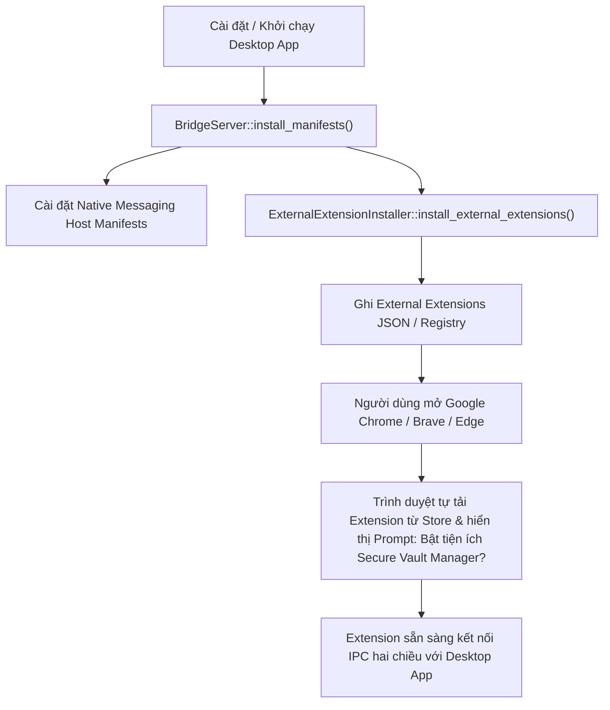

# 11. Extension Bridge & Native Messaging Installation Specification

## Đặc tả Kỹ thuật Cài đặt Native Messaging Host & Cơ Chế External Extensions

---

## 1. Hiện Trạng Triển Khai (Native Messaging Auto-Registration)

Trong mã nguồn hiện tại, việc kết nối trình duyệt với ứng dụng Desktop được tự động cấu hình thông qua **`BridgeServer::install_manifests`** ([`core/crates/svm-bridge/src/server.rs`](../core/crates/svm-bridge/src/server.rs)) khi bật tích hợp trình duyệt (mặc định bật khi khởi động hoặc cấu hình trong *Settings → Browser Integration*).

### 1.1. Tên Host & Extension Identifiers Hoạt Động

- **Native Messaging Host Name chuẩn trong ứng dụng & extension:**
  - `io.hephaestus.secure_vault_manager` (định nghĩa trong [`extension/src/background/native_client.ts`](../extension/src/background/native_client.ts#L8) và [`svm-bridge/src/server.rs`](../core/crates/svm-bridge/src/server.rs)).
- **Firefox Gecko Add-on ID chính thức:**
  - `secure-vault-manager-extension@hephaestus.dev` (`strict_min_version: "140.0"`, khai báo trong [`extension/public/manifest.firefox.json`](../extension/public/manifest.firefox.json)).
  - Manifest host Firefox cấu hình chuẩn: `allowed_extensions: ["secure-vault-manager-extension@hephaestus.dev"]`.
- **Chromium `allowed_origins`:**
  - Origin chính thức: `chrome-extension://jfgmpgpijiloaglplchmjomeboglioec/`.
  - Hỗ trợ cơ chế tự động quét file `Preferences` của Google Chrome (`Default`, `Profile 1`, `Profile 2`), Chromium, Brave, Edge, Flatpak Chrome/Brave và Snap Chromium để nhận diện thêm các Extension ID nhà phát triển nạp cục bộ.

### 1.2. Đường Dẫn Cài Đặt Manifest Tự Động Theo Hệ Điều Hành (`BridgeServer::install_manifests`)

#### Linux & macOS (User Scope)

Hệ thống ghi tệp `io.hephaestus.secure_vault_manager.json` trỏ `"path"` tới binary `svm-native-host` vào các thư mục trình duyệt tồn tại trên máy:

- **Linux:**
  - Chrome: `~/.config/google-chrome/NativeMessagingHosts/`
  - Chromium: `~/.config/chromium/NativeMessagingHosts/`
  - Brave: `~/.config/BraveSoftware/Brave-Browser/NativeMessagingHosts/`
  - Edge: `~/.config/microsoft-edge/NativeMessagingHosts/`
  - Firefox: `~/.mozilla/native-messaging-hosts/`
- **macOS:**
  - Chrome: `~/Library/Application Support/Google/Chrome/NativeMessagingHosts/`
  - Chromium: `~/Library/Application Support/Chromium/NativeMessagingHosts/`
  - Brave: `~/Library/Application Support/BraveSoftware/Brave-Browser/NativeMessagingHosts/`
  - Edge: `~/Library/Application Support/Microsoft Edge/NativeMessagingHosts/`
  - Firefox: `~/Library/Application Support/Mozilla/NativeMessagingHosts/`
- **Fallback copy:** `<DATA_DIR>/native-messaging-hosts/io.hephaestus.secure_vault_manager.json`.

#### Windows (User Scope Registry)

Đăng ký key trỏ tới `<DATA_DIR>\native-messaging-hosts\io.hephaestus.secure_vault_manager.json`:

- `HKEY_CURRENT_USER\Software\Google\Chrome\NativeMessagingHosts\io.hephaestus.secure_vault_manager`
- `HKEY_CURRENT_USER\Software\Chromium\NativeMessagingHosts\io.hephaestus.secure_vault_manager`
- `HKEY_CURRENT_USER\Software\BraveSoftware\Brave-Browser\NativeMessagingHosts\io.hephaestus.secure_vault_manager`
- `HKEY_CURRENT_USER\Software\Microsoft\Edge\NativeMessagingHosts\io.hephaestus.secure_vault_manager`
- `HKEY_CURRENT_USER\Software\Mozilla\NativeMessagingHosts\io.hephaestus.secure_vault_manager`

---

## 2. Phân Phối Không Chạm: Cơ Chế External Extensions (Đã Triển Khai)

Cơ chế **External Extensions** (theo chuẩn Chromium Alternative Distribution) cho phép Desktop App tự động đề xuất cài đặt extension chính thức từ Chrome Web Store ngay khi người dùng cài ứng dụng Desktop, người dùng không cần thao tác nạp unpacked thủ công.

### 2.1. Cấu Trúc Module `ExternalExtensionInstaller`

Module `ExternalExtensionInstaller` được hiện thực tại [`core/crates/svm-bridge/src/external_installer.rs`](../core/crates/svm-bridge/src/external_installer.rs) và được tích hợp trực tiếp vào luồng khởi chạy của `BridgeServer::install_manifests`:

- **Store Extension ID:** `jfgmpgpijiloaglplchmjomeboglioec`
- **External Update URL:** `https://clients2.google.com/service/update2/crx`

### 2.2. Vị Trí Ghi Nhận Tự Động

#### Linux & macOS (External Extensions JSON)

Hệ thống tự động ghi tệp `jfgmpgpijiloaglplchmjomeboglioec.json` chứa nội dung:

```json
{
  "external_update_url": "https://clients2.google.com/service/update2/crx"
}
```

Vào các thư mục phát hiện trên hệ thống:

- **Google Chrome:** `~/.config/google-chrome/External Extensions/`
- **Chromium:** `~/.config/chromium/External Extensions/`
- **Brave Browser:** `~/.config/BraveSoftware/Brave-Browser/External Extensions/`
- **Microsoft Edge:** `~/.config/microsoft-edge/External Extensions/`
- **Flatpak & Snap:**
  - `~/.var/app/com.google.Chrome/config/google-chrome/External Extensions/`
  - `~/.var/app/com.brave.Browser/config/BraveSoftware/Brave-Browser/External Extensions/`
  - `~/snap/chromium/current/.config/chromium/External Extensions/`
- **macOS:** `~/Library/Application Support/<Browser>/External Extensions/`

#### Windows (Registry Keys)

Trên hệ điều hành Windows, hệ thống tự động ghi các khóa chuỗi vào `HKEY_CURRENT_USER`:

- `HKCU\Software\Google\Chrome\Extensions\jfgmpgpijiloaglplchmjomeboglioec`
  - `update_url` = `"https://clients2.google.com/service/update2/crx"`
- `HKCU\Software\Microsoft\Edge\Extensions\jfgmpgpijiloaglplchmjomeboglioec`
  - `update_url` = `"https://clients2.google.com/service/update2/crx"`
- `HKCU\Software\BraveSoftware\Brave-Browser\Extensions\jfgmpgpijiloaglplchmjomeboglioec`
  - `update_url` = `"https://clients2.google.com/service/update2/crx"`
- `HKCU\Software\Chromium\Extensions\jfgmpgpijiloaglplchmjomeboglioec`
  - `update_url` = `"https://clients2.google.com/service/update2/crx"`

---

## 3. Quy Trình Trải Nghiệm Người Dùng (User Flow)



---

## 4. Tài Liệu Tham Khảo Chính Thức

- [Chrome Developers: Native Messaging](https://developer.chrome.com/docs/extensions/develop/concepts/native-messaging)
- [Chrome Developers: Alternative Extension Distribution Options](https://developer.chrome.com/docs/extensions/how-to/distribute/install-alternative-providers)
- [Microsoft Edge Docs: Pre-installation of Edge Extensions](https://learn.microsoft.com/en-us/microsoft-edge/extensions-chromium/developer-guide/alternate-distribution-options)
- [Mozilla Extension Workshop: Native Messaging & Distribution](https://extensionworkshop.com/documentation/publish/distribute-for-any-firefox-user/)
