# 12. Hướng Dẫn Thiết Lập & Kiểm Thử Browser Extension (Setup & Testing Guide)

Tài liệu này hướng dẫn chi tiết từng bước quy trình thiết lập môi trường, biên dịch, nạp extension và kiểm thử toàn diện tính năng của Secure Vault Manager trên các trình duyệt: **Google Chrome**, **Mozilla Firefox**, **Brave Browser**, **Microsoft Edge** và các trình duyệt Chromium khác.

---

## Mục Lục

1. [Kiến Trúc Tích Hợp & Luồng Dữ Liệu](#1-kiến-trúc-tích-hợp--luồng-dữ-liệu)
2. [Bước 1: Biên Dịch Các Thành Phần Dự Án](#bước-1-biên-dịch-các-thành-phần-dự-án)
3. [Bước 2: Cài Đặt & Đăng Ký Native Messaging Host](#bước-2-cài-đặt--đăng-ký-native-messaging-host)
4. [Bước 3: Nạp & Thiết Lập Trên Google Chrome & Chromium](#bước-3-nạp--thiết-lập-trên-google-chrome--chromium)
5. [Bước 4: Nạp & Thiết Lập Trên Mozilla Firefox](#bước-4-nạp--thiết-lập-trên-mozilla-firefox)
6. [Bước 5: Nạp & Thiết Lập Trên Brave Browser & Microsoft Edge](#bước-5-nạp--thiết-lập-trên-brave-browser--microsoft-edge)
7. [Bước 6: Các Kịch Bản Kiểm Thử Tính Năng Thực Tế (Test Scenarios)](#bước-6-các-kịch-bản-kiểm-thử-tính-năng-thực-tế-test-scenarios)
8. [Bước 7: Chu Trình Lập Trình & Hot-Reload Extension](#bước-7-chu-trình-lập-trình--hot-reload-extension)
9. [Bước 8: Khắc Phục Sự Cố Thường Gặp (Troubleshooting)](#bước-8-khắc-phục-sự-cố-thường-gặp-troubleshooting)
10. [Bảng Tra Cứu Nhanh Đường Dẫn & Lệnh Hữu Ích](#bảng-tra-cứu-nhanh-đường-dẫn--lệnh-hữu-ích)

---

## 1. Kiến Trúc Tích Hợp & Luồng Dữ Liệu

Extension kết nối với ứng dụng Desktop Secure Vault Manager thông qua giao thức **Native Messaging** tiêu chuẩn của trình duyệt kết hợp với Unix Domain Socket / Named Pipe nội bộ:

```mermaid
flowchart LR
    subgraph Browser ["Web Browser (Chrome / Firefox / Brave / Edge)"]
        Page["Web Page Context<br/>(DOM, Forms, Passkeys)"]
        CS["Content Script & Injected Script<br/>(Autofill Badge, Overlay, WebAuthn Hook)"]
        SW["Background Service Worker<br/>(Native Client, TOTP, Crypto Cache)"]
    end

    subgraph NativeBridge ["Native Messaging Boundary"]
        Host["svm-native-host<br/>(STDIO 4B LE Framing + JSON)"]
    end

    subgraph DesktopApp ["Secure Vault Manager Desktop (Rust Core & Qt6 UI)"]
        IPC["BridgeServer Unix Socket<br/>$XDG_RUNTIME_DIR/svm/bridge.sock"]
        Core["Vault Engine<br/>(Argon2id, XChaCha20, Passkey ES256)"]
    end

    Page <-->|window.postMessage| CS
    CS <-->|chrome.runtime.sendMessage| SW
    SW <-->|connectNative: stdio| Host
    Host <-->|Unix Domain Socket| IPC
    IPC <--> Core
```



- **Host Name chuẩn:** `io.hephaestus.secure_vault_manager`
- **Firefox Gecko Extension ID:** `extension@secure-vault.hephaestus.io`
- **Cơ chế xác thực IPC:** Socket nội bộ chỉ chấp nhận kết nối từ cùng user UID (`0o600`), tự động ghép nối (handshake pairing) và kiểm tra nguồn gốc URL trước khi cấp thông tin đăng nhập.

---

## Bước 1: Biên Dịch Các Thành Phần Dự Án

Trước khi nạp extension, bạn cần biên dịch cả ứng dụng Desktop, binary `svm-native-host`, và gói extension.

### 1.1. Biên dịch Desktop App & Core Native Host

Từ thư mục gốc dự án:

```bash
# Biên dịch toàn bộ dự án (C++ Qt6 UI + Rust Core + svm-native-host)
./scripts/build.sh
```

Kết quả biên dịch sẽ sinh ra:

- **Ứng dụng Desktop:** `build/debug/ui/svm`
- **Native Messaging Host binary:** `build/debug/core/svm-native-host` (hoặc `core/target/debug/svm-native-host`)

### 1.2. Biên dịch Browser Extension (MV3)

Chạy script đóng gói extension:

```bash
./scripts/build-extension.sh
```

> [!TIP]
> Bạn cũng có thể vào thư mục `extension/` và chạy trực tiếp bằng công cụ Node.js:
>
> ```bash
> cd extension
> node --no-warnings scripts/build.mjs
> node --no-warnings scripts/post-build.js
> ```

Thư mục xuất bản sau khi biên dịch:

- **`extension/dist/chrome/`**: Gói Manifest V3 dành cho Google Chrome, Brave, Microsoft Edge, Chromium.
- **`extension/dist/firefox/`**: Gói Manifest V3 kèm định danh Gecko ID (`extension@secure-vault.hephaestus.io`) dành cho Mozilla Firefox.

---

## Bước 2: Cài Đặt & Đăng Ký Native Messaging Host

Để trình duyệt có thể khởi chạy và giao tiếp với binary `svm-native-host`, tệp cấu hình JSON manifest (`io.hephaestus.secure_vault_manager.json`) phải được đăng ký vào thư mục hệ thống của trình duyệt tương ứng.

Dự án cung cấp 2 phương thức:

### Cách A: Tự Động Qua Desktop App (Khuyên Dùng)

Khi bạn khởi động ứng dụng Desktop Secure Vault Manager:

```bash
./scripts/run.sh --app
# hoặc:
./build/debug/ui/svm
```

Hệ thống sẽ tự động gọi hàm `BridgeServer::install_manifests` ([`core/crates/svm-bridge/src/server.rs`](../core/crates/svm-bridge/src/server.rs#L515-L629)):

1. Tự dò tìm đường dẫn tuyệt đối của binary `svm-native-host`.
2. Tự kiểm tra các trình duyệt có sẵn trên máy (Chrome, Chromium, Brave, Edge, Firefox).
3. Đọc tệp cấu hình `Preferences` của trình duyệt để phát hiện ID extension đã được nạp và điền vào mảng `allowed_origins`.
4. Ghi tệp manifest JSON vào các thư mục cấu hình chuẩn.

> [!IMPORTANT]
> **Quy tắc vàng khi test Chrome/Brave/Edge:**  
> Sau khi bạn nạp unpacked extension vào trình duyệt lần đầu tiên (hoặc khi Extension ID bị thay đổi), hãy **khởi động lại ứng dụng Desktop** (hoặc vào menu *Settings → Browser Integration* bật/tắt lại). Ứng dụng Desktop sẽ tự động quét ID mới và cập nhật ngay vào `allowed_origins` trong file manifest!

### Cách B: Cài Đặt Thủ Công Bằng Script

Nếu bạn muốn cấu hình trước khi khởi chạy ứng dụng hoặc gán trực tiếp Extension ID:

```bash
# Cú pháp: ./scripts/install-native-host.sh [CHROME_EXTENSION_ID]
./scripts/install-native-host.sh
```

Nếu bạn đã biết Extension ID trên Chrome (ví dụ `cblgnkccngfnmepkgkgljklmjgfkcfhd`):

```bash
./scripts/install-native-host.sh cblgnkccngfnmepkgkgljklmjgfkcfhd
```

---

## Bước 3: Nạp & Thiết Lập Trên Google Chrome & Chromium

### Các bước thực hiện

1. **Mở trang quản lý Extensions:**
   - Trên thanh địa chỉ Chrome, nhập: `chrome://extensions/` và nhấn `Enter`.
   - (Hoặc nhấp vào menu 3 chấm góc phải trên → **Extensions** (Tiện ích mở rộng) → **Manage Extensions**).

2. **Kích hoạt Chế độ Nhà phát triển (Developer mode):**
   - Bật công tắc gạt **Developer mode** ở góc trên cùng bên phải màn hình.

3. **Nạp Extension đã giải nén (Load unpacked):**
   - Nhấp vào nút **Load unpacked** (Tải tiện ích đã giải nén) ở góc trên bên trái.
   - Hộp thoại chọn thư mục mở ra: Duyệt đến thư mục dự án và chọn:  
     `.../secure-vault-manager/extension/dist/chrome`
   - Bấm **Select Folder** (hoặc Open).

4. **Xác nhận Extension đã được nạp:**
   - Thẻ tiện ích **Secure Vault Manager** xuất hiện trên trang với logo biểu tượng.
   - Ghi lại chuỗi **ID** gồm 32 ký tự hiển thị trên thẻ (ví dụ: `abcdefghijklmnop...`).

5. **Đồng bộ quyền kết nối với Desktop App:**
   - Đảm bảo ứng dụng Desktop `svm` đang chạy. Nếu đã chạy trước khi nạp extension, hãy **tắt đi và chạy lại** một lần:

     ```bash
     ./scripts/run.sh --app
     ```

   - Ứng dụng sẽ tự động đọc `Preferences` của Chrome, nhận diện ID trên và bổ sung vào `~/.config/google-chrome/NativeMessagingHosts/io.hephaestus.secure_vault_manager.json`.

6. **Ghim Extension lên thanh công cụ:**
   - Nhấp vào biểu tượng mảnh ghép (Extensions) trên thanh công cụ Chrome.
   - Tìm **Secure Vault Manager** và nhấp vào biểu tượng cây ghim (Pin) để luôn nhìn thấy icon.

---

## Bước 4: Nạp & Thiết Lập Trên Mozilla Firefox

Firefox sử dụng cơ chế bảo mật nghiêm ngặt hơn và yêu cầu tệp manifest có khai báo trường `browser_specific_settings.gecko.id`. Gói `extension/dist/firefox` đã được cấu hình sẵn định danh cố định: **`extension@secure-vault.hephaestus.io`**.

### Các bước thực hiện

1. **Mở trang Debugging của Firefox:**
   - Trên thanh địa chỉ Firefox, nhập: `about:debugging#/runtime/this-firefox` và nhấn `Enter`.

2. **Nạp Tiện ích Tạm thời (Load Temporary Add-on):**
   - Cuộn tới mục **Temporary Extensions** (Tiện ích bổ sung tạm thời).
   - Nhấp vào nút **Load Temporary Add-on...** (Tải tiện ích bổ sung tạm thời...).

3. **Chọn tệp Manifest:**
   - Trong cửa sổ duyệt tệp, tìm đến thư mục dự án và chọn chính xác tệp:  
     `.../secure-vault-manager/extension/dist/firefox/manifest.json`
   - Bấm **Open**.

4. **Xác nhận trạng thái:**
   - Tiện ích **Secure Vault Manager** sẽ xuất hiện trong danh sách Temporary Extensions.
   - Extension ID hiển thị: `extension@secure-vault.hephaestus.io`.
   - Manifest host của Firefox (`~/.mozilla/native-messaging-hosts/io.hephaestus.secure_vault_manager.json`) đã cho phép ID này sẵn nên kết nối sẽ hoạt động ngay mà không cần cấu hình thêm.

> [!NOTE]
> **Đặc điểm của Temporary Add-on trên Firefox:**  
> Extension được nạp theo cách này sẽ tự động hủy khi bạn tắt hoàn toàn trình duyệt Firefox. Khi mở lại Firefox để tiếp tục kiểm thử, bạn chỉ cần vào lại `about:debugging#/runtime/this-firefox` và bấm chọn lại tệp `manifest.json`.

---

## Bước 5: Nạp & Thiết Lập Trên Brave Browser & Microsoft Edge

### 5.1. Brave Browser

1. Mở Brave, truy cập: `brave://extensions/`.
2. Bật công tắc **Developer mode** ở góc phải trên.
3. Nhấp **Load unpacked**, chọn thư mục `extension/dist/chrome`.
4. Khởi động lại ứng dụng Desktop `svm` để tự động ghi nhận Extension ID vào `~/.config/BraveSoftware/Brave-Browser/NativeMessagingHosts/io.hephaestus.secure_vault_manager.json`.

### 5.2. Microsoft Edge

1. Mở Microsoft Edge, truy cập: `edge://extensions/`.
2. Bật công tắc **Developer mode** ở menu cột bên trái.
3. Nhấp nút **Load unpacked** ở thanh trên cùng, chọn thư mục `extension/dist/chrome`.
4. Khởi động lại ứng dụng Desktop `svm` để cập nhật `allowed_origins` cho Edge.

---

## Bước 6: Các Kịch Bản Kiểm Thử Tính Năng Thực Tế (Test Scenarios)

Sau khi hoàn tất cài đặt, hãy thực hiện lần lượt 5 kịch bản kiểm thử sau để kiểm tra toàn bộ luồng hoạt động:

### Kịch Bản 1: Kiểm Tra Trạng Thái Kết Nối & Ghép Nối (Pairing)

1. **Chuẩn bị:** Khởi chạy Desktop App `build/debug/ui/svm`. Mở khóa Vault bằng Master Password.
2. **Thao tác:** Trên trình duyệt, nhấp vào icon Secure Vault Manager trên thanh công cụ:
   - **Kỳ vọng:**
     - Cửa sổ Popup mở ra, hiển thị trạng thái **Connected** (màu xanh lá/accent).
     - Hiển thị thông tin tên kho hoặc số lượng mục lưu trữ.
     - Biểu tượng badge không báo lỗi chấm đỏ.
3. **Thử nghiệm khóa kho:** Trên Desktop App, bấm nút **Lock Vault** (`Ctrl+L`):
   - Mở lại Popup extension: Popup hiển thị thông báo kho đang bị khóa ("Vault is locked") và nút hướng dẫn mở khóa từ Desktop.

---

### Kịch Bản 2: Tự Động Điền Thông Tin Đăng Nhập (Autofill)

1. **Chuẩn bị:** Trong Desktop App, tạo một mục đăng nhập (Login item) có:
   - **Title:** `GitHub Test`
   - **Website / URL:** `https://github.com`
   - **Username:** `developer@example.com`
   - **Password:** `P@ssw0rdSecure2026!`
2. **Thao tác:**
   - Mở tab mới trên trình duyệt và truy cập trang đăng nhập: `https://github.com/login`.
   - Quan sát ô nhập **Username or email address**:
     - Biểu tượng icon SVM xuất hiện bên phải bên trong ô input.
   - Nhấp chuột vào biểu tượng SVM hoặc nhấn phím khi focus vào ô:
     - Menu dropdown gợi ý tài khoản hiển thị mục `developer@example.com (GitHub Test)`.
   - Nhấp chọn tài khoản:
     - Trường username được điền `developer@example.com`.
     - Trường password được tự động điền `P@ssw0rdSecure2026!`.
     - Badge trên icon extension hiển thị số `1` (biểu thị có 1 tài khoản khớp với trang web hiện tại).

---

### Kịch Bản 3: Tự Động Lưu Mật Khẩu Khi Đăng Ký / Đăng Nhập Mới (Save Credential Prompt)

1. **Thao tác:**
   - Truy cập một trang web có form đăng nhập hoặc đăng ký bất kỳ (ví dụ: `https://httpbin.org/forms/post` hoặc một trang thử nghiệm cục bộ).
   - Nhập thông tin tài khoản mới chưa có trong kho:
     - Username: `newuser_2026@test.com`
     - Password: `RandomGeneratedStrongPassword#99`
   - Nhấp nút nộp form (**Sign In** / **Submit**).
2. **Kỳ vọng:**
   - Extension bắt sự kiện form submission và hiển thị banner / pop-up trượt xuống ở góc phải trên:
     - *"Save password to Secure Vault Manager?"*
   - Nhấp vào nút **Save**:
     - Mở ứng dụng Desktop: Một item mới với thông tin vừa nhập đã được tự động thêm vào danh sách và đồng bộ vào kho mã hóa.

---

### Kịch Bản 4: Quét Mã QR Thiết Lập 2FA (Screen-Crop TOTP)

1. **Chuẩn bị:** Mở một trang hiển thị mã QR 2FA (ví dụ trang cấu hình 2FA của tài khoản Google, GitHub hoặc một hình ảnh mã QR mẫu dạng `otpauth://totp/Example:alice?secret=JBSWY3DPEHPK3PXP&issuer=Example`).
2. **Thao tác:**
   - Nhấp vào icon Extension trên thanh công cụ → Chọn mục cần thêm mã 2FA.
   - Nhấp nút **Scan QR Code / Crop Screen**.
   - Màn hình trình duyệt chuyển sang chế độ lớp phủ làm mờ (Selection Overlay) với con trỏ hình dấu thập chữ nhật.
   - Kéo chuột quét một vùng bao quanh mã QR trên màn hình rồi thả chuột.
3. **Kỳ vọng:**
   - Extension tự động chụp vùng canvas, giải mã barcode và trích xuất chuỗi bí mật TOTP.
   - Popup hiển thị mã xác thực 6 chữ số kèm vòng tròn đếm ngược chu kỳ 30 giây.
   - Mã 6 chữ số này khớp với mã sinh ra trên ứng dụng Desktop.

---

### Kịch Bản 5: Xác Thực Không Mật Khẩu Passkey / WebAuthn

Kiểm thử tính năng can thiệp WebAuthn của Extension trên trang chuẩn quốc tế:

1. **Kiểm thử Đăng ký Passkey (`passkey_create`):**
   - Truy cập: `https://webauthn.io` hoặc `https://passkeys.io`.
   - Nhập Username: `passkey_user_test`.
   - Nhấp **Register** (hoặc Create a passkey):
     - Extension can thiệp vào cuộc gọi `navigator.credentials.create()`.
     - Hộp thoại Shadow DOM của Secure Vault Manager hiển thị ngay trong trang web hỏi người dùng xác nhận tạo Passkey:
       - *"Tạo Passkey cho passkey_user_test trên webauthn.io?"*
     - Nhấp **Xác nhận / Approve**:
       - Rust Core sinh cặp khóa `ES256` (P-256), lưu public key credential vào kho và ký attest.
       - Trang web hiển thị thông báo đăng ký Passkey thành công!

2. **Kiểm thử Đăng nhập bằng Passkey (`passkey_get`):**
   - Trên cùng trang web, nhấp **Authenticate** (hoặc Sign in with Passkey):
     - Extension can thiệp vào `navigator.credentials.get()`.
     - Hộp thoại hỏi sự đồng ý hiển thị Passkey vừa tạo.
     - Nhấp **Xác nhận Đăng nhập**:
       - Rust Core ký xác thực assertion bằng private key được bảo vệ.
       - Trang web xác nhận danh tính thành công mà không cần nhập bất kỳ mật khẩu nào.

---

## Bước 7: Chu Trình Lập Trình & Hot-Reload Extension

Khi bạn chỉnh sửa mã nguồn trong thư mục `extension/src/`:

1. **Build lại Extension:**

   ```bash
   ./scripts/build-extension.sh
   ```

2. **Reload trên Google Chrome / Brave / Edge:**
   - Quay lại trang `chrome://extensions/`.
   - Tìm thẻ **Secure Vault Manager**.
   - Nhấp vào biểu tượng mũi tên xoay tròn (**Reload** / Tải lại) ở góc dưới của thẻ.
   - Tải lại trang web đang test (`F5` hoặc `Ctrl+R`) để nạp content script mới.

3. **Reload trên Mozilla Firefox:**
   - Vào `about:debugging#/runtime/this-firefox`.
   - Tìm **Secure Vault Manager** trong mục *Temporary Extensions*.
   - Nhấp vào nút **Reload** bên cạnh tiện ích.

4. **Xem Log & Debug:**
   - **Background Service Worker Console:** Trên trang `chrome://extensions/`, nhấp vào đường link `"service worker"` (hoặc `"Inspect views: background page"`) để mở DevTools riêng của background script.
   - **In-Page / Content Script Console:** Nhấn `F12` trên bất kỳ tab trang web nào đang mở để xem log của `content.js` và `injected.js`.

---

## Bước 8: Khắc Phục Sự Cố Thường Gặp (Troubleshooting)

### Vấn Đề 1: Lỗi `"Specified native messaging host not found"`

- **Nguyên nhân:** Trình duyệt không tìm thấy tệp manifest `io.hephaestus.secure_vault_manager.json` tại thư mục quy định, hoặc trường `"path"` bên trong trỏ tới tệp binary không tồn tại.
- **Cách khắc phục:**
  1. Kiểm tra sự tồn tại của tệp manifest:

     ```bash
     # Chrome
     cat ~/.config/google-chrome/NativeMessagingHosts/io.hephaestus.secure_vault_manager.json
     # Firefox
     cat ~/.mozilla/native-messaging-hosts/io.hephaestus.secure_vault_manager.json
     ```

  2. Kiểm tra đường dẫn `"path"` trong tệp JSON: Đảm bảo trỏ tới đúng `build/debug/core/svm-native-host` (hoặc bản release) và tệp có quyền thực thi (`chmod +x`).
  3. Khởi động lại Desktop App để cập nhật lại tệp manifest.

---

### Vấn Đề 2: Lỗi `"Access to the specified native messaging host is forbidden"`

- **Nguyên nhân:** Extension ID hiện tại chưa được cấp quyền trong mảng `"allowed_origins"` của manifest Chrome/Brave/Edge.
- **Cách khắc phục:**
  1. Mở `chrome://extensions/` xem Extension ID (32 ký tự).
  2. Khởi động lại ứng dụng Desktop `svm` để bộ quét tự động bổ sung ID này.
  3. Hoặc chạy lệnh cài đặt thủ công:

     ```bash
     ./scripts/install-native-host.sh <EXTENSION_ID>
     ```

---

### Vấn Đề 3: Lỗi `"Native messaging host disconnected"` / Không kết nối được

- **Nguyên nhân:** Binary `svm-native-host` đã chạy nhưng không thể kết nối tới Unix Domain Socket của ứng dụng Desktop (do ứng dụng Desktop chưa chạy, hoặc socket bị giới hạn quyền).
- **Cách khắc phục:**
  1. Kiểm tra Desktop App đã mở và đang chạy:

     ```bash
     ps aux | grep svm
     ```

  2. Kiểm tra tệp socket đang tồn tại:

     ```bash
     ls -la ${XDG_RUNTIME_DIR:-/tmp}/svm/bridge.sock
     ```

  3. Đảm bảo quyền của socket là `0600` thuộc cùng người dùng hiện tại.
  4. Mở khóa Vault trên Desktop App: Một số tính năng bảo mật sẽ từ chối trả lời nếu kho mật khẩu chưa được giải mã.

---

## Bảng Tra Cứu Nhanh Đường Dẫn & Lệnh Hữu Ích

| Thao Tác | Lệnh / Đường Dẫn |
| :--- | :--- |
| **Biên dịch toàn bộ** | `./scripts/build.sh` |
| **Biên dịch Extension** | `./scripts/build-extension.sh` |
| **Khởi chạy Desktop App** | `./scripts/run.sh --app` hoặc `build/debug/ui/svm` |
| **Cài đặt Native Manifest** | `./scripts/install-native-host.sh [EXTENSION_ID]` |
| **Trang Extensions (Chrome)** | `chrome://extensions/` |
| **Trang Extensions (Firefox)** | `about:debugging#/runtime/this-firefox` |
| **Trang Extensions (Brave)** | `brave://extensions/` |
| **Trang Extensions (Edge)** | `edge://extensions/` |
| **Manifest Chrome (Linux)** | `~/.config/google-chrome/NativeMessagingHosts/io.hephaestus.secure_vault_manager.json` |
| **Manifest Firefox (Linux)** | `~/.mozilla/native-messaging-hosts/io.hephaestus.secure_vault_manager.json` |
| **Unix Domain Socket IPC** | `${XDG_RUNTIME_DIR:-/tmp}/svm/bridge.sock` |
| **Trang Test Passkey Quốc Tế** | `https://passkeys.io` hoặc `https://webauthn.io` |

---

## Tài Liệu Tham Khảo Liên Quan

- [`docs/06. Extension Bridge Protocol.md`](./06.%20Extension%20Bridge%20Protocol.md): Chi tiết giao thức framing 4B LE và 15+ action message.
- [`docs/07. Passkey Implementation.md`](./07.%20Passkey%20Implementation.md): Đặc tả kiến trúc can thiệp WebAuthn và Shadow DOM modal.
- [`docs/11. External Extensions Installation Specification.md`](./11.%20External%20Extensions%20Installation%20Specification.md): Đặc tả kiến trúc Native Messaging Host & lộ trình phân phối Store.
